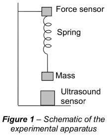

**Simple harmonic motion** is important in many engineering disciplines. Most often, it appears as the oscillatory motion of a *mass on a spring* (which is useful for approximating vibration modes in building structures, airframes or vehicle suspensions), but the same equations also describe current and voltage oscillations in electrical circuits containing capacitor/inductor combinations.

You will analyse experimental data from student measurements of $1$ kg masses on springs, predict what the underlying engineering physics says about the motion, and then work out how well theory fits experiment. You will plot the results to make the fitting clear, and calculate a measure of the quality of the fit.

To prepare you for the main analysis, we first give some preparatory material on fitting arbitrary functions to data (Part 1). The main assignment follows in Part 2.

# Part 1: Curve fitting with SciPy

In Python, it is standard practice to import the modules we need at the very top of our scripts.

```{python}
# In Python it is standard practice to import the modules we need at the very top of our scripts
import numpy as np
import matplotlib.pyplot as plt
```

**SciPy**, like **NumPy**, is one of many libraries that can be used to extend Python's functionality. SciPy includes functions for integration, interpolation, signal processing, linear algebra and more. Between NumPy, SciPy and Matplotlib, you should be able to accomplish many data analysis tasks. The SciPy documentation has the same style as the NumPy documentation, so you should already feel comfortable finding your way around and reading the documentation for functions.

## Importing SciPy submodules

You have probably noticed that to call a function from, for example, the NumPy module, we use the dot operator, e.g. `np.zeros()`, and sometimes we call a function from a submodule, e.g. `np.random.randint()`. However, a small quirk of SciPy, due to its size, is that each SciPy submodule has to be imported separately.

As such, it is unlikely that you will ever just write

```python
import scipy as sp
```

but you will more likely import specific submodules, such as in the cell below, where we import the `stats` and `optimize` submodules. We can then, for example, access the function `sem` by writing `stats.sem()`, which calculates the standard error of the mean.

If SciPy has not been installed on your computer, you might need to install it by running the following statement in a code cell of your notebook (note that the exclamation mark "!" is needed)

```python
!pip install scipy
```

```{python}
from scipy import stats
from scipy import optimize
```

It is worth having a look at the documentation of `stats.sem()` (see [scipy.stats.sem](https://docs.scipy.org/doc/scipy/reference/generated/scipy.stats.sem.html)). In a Jupyter notebook, you can also display the documentation by running `stats.sem?` in a code cell. For example, the standard error of the mean of $100$ equally spaced numbers between $0$ and $1$ is

```{python}
a = np.linspace(0, 1, 100)
stats.sem(a)
```

## Least-squares fitting of a function to data

An important tool in data analysis is the ability to fit a function to raw data in order to extract the parameters of a model; likewise, measuring the "goodness of fit" of a function can be used to test an underlying hypothesis.

There are many alternative ways to do fitting in Python. The SciPy function `optimize.curve_fit()` will fit a mathematical function to data. Although simpler methods exist for a basic linear fit, as soon as we want to fit a more complex function, we usually use `optimize.curve_fit()`. Therefore, we may as well learn about this method from the start!

For the purposes of this exercise, we will generate some simple data that we can be fairly sure should fit a linear function

$$
f(x) = m x + c.
$$

```{python}
# Example Data
x = np.arange(10)
m = 5
c = 10
# Generate some data, with random 'jitter' for realism
# Note that we use randn to generate our randomness. 
# The number 10 tells it to generate ten numbers (from a normal distribution),
# one number for each of the ten x coordinates we are generating data for.
np.random.seed(42)           # Freeze the randomness, so that everybody gets the same data
y_jittered = m*x + c + 2*np.random.randn(10)  

plt.figure(figsize=(5, 3))
plt.scatter(x, y_jittered)
plt.xlabel('Independent Variable')
plt.ylabel('Dependent Variable')
plt.title('My Example Data')
plt.grid(True)
plt.show()
```

First, we define a Python function for the mathematical function that we want to fit to our data.

```{python}
def linear_function(x, m, c):   
    # function of a straight line y = mx + c
    return m*x + c

# Note that we can call the new function we have defined, just like we call np.sin(x),
# by passing it the parameters (three in this case) that it expects
gradient = 2
intercept = 1
value = 4.2
func_result = linear_function(value, gradient, intercept)
print(f"Calling our function: when x = {value}")
print(f"y = f({value}) = {gradient} * {value} + {intercept} = {func_result}")
```

Now we tell `optimize.curve_fit()` to find the best fit to our data using our new function `linear_function()`. In other words, `optimize.curve_fit()` will tell us the values of $m$ and $c$ that provide the best fit to our data. The initial values of the parameters to be found are passed to `optimize.curve_fit()` via the keyword argument `p0`. In the following example, we use the vector $\mathbf{p}_0 = (1, 0)$, which represents a "plausible" initial guess for $m$ and $c$.

Then, `optimize.curve_fit()` returns several pieces of information. The first two are

* the best-fit values of the parameters, as a list (here, the two parameters $m$ and $c$), which we call `params` in the code below (`popt` in the documentation); and
* the estimated covariance matrix of these parameters, which we call `params_covariance` (`pcov` in the documentation). The square roots of its diagonal elements are the uncertainties (one standard deviation) of the fitted parameters.

For further explanation, please refer to the [documentation of this function](https://docs.scipy.org/doc/scipy/reference/generated/scipy.optimize.curve_fit.html). **Recommendation**: Spend time reading this documentation and the examples therein. In a Jupyter notebook, you can also display it by running `optimize.curve_fit?` in a code cell.

```{python}
params, params_covariance = optimize.curve_fit(linear_function, x, y_jittered, p0=[1, 0])   # Try to change the initial guesses for p0 and see what happens.
m_fitted = params[0]         # Make sure we don't use 'm' and 'c' as variables here, because we already
c_fitted = params[1]         # used them earlier to define the ideal expected values of m and c.

print(f"Best fit has equation:\ny = {m_fitted:.4f}x + {c_fitted:.4f}")
print(f"params = {params}")
```

So `optimize.curve_fit()` got pretty close to the values we set up. But how close? Often, the goodness of fit is measured using the $\chi^2$ statistic, which looks at how far each measured point is from the modelled point

$$
\chi^2 = \sum\limits_{i} \left( \frac{y_i - y_\mathrm{th}(x_i)}{\sigma_{m,i}} \right)^2,
$$

where $y_i$ are the experimental measurements, $y_\mathrm{th}(x_i)$ are the theoretically predicted values, and $\sigma_{m,i}$ are the measurement errors on each measurement $i$. We will assume a measurement error of $3.0$ on each data point below.

```{python}
y_fitted = m_fitted*x + c_fitted

sigma = 3
chi_squared = np.sum((y_jittered - y_fitted)**2 / sigma**2)

plt.figure(figsize=(5, 3))
plt.scatter(x, y_jittered, label='Raw Data')
plt.plot(x, y_fitted, 'r-', label= f"$y={m_fitted:.2f} x+{c_fitted:.2f}$")
plt.plot(x, m*x+c, 'k--', label= f"$y = {m}x + {c}$")
plt.text(6, 20, f"$\\chi^2 = {chi_squared:0.4f}$")

plt.legend()
plt.xlabel('Independent Variable')
plt.ylabel('Dependent Variable')
plt.title('My Example Data')
plt.show()
```

## Fitting more complicated functions

The function `optimize.curve_fit()` can fit more complicated functions than straight lines. In the example below, we set up a trial function, which is an upside-down cosine wave over the first part of its period, to give a gentle curve, jittered with some randomness. Then we try to fit these data to a general quadratic function, to see what the best quadratic approximation to this trial data is.

```{python}
# Generate a range of x values from 0 to 1, with intervals of 0.05
x = np.arange(0, 1, 0.05)
# Generate some simulated data.
# Note the little trick of using 'x.size' so that we don't need to know and write down explicitly
# the size of the array x that we need to pass to randn.
np.random.seed(42)          # To freeze the randomness in the random generator
y_jittered = 2 - 0.5*np.cos(1.5*x) + 0.02*np.random.randn(x.size)

def quadratic_func(x, a, b, c):
    return a*x**2 + b*x + c

params, params_covariance = optimize.curve_fit(quadratic_func, 
                                               x, y_jittered, 
                                               p0=[1, 0, 0])

plt.figure(figsize=(5, 3))
plt.scatter(x, y_jittered, label='our data', marker='o', s=24)
plt.plot(x, quadratic_func(x, params[0], params[1], params[2]), 'k--', label='best fit', linewidth=2)
plt.xlabel('Independent Variable')
plt.ylabel('Dependent Variable')
plt.title('My Example Data')
plt.legend()
plt.grid(True)
plt.show()
print(f"Best fit has equation:\ny = {params[0]:.2f}x^2 + {params[1]:.2f}x + {params[2]:.2f}")
```

# Part 2: Simple harmonic motion

Now we are ready to analyse data from a simple harmonic motion experiment. You should complete all the tasks below in your own notebook and use markdown cells to document your work.

## Theoretical background



A mass is attached to the lower end of a spring and oscillates vertically with simple harmonic motion, such that its displacement $x$ relative to its mean position is given by

$$
x(t) = A\sin{\frac{2\pi}{T}t},
$$

where $A$ is the maximum displacement and $T$ is the period. The force $F$ due to the extension of the spring from its mean position is given by Hooke's law

$$
F = -kx,
$$

where $k$ is the spring constant. The period of the oscillations is given by

$$
T=2\pi\sqrt{\frac{m}{k}}.
$$

## Description of the data

The data files provided are named `groupA.csv`, `groupB.csv`, and so on up to `groupE.csv` (five files in total). They contain experimental data taken with the above set-up, using a $1$ kg mass and an ultrasound sensor for distance measurement. Each file contains two columns: the first column is time and the second column is distance.

Note that the sensor measures the *distance* from the sensor, and not the displacement relative to the mean position. You may need to take this into account when you choose the function to fit.

## Tasks

1. Using the variables $A$ and $T$ and the equations provided above, determine the expected motion of a $1$ kg mass on a spring with a spring constant of $1$ N/m. Calculate the period $T$ and choose your own value of $A$. Then plot the ideal displacement of the mass against time, the ideal velocity of the mass against time, and the ideal force due to the extension of the spring against time. Annotate these plots with the maximum displacement $A$ and the period of oscillation $T$.
2. Define a small function that takes two parameters, the period of oscillation $T$ and the mass $m$, and returns the spring constant. Run your function on your model from task 1.
3. Load the data from `groupA.csv` and plot the distance measured by the sensor against time for this real example.
4. Fit an appropriate function to this real data. What are the values of $A$ and $T$ obtained from your fit? Use your value of $T$ and the function defined in task 2 to determine the spring constant $k$ from the experimental measurements.
5. Calculate the $\chi^2$ value of your fit. You will need to assume a measurement error $\sigma$ for the data points, as we did in the example above; state your assumption clearly.
6. Use a loop to read in the data from all five files, fit an appropriate function to each of them, and determine $A$, $T$ and $k$ for each file. Then calculate the mean value of $k$ together with its uncertainty (for example, using the standard error of the mean, `stats.sem()`). Comment on whether the experimental uncertainty is reasonable.
