# Project overview

In this assignment, you will implement a 2D "**Dungeon Crawler**" simulation. The goal is to create a player that can navigate a non-convex environment while detecting wall collisions using the ray casting algorithm.

By the end of this task, you will demonstrate proficiency in:

- Computational geometry: implementing point-in-polygon logic.
- Event-driven programming: handling real-time keyboard input.
- Data visualization: using `matplotlib` to create an interactive game interface.

# Core mechanics

## A. The environment (polygon representation)

The **dungeon** is defined as a series of vertices forming a closed polygon, which means that the last vertex is connected back to the first one. Unlike a simple rectangle, our dungeon is **non-convex**. In the example provided, a "C-shaped" dungeon is created. Its eight vertices, which you can read off the screenshots below, are shown in the following figure.

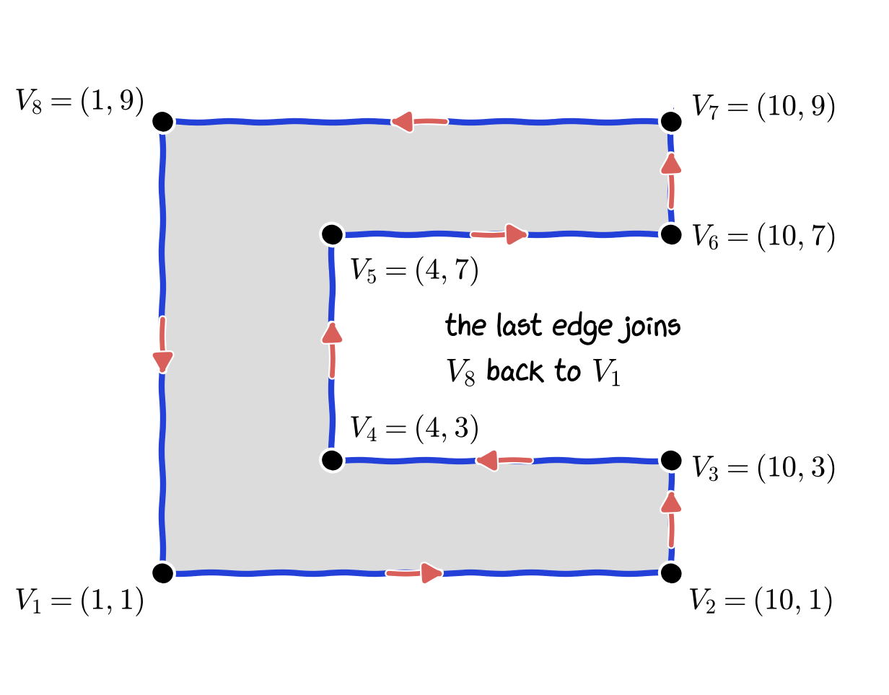{fig-align="center" width="520px"}

However, you are free to create a dungeon of any shape. Here are some ideas.

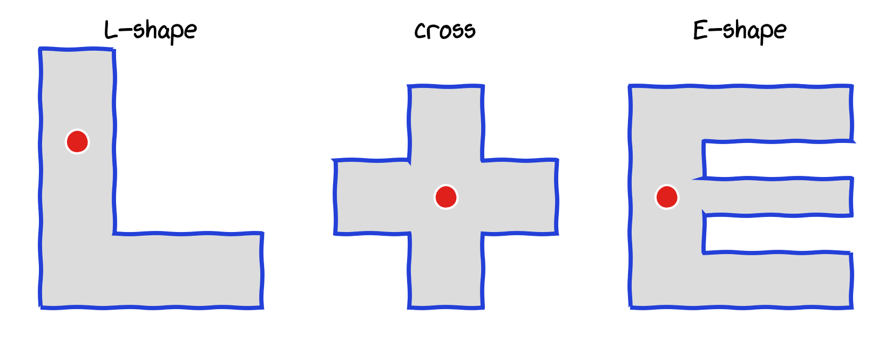{fig-align="center" width="700px"}

## B. Collision detection: the ray casting algorithm

The heart of this assignment is to design a Python function that tests whether a point $\mathbf{M}$ with coordinates $(x, y)$ is inside a polygon $\mathcal{P}$ defined by its vertices $\{(x_1, y_1), \ldots, (x_n, y_n)\}$. To determine whether the player is inside the dungeon, you will need to use the **ray casting algorithm**, also known as the **odd-even rule**; see [Wikipedia: Point in polygon](https://en.wikipedia.org/wiki/Point_in_polygon).

**Ray casting algorithm**

The **ray casting algorithm** (see the figure) is briefly explained in the following bullet points:

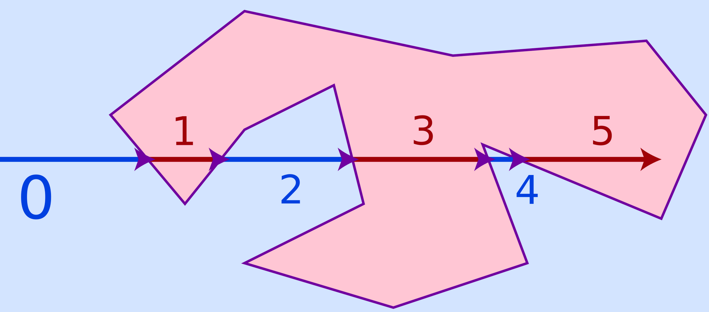{fig-align="center" width="65%"}

- Project an imaginary ray from the player's position $(x,y)$ in any fixed direction (e.g., **horizontally to the right**); see the figure above.
- Count how many times this ray intersects the edges of the dungeon.
- [**Result**]{.underline}: If the number of intersections is **odd** $(1, 3, 5, \ldots)$, the player is inside. If the number of intersections is **even** $(0, 2, 4, 6, \ldots)$, the position is outside the dungeon, that is, the player has hit a wall.

::: {.callout-note title="Note"}
In fact, it is a good idea to use a horizontal ray, starting from the player and extending to infinity on the right.
:::

The next figure applies the algorithm to the C-shaped dungeon.

{fig-align="center" width="700px"}

### Special cases

Your function must also deal with a few special cases, which are easy to overlook. Think about how to treat them, and document your decisions in your code.

1. **The ray passes through a vertex, or runs along a horizontal edge.** A naive count may count the same crossing twice, or miss it. How many crossings should be counted in each of the three situations below? The Wikipedia page above discusses this problem.

    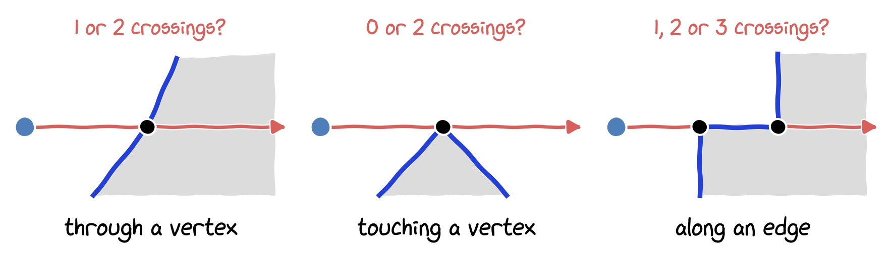{fig-align="center" width="780px"}

2. **The point lies exactly on a wall.** In the screenshots below, the player can stand exactly on a wall, for example at $x = 10.00$ (the move is valid), and only a move through the wall is penalized.
3. **Rounding errors.** Positions are floating-point numbers, so adding the step size repeatedly accumulates tiny errors. For example, adding $0.1$ twenty times to $2.0$ gives `4.000000000000002` instead of `4.0` (check it in Python!). Such a player is slightly on the other side of a wall at $x = 4$. Think about how to handle this, for example by rounding the coordinates or by using a small tolerance.

    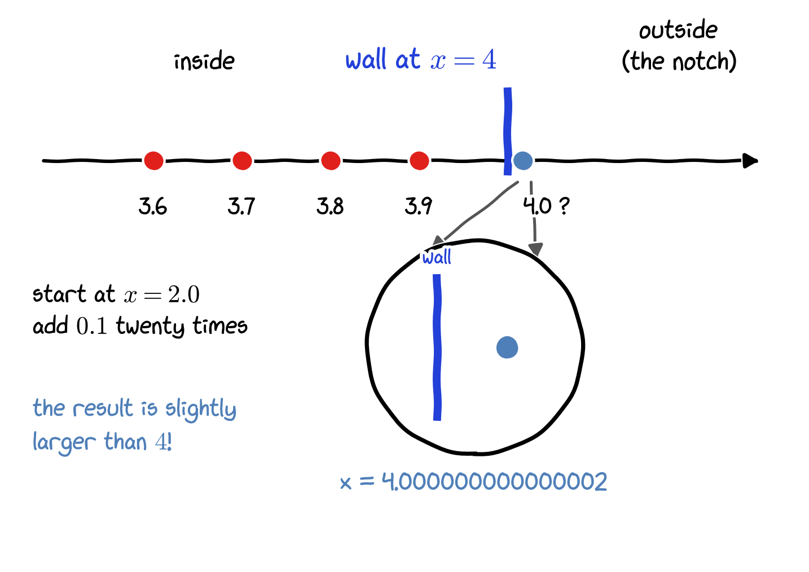{fig-align="center" width="560px"}

## C. Keyboard listener in `matplotlib`

To make a simulation using `matplotlib`, like the one shown in the executable files, you need to learn about [Event handling and picking](https://matplotlib.org/stable/users/explain/figure/event_handling.html) (click the link!). Some simple examples are attached in this assignment folder to help you with that. Nevertheless, it is advisable to click on the link to learn about event handling.

# Play the game to understand

It is best to play the game yourself to understand the project requirements. Indeed, I attached two executable files for you to play around with.

- **Linux**: `DungeonSimulatorUbuntu`
- **Windows**: `DungeonSimulatorWindows`
- **macOS**: Unfortunately, I don't have a MacBook to generate the executable file for this. If you use macOS, please try to run the Windows executable using this tutorial: [YouTube: How to run EXE file on Mac](https://www.youtube.com/watch?v=xTsuAKkaur8). An easy alternative is to borrow your friend's laptop for a minute.

Whether or not you can run the executable file, a few screenshots of the simulation are shown below. As you can see, when the player hits the wall, the health decreases by $1$. Otherwise, the move is valid. The title of the window also tells you the keys of the simulator: the arrow keys, or alternatively `a` (left), `d` (right), `w` (up), `z` (down), and `x` (exit).

::: {layout-ncol=3}
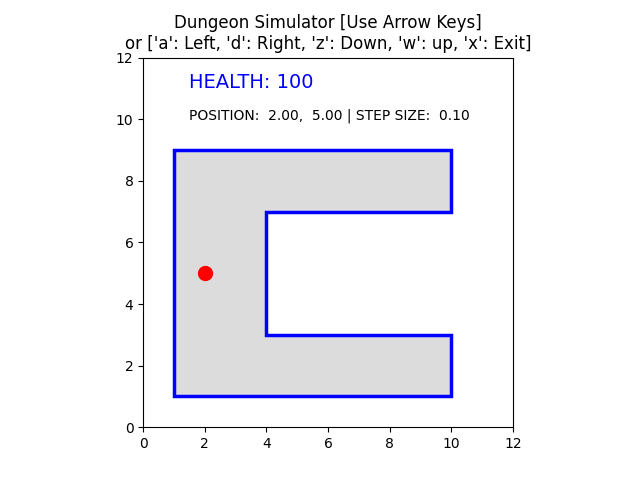

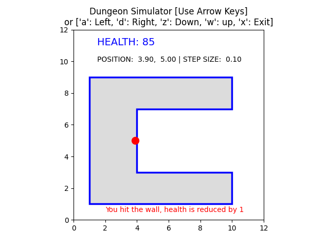

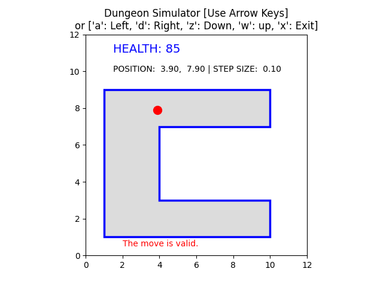

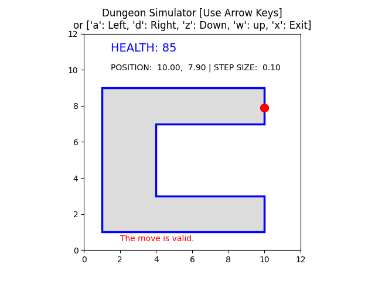

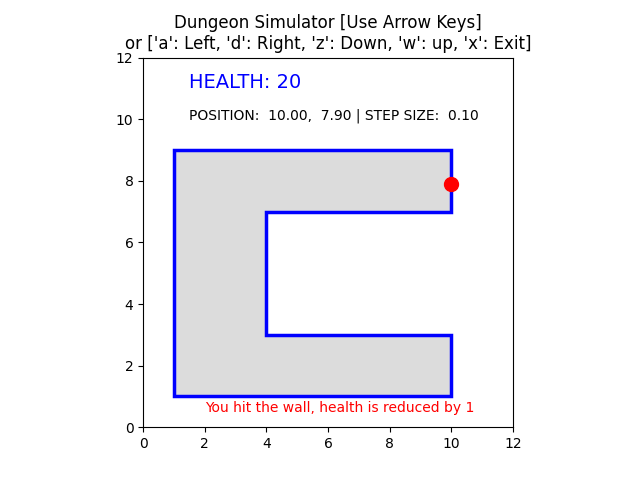

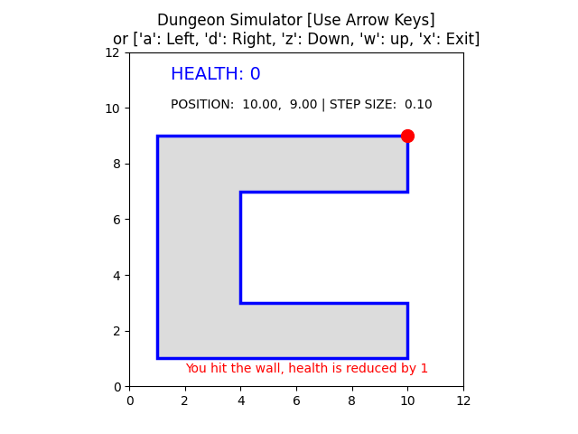
:::

# Code helper

Please have a look at the two Python files and try to run them.

- `example_key_event.py`
- `example_mouse_event.py`

I found that my own solution of the simulator does not work in a Jupyter Notebook, so I had to run it as a Python file with the extension `.py`. However, I found a way around this hurdle: we can run the simulator in a Jupyter Notebook after installing an interactive backend. The most reliable way to get interactive windows in Jupyter is the package `ipympl`. So, you need to install it using the command below (note that the exclamation mark "!" is needed)

```python
!pip install ipympl
```

Then, you need to put the following line in the Jupyter Notebook to make the plots interactive

```python
%matplotlib widget
```

# Implementation requirements

This assignment requires a significant investment in research. The following requirements are just suggestions: you can solve **fewer or more** requirements than suggested. It is up to you how to add more intellectual/technical achievement to your project.

## 1. Movement logic

Your script must listen for arrow key events. When a key is pressed:

- Calculate a candidate position based on the current step size.
- Validate the candidate position using the ray casting function.
- If valid: update the player's coordinates.
- If invalid: prevent the movement and trigger a penalty.

## 2. Health and game over state

- The player starts with $100$ health.
- Every time the player attempts to walk through a wall, the health must decrease by $1$.
- If the health reaches $0$, the simulation should automatically close.
- The simulation also stops when the user hits the key `x` (the character x).

The following figure summarizes what should happen when a key is pressed.

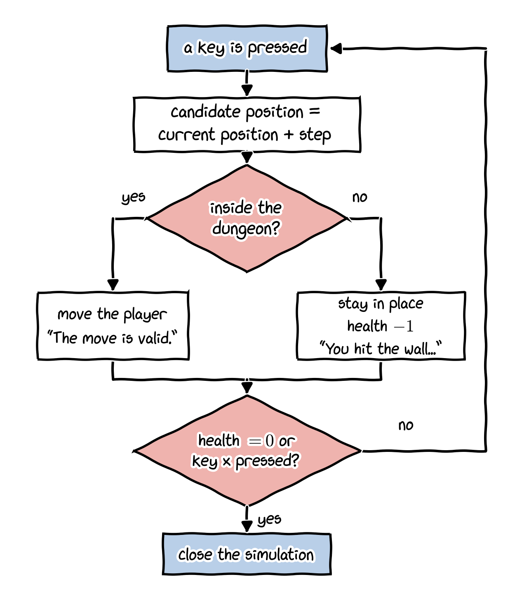{fig-align="center" width="500px"}

## 3. Interactive UI

The simulation must display real-time feedback:

- **Visuals**: a red dot representing the player and a grey-filled polygon for the dungeon.
- **Status bar**: dynamic text showing the current coordinates and health. (The screenshots above also show the step size.)
- **Warnings**: a message indicating whether the last move was valid or a collision occurred.
