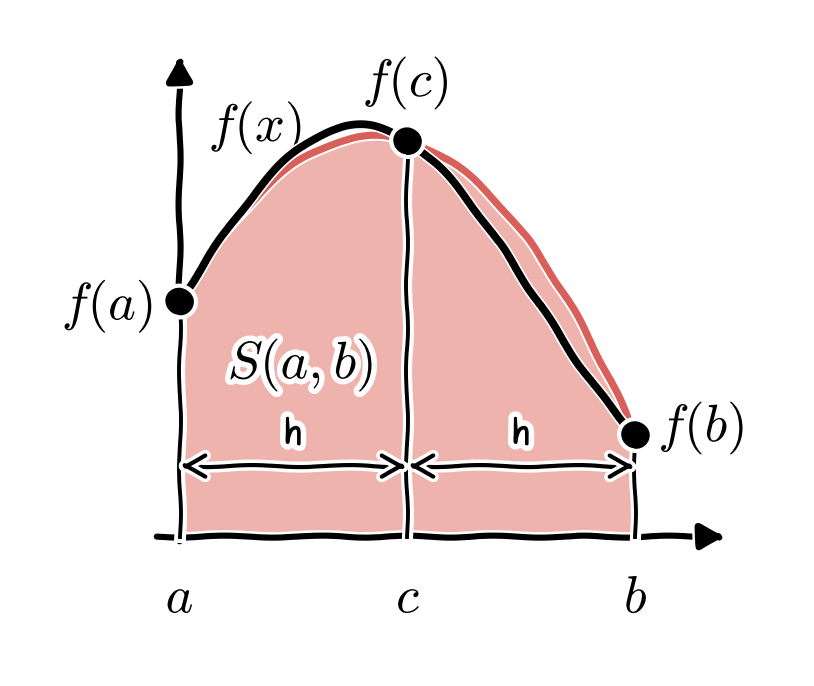
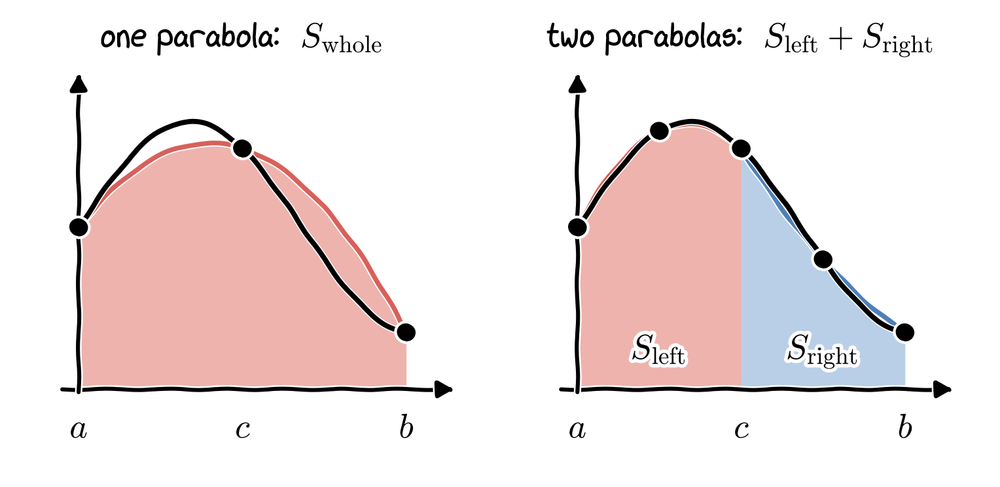
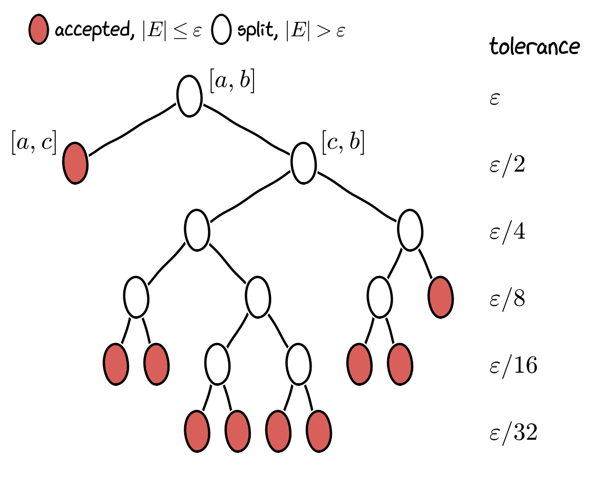
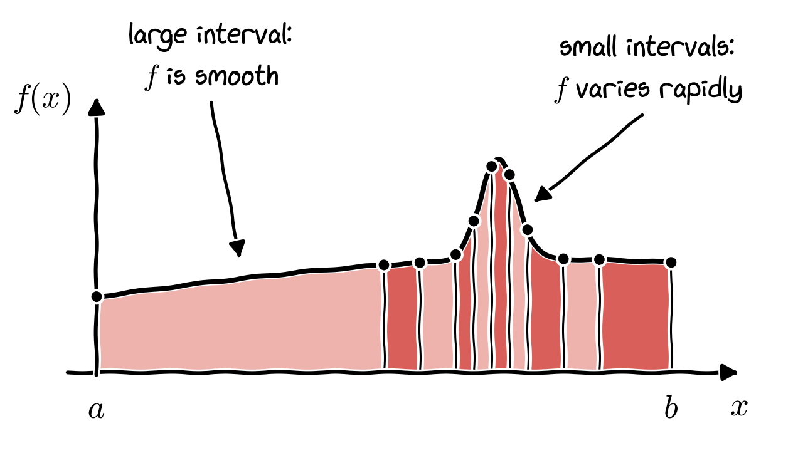
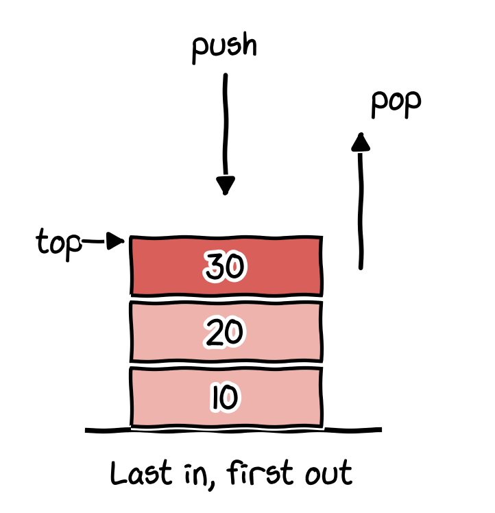

This assignment consists of two parts. In Part 1, you will learn the adaptive strategy for numerical integration and the recursive algorithm that implements it. In Part 2, you will learn how to refactor a recursive algorithm into an iterative one using an explicit stack. The tasks, which combine both parts, are given after the two parts.

# Part 1: Adaptive integration

## Introduction

In this assignment, you will implement an **adaptive quadrature**, or **adaptive integration**, algorithm. While standard methods like the trapezoidal rule or Simpson's rule rely on a fixed grid of evenly spaced points, adaptive methods concentrate computational effort where it is needed most -- typically where the function varies rapidly.

For this assignment, we focus on the **adaptive Simpson's rule**. Although the explanation below uses Simpson's rule, the adaptive strategy can be applied to other integration rules as well.

## Theoretical background

### Simpson's rule

Simpson's rule approximates the integral of a function $f(x)$ over an interval $[a, b]$ by fitting a parabola through the endpoints and the midpoint, as shown below.

{fig-align="center" width="420px"}

Let $c = \displaystyle \frac{a+b}{2}$ be the midpoint and $h = \frac{b - a}{2}$ be the step size. Simpson's rule is given by

$$
S(a, b) = \frac{h}{3}\big[f(a) + 4 f(c) + f(b)\big].
$$

### Error estimation

To make this adaptive, we need a way to estimate the error *without knowing the true answer*. We can do this by comparing one application of Simpson's rule over the whole interval $[a, b]$ against two applications of the rule on the sub-intervals $[a, c]$ and $[c, b]$ (see the figure below).

1. Calculate $S_{\text{whole}} = S(a, b)$.
2. Calculate $S_{\text{left}} = S(a, c)$ and $S_{\text{right}} = S(c, b)$.
3. The more accurate approximation should be $S_{\text{left}} + S_{\text{right}}$.

{fig-align="center" width="780px"}

The error estimate for $S_{\text{left}} + S_{\text{right}}$ can be computed by the formula

$$
E \approx \frac{1}{15}\big( S_{\text{left}} + S_{\text{right}} - S_{\text{whole}} \big).
$$

### Recursive algorithm

The recursive algorithm works as follows:

1. Given an interval $[a, b]$ and a tolerance $\varepsilon$.
2. Compute $S_{\text{whole}}$, $S_{\text{left}}$, and $S_{\text{right}}$.
3. Compute the error estimate $E$.
4. **Base case**:  
    If $|E| \leq \varepsilon$, return

    $$
    S_\text{left} + S_\text{right} +  \frac{1}{15}\Big(S_\text{left} + S_\text{right} - S_\text{whole}\Big)
    $$

    (adding the error estimate, a technique known as Richardson extrapolation, improves the accuracy).
5. **Recursive step**:  
    If $|E| > \varepsilon$, then recursively call the function on $[a, c]$ and $[c, b]$ with tolerance $\displaystyle \frac{\varepsilon}{2}$, and return the sum of their results.

The recursion builds a binary tree of intervals. Each interval is either accepted ($|E| \leq \varepsilon$) or split into two halves, and each half is then treated in the same way with half of the tolerance. The figure below shows such a tree for a function that is smooth over most of the interval but has one sharp feature (a narrow bump).

{fig-align="center" width="600px"}

The accepted intervals of this tree, which are the leaves of the tree, are shown in the next figure. The algorithm automatically uses many small intervals where the function varies rapidly, and only a few large intervals where the function is smooth. This is how the adaptive strategy saves computational effort compared with a fixed grid of evenly spaced points.

{fig-align="center" width="700px"}

# Part 2: Understanding stacks and refactoring recursion

::: {.callout-note title="Objectives and tasks"}
**Objectives**  
In this part, we explore the technique of refactoring recursion into iteration using the **stack** data structure. The stack is a fundamental tool in computer science, widely used to implement complex algorithms, such as depth-first search (DFS) in graphs or trees, where simple loops are insufficient.

**Task**  
You are asked to refactor the recursive algorithm for adaptive integration into an iterative version using an explicit stack.
:::

Below, we explain the stack data structure and demonstrate how to refactor recursive functions into iterative ones, using the factorial problem (computing $n! = 1\times 2\times \cdots \times n$) as an example.

## What is a stack?

A **stack** is a linear data structure that follows the **LIFO** (Last-In, First-Out) principle. Think of a stack of plates in a cafeteria:

- **Push:** You place a new plate on top.
- **Pop:** You can only take the plate that is on the top.

{fig-align="center" width="320px"}

In programming, stacks are crucial because they manage **function calls**. When you call a function, the computer "pushes" the function's state (variables, line number) onto the "call stack". When the function returns, the computer "pops" that state off.

In Python, we can use a simple `list` as a stack:

* `list.append(item)` acts as **push**.
* `list.pop()` acts as **pop**.

```{python}
# A simple demonstration of LIFO (Last-In, First-Out)
stack = []

# Pushing items
print("Pushing 10, 20, 30...")
stack.append(10)
stack.append(20)
stack.append(30)
print(f"--> Stack state: {stack}")

# Popping items
last_item = stack.pop()
print(f"Popped item: {last_item}")
print(f"--> Stack state: {stack}")

last_item = stack.pop()
print(f"Popped item: {last_item}")
print(f"--> Stack state: {stack}")

last_item = stack.pop()
print(f"Popped item: {last_item}")
print(f"--> Stack state: {stack}")
```

## Recursive approach

Mathematically, the factorial of $n$ (denoted $n!$) is defined as

$$
n! = n \times (n-1)!
$$

with the base case

$$
0! = 1.
$$

Here is the standard recursive implementation. Note that for every call, Python adds a "frame" to its internal call stack.

```{python}
def factorial_recursive(n):
    # Base case
    if n == 0 or n == 1:
        return 1
    # Recursive step
    return n * factorial_recursive(n - 1)

# Test it
print(f"Recursive 5! = {factorial_recursive(5)}")
```

## Refactoring with an explicit stack

### Why refactor?

Python has a recursion limit (usually 1000). If you try `factorial_recursive(2000)`, your program will crash with a `RecursionError`. By using your own stack (a list stored in heap memory), you are only limited by your machine's RAM, not by the recursion limit.

### The strategy

Recursion usually has two phases:

1. **Winding (descent):** We go deeper into the problem until we hit the base case (pushing onto the stack).
2. **Unwinding (ascent):** We return values back up the chain, combining them (popping from the stack).

{fig-align="center" width="520px"}

To refactor the factorial using a stack, we mimic this behaviour manually:

1. **Phase 1:** Loop down from $n$ to $1$, pushing every number onto our `stack`.
2. **Phase 2:** Initialize a result accumulator. While the stack is not empty, `pop` a number and multiply it into the result.

```{python}
def factorial_stack(n):
    """
    Calculates factorial using an explicit stack, 
    mimicking the 'winding' and 'unwinding' of recursion.
    """
    stack = []
    
    # Phase 1: Winding (simulating function calls)
    # We push every number we need to multiply later onto the stack.
    # This replaces: return n * recursive_call(n-1)
    current = n
    while current > 0:
        stack.append(current)  # Push current state
        current -= 1           # Move to next sub-problem
        
    # Phase 2: Unwinding (processing results)
    result = 1
    while len(stack) > 0:
        # Pop the last added item (LIFO)
        val = stack.pop()
        
        # Combine it with our current result
        result *= val
        
    return result

# Verification
print(f"Stack-based 5! = {factorial_stack(5)}")
print(f"Stack-based 10! = {factorial_stack(10)}")
```

### Summary

By making the stack explicit, we converted a recursive process into an iterative loop.

| Feature | Recursive | Stack/Iterative |
| :--- | :--- | :--- |
| **Memory** | Uses system stack (limited) | Uses heap memory (large) |
| **Speed** | Slightly slower (function overhead) | Faster (simple loops) |
| **Crash risk** | High for large $n$ (`RecursionError`) | Low |

For simple problems like the factorial, this often looks just like a standard `while` loop. However, this **"Push work -> Pop work"** pattern is essential for complex algorithms like **depth-first search (DFS)** in graphs or trees, where a simple loop isn't enough. Think about how this pattern can be applied to the adaptive integration of Part 1.

# Tasks

1. Implement the adaptive Simpson's rule described in Part 1 as a **recursive** function. The function should receive the function $f$, the limits $a$ and $b$, and the tolerance $\varepsilon$.
2. Refactor your recursive function into an **iterative** version using an **explicit stack**, as explained in Part 2.
3. Test both versions on two or three integrals (see "Testing and analysis" below) and check that they give the same results. For several tolerances (for example, $\varepsilon = 10^{-3}, 10^{-6}, 10^{-9}$), compare your results with the exact values and report the errors together with the number of function evaluations.
4. Optional: Visualize your results if possible. For example, mark the points where your program evaluates the function, as in the figure of the final intervals in Part 1.

Please follow these rules:

- Use **pure Python + NumPy + Matplotlib** only to implement the adaptive integration algorithm.
- Do **not** use `scipy.integrate.quad` or other high-level integrators in your implementation. You may use them to check your results, as shown below.
- When measuring cost, count function evaluations. Try to avoid evaluating the function at the same point more than once.

**Hint**: for the iterative version, think about what information about an interval you need to keep on the stack, and what you have to do with the result of an interval that is accepted.

## Testing and analysis

Test your integrator on two or three functions with increasing complexity. Below are just suggestions, but you can use your imagination.

$$
\begin{aligned}
I_1 &= \int_{0}^{1}\big(x^4 - x^3 + x^2 - x + 1\big)\,\mathrm{d}x, \\[6pt]
I_2 &= \int_{0}^{1} \exp(-x^2)\,\mathrm{d}x, \\[6pt]
I_3 &= \int_{0}^{2\pi} \exp(-\sin(x))\,\mathrm{d}x.
\end{aligned}
$$

- The first integral $I_1$ can be computed analytically and the exact value is

    $$
    I_1 = \frac{47}{60}.
    $$

- The second integral $I_2$ cannot be expressed in terms of elementary functions. In fact, it can be expressed through the error function $\displaystyle \mathrm{erf}(z) = \frac{2}{\sqrt{\pi}} \int_{0}^{z} \mathrm{e}^{-t^2}\,\mathrm{d}t$. Indeed, $I_2$ is given by

    $$
    I_2 = \frac{\sqrt{\pi}}{2}\,\mathrm{erf}(1) \approx 0.74682413281242702540.
    $$

- The third integral $I_3$ cannot be expressed in terms of elementary functions either. In fact, it can be expressed through the modified Bessel function of the first kind, $I_3 = 2\pi\, I_0(1)$. You don't need to worry about that for now; the exact value can be approximated as follows

    $$
    I_3 \approx 7.9549265210128452745.
    $$

**Numerical integration using the SciPy library**

The code provided below introduces you to the library `scipy` and its submodule `integrate`. In particular, the above integrals $I_{j}$, $j = 1, 2, 3$, can be computed using the function `quad()` of the submodule `integrate`. The code is meant to give you an idea of how to test your program with reliable values.

::: {.callout-warning title="Note"}
Note that you must write your own code to implement the adaptive integration algorithm, and **not** use the library `scipy` for it. To repeat: the code below is only meant to show you how to obtain reliable values for testing your program.
:::

```{python}
from scipy.integrate import quad
import numpy as np
```

```{python}
f1 = lambda x: x**4 - x**3 + x**2 - x + 1
result = quad(f1, 0, 1)
print(f"result = {result}") # The second element of result gives the error estimation.
I1, err_estimate = result[0], result[1]
print(f"Numerical I1   = {I1}")
print(f"Exact I1       = {47/60}")
print(f"error estimate = {err_estimate}")
```

```{python}
f2 = lambda x: np.exp(-x**2)
result = quad(f2, 0, 1)
I2 = result[0]
print(f"Numerical I2   = {result[0]}")  # compare this result with the value I2 given above
print(f"error estimate = {result[1]}") 
```

```{python}
f3 = lambda x: np.exp(-np.sin(x))
result = quad(f3, 0, 2*np.pi)
I3 = result[0]
print(f"Numerical I3  = {result[0]}")  # compare this result with the value I3 given above
print(f"error estimate = {result[1]}") 
```
