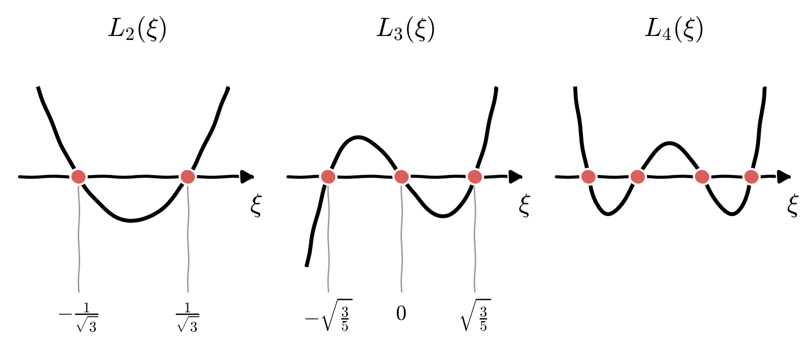

# Introduction: Gaussian quadrature

::: {.callout-note title="Note"}
- This project involves rather sophisticated mathematical concepts and thus [**requires you to invest time in research**]{.underline}.
- If you don't understand the content but still insist on doing this project, please feel free to contact me. Don't take the decision lightly.
- You cannot use a library to do the quadrature integration. You must write the program yourself. (You may, however, use libraries to check your results, as shown in the [Code helper](#code-helper) below.)
- Some of the texts contain links, which you can click on.
:::

## Key principle

[Gaussian quadrature](https://en.wikipedia.org/wiki/Gaussian_quadrature), named after the celebrated mathematician [Carl Friedrich Gauss](https://en.wikipedia.org/wiki/Carl_Friedrich_Gauss), is a highly accurate technique for approximating the definite integral of a function $f(x)$ over a range $[a,b]$

$$
\int\limits_{a}^{b} f(x)\,\mathrm{d} x \approx \sum\limits_{i=1}^{n} w_i \cdot f(x_i).
$$

Unlike simpler methods like the trapezoidal rule or Simpson's rule, which use equally spaced points, **Gaussian quadrature** strategically selects $n$ points $x_i$ (called **nodes**) for $i = 1, \ldots, n$ and the corresponding weights $w_i$ for $i = 1, \ldots, n$ within the integration interval.

## Reference

- You can watch these lectures on YouTube:
    - [An introduction to numerical integration through Gaussian quadrature](https://www.youtube.com/watch?v=Hu6yqs0R7GA)
    - [Numerical Computation - Gaussian Quadrature](https://www.youtube.com/watch?v=uxQCjeo955o)
- References for reading:
    - [Wikipedia: Gaussian quadrature](https://en.wikipedia.org/wiki/Gaussian_quadrature)

## Main idea

The genius of Gaussian quadrature lies in its choice of the nodes $x_i$ and weights $w_i$. For a given number of points $n$, the nodes and weights are specifically chosen so that the resulting approximation is **exact** for all polynomials of degree $2n - 1$ or less. For example:

- A $2$-point Gaussian quadrature ($n = 2$) integrates exactly any polynomial up to degree $2 \cdot 2 - 1 = 3$, that is, any cubic polynomial.
- A $5$-point Gaussian quadrature ($n = 5$) integrates exactly any polynomial up to degree $2 \cdot 5 - 1 = 9$.

![The $2$-point rule on $[-1, 1]$. The areas where the cubic $g$ lies above the straight line through the two nodes cancel the areas where it lies below. Hence, $g$ and the line have the same integral, and the integral of the line is exactly the $2$-point rule.](gauss_exactness.png){fig-align="center" width="520px"}

# Gauss-Legendre quadrature

In this assignment, we focus on the [Gauss-Legendre quadrature rule](https://en.wikipedia.org/wiki/Gauss%E2%80%93Legendre_quadrature) -- see also [Gaussian quadrature](https://en.wikipedia.org/wiki/Gaussian_quadrature).

Assume that we want to compute the integral of $f(x)$ on the interval $[a, b]$

$$
I = \int\limits_{a}^{b} f(x)\,\mathrm{d}x.
$$

To compute this integral, we shall use the following three key ideas:

1. We subdivide the original interval $[a, b]$ into multiple disjoint subdomains $[a_{j}, a_{j+1}]$ for $j = 0,\ldots, K-1$ and then integrate the function over these sub-intervals.
2. We make a change of variable to transform the function $f = f(x)$, defined on an arbitrary interval $[r, s]$, into the function $g = g(\xi)$, defined on the reference interval $[-1, 1]$. By doing this, the computation of the integral of $f(x)$ on the arbitrary interval $[r, s]$, namely $\int_{r}^{s} f(x)\,\mathrm{d}x$, is turned into the computation of the integral of $g(\xi)$ on the reference (standardized) interval $[-1, 1]$.
3. Based on the above transformation, we can focus on the integration of any continuous function on the reference interval $[-1, 1]$.

::: {.callout-note title="Note"}
Although we are concerned with the integration of any function on the reference interval $[-1, 1]$, you will soon find out that the key point is to make a change of variable $x = x(\xi)$, so that we can transform the Gauss quadrature nodes $\xi_{j}$ defined on the interval $[-1, 1]$ into the Gauss quadrature nodes $x_{j}$ defined on the interval $[r, s]$.
:::

## 1 - Multiple subdomains

It is not easy to compute the integral of a rather complex function $f$ on the interval $[a, b]$ by using just a single interval. Similar to the trapezoidal rule or Simpson's rule, to approximate the integral better, we divide the domain $[a, b]$ into $K$ disjoint subdomains

$$
[a, b] = [a_0, a_1] \cup [a_1, a_2] \cup \cdots \cup [a_{K-1}, a_{K}], \qquad \text{where } a_0 = a,\ a_{K} = b.
$$

The integral $I$ is then computed by summing the integrals of the function over the disjoint subdomains $[a_{j}, a_{j+1}]$ for $j = 0, \ldots, K-1$

$$
I = \int\limits_{a}^{b} f(x)\,\mathrm{d}x = \sum\limits_{j=0}^{K-1} \int_{a_j}^{a_{j+1}}f(x)\,\mathrm{d}x.
$$

![The interval $[a, b]$ divided into $K = 4$ subdomains. The dots mark the nodes of a $2$-point Gauss rule applied in every subdomain.](composite_subdomains.png){fig-align="center" width="640px"}

Clearly, we are now left with the same problem of computing the integral of $f(x)$ on an arbitrary domain $[r, s]$, but the domain is now smaller than the original domain and thus the approximation of the integral is hopefully better. By making a change of variable, we can shift the integration on $[r, s]$ to the integration on $[-1, 1]$ and thus standardize the integration process. This is the next topic.

## 2 - Change of interval

Assume that we want to compute the integral

$$
J = \int\limits_{r}^{s} f(x)\,\mathrm{d}x.
$$

In fact, we can illustrate the following technique using $a$ and $b$ instead of $r$ and $s$, respectively, because $[a, b]$ or $[r, s]$ just represents an arbitrary domain.

By applying the change of variable $x = x(\xi)$

$$
x = \frac{s - r}{2} \xi + \frac{s + r}{2} \qquad \text{for all } \xi \in [-1, 1],
$$

we can change the integration over the "physical" domain $[r, s]$ to the integration over the "reference" domain $[-1, 1]$. Indeed, we can verify that $x = r$ when $\xi = -1$ and $x = s$ when $\xi = 1$

$$
\begin{aligned}
x(\xi = -1) &= \frac{s - r}{2} \cdot (-1) + \frac{s + r}{2} = r, \\
x(\xi = +1) &= \frac{s - r}{2} \cdot (+1) + \frac{s + r}{2} = s.
\end{aligned}
$$

Using this change of variable, the integral $J$ can be transformed to

$$
\begin{aligned}
J &= \int\limits_{r}^{s} f(x)\,\mathrm{d}x = \int_{-1}^{1} f(x(\xi)) \frac{\mathrm{d}x}{\mathrm{d}\xi}\, \mathrm{d}\xi \\
&= \int_{-1}^{1} f\Big(\frac{s - r}{2} \xi + \frac{s + r}{2} \Big) \frac{s - r}{2}\, \mathrm{d}\xi \\
&= \frac{s - r}{2}\cdot \int_{-1}^{1} f\Big(\frac{s - r}{2} \xi + \frac{s + r}{2} \Big) \mathrm{d}\xi.
\end{aligned}
$$

Now, by defining the function $g(\xi)$ as follows

$$
g(\xi) := f\Big(\frac{s - r}{2} \xi + \frac{s + r}{2} \Big) \qquad \text{for all }\xi \in [-1, 1],
$$

we can compute $J$ by the formula

$$
J = \frac{s - r}{2} \int_{-1}^{1} g(\xi)\,\mathrm{d}\xi.
$$

![The change of variable between the reference interval $[-1, 1]$ and the physical interval $[r, s]$. The nodes (dots) and the end points of the reference interval are mapped to the nodes and the end points of $[r, s]$.](change_of_variable.png){fig-align="center" width="560px"}

In the above analysis, $f$ and $g$ are just the names of two functions; $f$ is defined on the interval $[r, s]$ and $g$ is defined on the interval $[-1, 1]$. Following this analysis, we only need to know how to compute the integral of any arbitrary function $g(\xi)$ on the interval $[-1, 1]$ numerically. Roughly speaking, any integration over the interval $[r, s]$ can be transformed to the integration over the interval $[-1, 1]$ and then scaled by the factor $(s - r)/2$.

### Example

We shall compute one integral example by using the analytical method (doing it with analytical formulas) before and after the change of variable.

- Let us compute the following integral directly, without a change of variable

    $$
    \begin{aligned}
    J &= \int_{0}^{2 \pi} \exp(-x) \sin(x)\,\mathrm{d}x = -\frac{1}{2}\mathrm{e}^{-x}\big(\cos x + \sin x \big) \Big|_{x\rightarrow 0}^{x\rightarrow 2\pi}  \\
    &= \bigg[-\frac{1}{2}  \mathrm{e}^{-2\pi} \big(\underbrace{\cos(2\pi) + \sin(2\pi)}_{1 + 0} \big) \bigg] - \bigg[-\frac{1}{2}  \underbrace{\mathrm{e}^{0}}_{1} \big(\underbrace{ \cos(0) + \sin(0)}_{1 + 0}\big) \bigg] \\
    &= \frac{1}{2} - \frac{1}{2}\mathrm{e}^{-2\pi} \approx 0.49906627863414593.
    \end{aligned}
    $$ {#eq-direct}

- Now, we apply the change of variable

    $$
    x(\xi) = \frac{2 \pi - 0}{2}\xi + \frac{2\pi + 0}{2} = \pi (\xi + 1).
    $$

    The integral $J$ can be transformed to

    $$
    \begin{aligned}
    J &= \int_{-1}^{1} \exp(-\pi(\xi + 1)) \sin(\pi(\xi + 1))\frac{\mathrm{d}x}{\mathrm{d}\xi}\, \mathrm{d}\xi \\
    &= \frac{2\pi - 0}{2} \int_{-1}^{1} \exp(-\pi(\xi + 1)) \sin(\pi(\xi + 1))\,\mathrm{d}\xi \\
    &= \pi \bigg[ \frac{e^{-\pi  (\xi +1)} (\sin (\pi  \xi )+\cos (\pi  \xi ))}{2 \pi }\bigg]_{\xi\rightarrow -1}^{\xi\rightarrow 1} \\
    &= \pi \bigg\{ \underbrace{\frac{e^{-\pi  (1+1)} (\sin (\pi\cdot 1 )+\cos (\pi \cdot 1 ))}{2 \pi }}_{\displaystyle \frac{-\mathrm{e}^{-2\pi}}{2\pi}} - \underbrace{\frac{e^{-\pi  (-1 +1)} (\sin (\pi  \cdot(-1) )+\cos (\pi  \cdot (-1) ))}{2 \pi }}_{\displaystyle -\frac{1}{2\pi}} \bigg\} \\
    &= \frac{1}{2} - \frac{1}{2}\mathrm{e}^{-2\pi}  \approx 0.49906627863414593.
    \end{aligned}
    $$ {#eq-transformed}

- According to @eq-direct and @eq-transformed, we can see that the integration before and after the change of variable from $x$ to $\xi$ gives the same value. If you still cannot believe it, you can test this analysis, to gain trust in this result, with simple integrals such as

    $$
    J_1 = \int_{3/2}^{5/2}x\,\mathrm{d}x = 2, \qquad J_2 = \int_{3/2}^{5/2}x^2\,\mathrm{d}x = \frac{49}{12}, \qquad J_3 = \int_{3/2}^{5/2}x^3\,\mathrm{d}x = \frac{17}{2}.
    $$

## 3 - Gauss-Legendre quadrature: formulation

We now focus on the integration over the reference domain $[-1, 1]$

$$
J = \int\limits_{-1}^{1} g(\xi)\,\mathrm{d}\xi \approx \sum\limits_{i=1}^{n} w_i \cdot g(\xi_i).
$$

This integral can be computed exactly for any polynomial up to degree $2n-1$ by using $n$ pairs $(\xi_i, w_i)$ for $i = 1, \ldots, n$ as follows:

- The Gauss node $\xi_i$ is the $i$-th root of the Legendre polynomial of degree $n$, denoted by $L_n$. That is, $L_n(\xi_i) = 0$ for all $i = 1, \ldots, n$.
- The weights are given by the formula, where $L_n^{\prime}(\xi)$ denotes the derivative of $L_n(\xi)$

    $$
    w_i = \frac{2}{(1 - \xi_i^2)\,[L_n^{\prime}(\xi_i)]^2}.
    $$

{fig-align="center" width="780px"}

The $1$-point rule up to the $5$-point rule are given by the following table. This table can be found on the [Wikipedia website for Gaussian quadrature](https://en.wikipedia.org/wiki/Gaussian_quadrature). Please check it for yourself. The nodes come in pairs $\pm$, and the two nodes of a pair have the same weight. **You should be able to reproduce this table using the helping code below.**

| Number of points, $n$ | Points, $x_i$ | Decimal value | Weights, $w_i$ | Decimal value |
| :---: | :---: | :---: | :---: | :---: |
| 1 | 0 | 0 | 2 | 2 |
| 2 | $\displaystyle \pm \frac{1}{\sqrt{3}}$ | $\pm 0.57735\ldots$ | 1 | 1 |
| 3 | $\displaystyle \pm \sqrt{\frac{3}{5}}$ | $\pm 0.774597\ldots$ | $\displaystyle \frac{5}{9}$ | $0.555556\ldots$ |
| $\phantom{3}$ | 0 | 0 | $\displaystyle \frac{8}{9}$ | $0.888889\ldots$ |
| 4 | $\displaystyle \pm \sqrt{\frac{3}{7} - \frac{2}{7} \sqrt{\frac{6}{5}}}$ | $\pm 0.339981\ldots$ | $\displaystyle \frac{18 + \sqrt{30}}{36}$ | $0.652145\ldots$ |
| $\phantom{4}$ | $\displaystyle \pm \sqrt{\frac{3}{7} + \frac{2}{7} \sqrt{\frac{6}{5}}}$ | $\pm 0.861136\ldots$ | $\displaystyle \frac{18 - \sqrt{30}}{36}$ | $0.347855\ldots$ |
| 5 | $\displaystyle \pm \frac{1}{3} \sqrt{5 - 2 \sqrt{\frac{10}{7}}}$ | $\pm 0.538469\ldots$ | $\displaystyle \frac{322 + 13 \sqrt{70}}{900}$ | $0.478629\ldots$ |
| $\phantom{5}$ | $\displaystyle \pm \frac{1}{3} \sqrt{5 + 2 \sqrt{\frac{10}{7}}}$ | $\pm 0.90618\ldots$ | $\displaystyle \frac{322 - 13 \sqrt{70}}{900}$ | $0.236927\ldots$ |
| $\phantom{5}$ | 0 | 0 | $\displaystyle \frac{128}{225}$ | $0.568889\ldots$ |

The figure below shows the same nodes and weights. Note that the nodes are not equally spaced: they are denser near the end points of the interval, where the weights are smaller.

![The nodes of the $n$-point Gauss-Legendre rules for $n = 1, \ldots, 5$ on the interval $[-1, 1]$. The size of each dot is proportional to its weight.](gauss_nodes_weights.png){fig-align="center" width="560px"}

### Examples

We shall verify the above Gauss-Legendre rule for two cases: the $2$-point quadrature rule can integrate exactly any polynomial of degree up to $3$ on the interval $[-1, 1]$, and the $3$-point quadrature rule can integrate exactly any polynomial of degree up to $5$ on the interval $[-1, 1]$. Note that we use $x$ instead of $\xi$ in the derivation below because $x$ or $\xi$ just stands for a scalar variable.

1. In the first example, we compute the integral of a general cubic polynomial $Q_3(x) = a_3 x^3 + a_2 x^2 + a_1 x + a_0$ on the interval $[-1, 1]$ by using the $2$-point quadrature rule. Before doing that, we know for sure that this integral can be computed as follows

    $$
    \begin{aligned}
    I &= \int_{-1}^{1} Q_3(x)\,\mathrm{d}x = \int_{-1}^{1} (a_3 x^3 + a_2 x^2 + a_1 x + a_0 )\,\mathrm{d}x \\
    &= \bigg[\frac{a_3 x^4}{4}+\frac{a_2 x^3}{3}+\frac{a_1 x^2}{2} + a_0 x \bigg]_{x\rightarrow -1}^{x\rightarrow 1} \\
    &= \bigg[\frac{a_3}{4} + \frac{a_2}{3} + \frac{a_1}{2} + a_0 \bigg] - \bigg[\frac{a_3}{4} - \frac{a_2}{3} + \frac{a_1}{2} - a_0\bigg]  \\
    &= \frac{2a_2}{3} + 2a_0.
    \end{aligned}
    $$ {#eq-cubic-exact}

    Now, using the $2$-point quadrature rule with nodes $x_{1} = -\frac{1}{\sqrt{3}}, x_{2}=\frac{1}{\sqrt{3}}$ and weights $w_1 = w_2 = 1$ (see the table above), we obtain

    $$
    \begin{aligned}
    I &= w_1 Q_3(x_1) + w_2 Q_3(x_2) = 1 \cdot \bigg( -a_3 \bigg[\frac{1}{\sqrt{3}}\bigg]^3 + a_2 \bigg[\frac{1}{\sqrt{3}}\bigg]^2 - a_1 \bigg[\frac{1}{\sqrt{3}}\bigg] + a_0 \bigg) + 1 \cdot \bigg(a_3 \bigg[\frac{1}{\sqrt{3}}\bigg]^3 + a_2 \bigg[\frac{1}{\sqrt{3}}\bigg]^2 + a_1 \bigg[\frac{1}{\sqrt{3}}\bigg] + a_0 \bigg) \\
    &= \underbrace{a_3 \bigg[\frac{1}{\sqrt{3}}\bigg]^3 -a_3 \bigg[\frac{1}{\sqrt{3}}\bigg]^3}_{\displaystyle 0} + \underbrace{a_2 \bigg[\frac{1}{\sqrt{3}}\bigg]^2 + a_2 \bigg[\frac{1}{\sqrt{3}}\bigg]^2}_{\displaystyle \frac{2}{3}a_2} + \underbrace{a_1 \bigg[\frac{1}{\sqrt{3}}\bigg] - a_1 \bigg[\frac{1}{\sqrt{3}}\bigg]}_{\displaystyle 0} + \underbrace{a_0 + a_0}_{\displaystyle 2a_0} \\
    &= \frac{2}{3}a_2 + 2 a_0.
    \end{aligned}
    $$ {#eq-cubic-gauss}

    $\diamond$ By comparing the results in @eq-cubic-exact and @eq-cubic-gauss, we can conclude that the $2$-point quadrature rule gives the exact integral of any polynomial of degree up to $3$ on the interval $[-1, 1]$.

2. In the second example, we compute the integral of a general polynomial of degree $5$, $Q_{5}(x) = \sum\limits_{i=0}^{5} a_i x^i$, on the interval $[-1, 1]$. Again, let us first compute the exact integral

    $$
    I = \int_{-1}^{1} \sum\limits_{i=0}^{5} a_i x^i\,\mathrm{d}x = \bigg[\sum\limits_{i=0}^{5} \frac{1}{i + 1}a_i x^{i + 1} \bigg]_{x \rightarrow -1}^{x \rightarrow 1} = \frac{2}{5}a_4 + \frac{2}{3}a_2 + 2a_0.
    $$ {#eq-quintic-exact}

    Next, we compute this integral by using the $3$ nodes $x_{1} = -\sqrt{\frac{3}{5}}, x_2 = 0, x_{3} = \sqrt{\frac{3}{5}}$ and the corresponding weights $w_1 = \frac{5}{9}, w_2 = \frac{8}{9}, w_3 = \frac{5}{9}$ (see the table above) as follows

    $$
    \begin{aligned}
    I &= w_1 Q_5(x_1) + w_2 Q_5(x_2) + w_3 Q_5(x_3) \\
    &= \frac{5}{9} \cdot \bigg(\sum\limits_{i=0}^{5}a_i \bigg(-\sqrt{\frac{3}{5}}\bigg)^i \bigg) + \frac{8}{9}\cdot \bigg(\sum\limits_{i=0}^{5}a_i 0^i \bigg) + \frac{5}{9} \cdot \bigg(\sum\limits_{i=0}^{5}a_i \bigg(+\sqrt{\frac{3}{5}}\bigg)^i \bigg) \\
    &= \frac{5}{9}\cdot \bigg[ 2 a_4 \bigg(\sqrt{\frac{3}{5}}\bigg)^4 + 2 a_2 \bigg(\sqrt{\frac{3}{5}}\bigg)^2 + 2 a_0 \bigg] + \frac{8}{9} a_0 \\
    &= \frac{5}{9} \cdot \bigg(\frac{3}{5}\bigg)^2 \cdot 2 a_4 + \frac{5}{9}\cdot \frac{3}{5} \cdot 2 a_2 + \frac{10}{9}a_0 + \frac{8}{9}a_0 \\
    &= \frac{2}{5}a_4 + \frac{2}{3}a_2 + 2a_0.
    \end{aligned}
    $$ {#eq-quintic-gauss}

    $\diamond$ By comparing the results in @eq-quintic-exact and @eq-quintic-gauss, we can conclude that the $3$-point quadrature rule gives the exact integral of any polynomial of degree up to $5$ over the interval $[-1, 1]$.

# Objectives of this assignment

- You need to implement a **function** or a **class** to compute the integral of a given function $f(x)$ on the interval $[a, b]$ using the composite Gauss-Legendre quadrature rule. That is, in your program, you need to divide the original interval $[a, b]$ into many subdomains, and the Gauss-Legendre quadrature rule is applied in each subdomain.
- Write code to compute the nodes and the weights for any arbitrary $n$-point Gauss-Legendre quadrature rule. Compare the results you obtained with the table provided on [Wikipedia](https://en.wikipedia.org/wiki/Gaussian_quadrature).
- Your program should calculate the integrals of the following functions on the specified intervals
    * $\displaystyle f_1(x) = \Big(x + \frac{3}{2}\Big)\Big(x + \frac{1}{2}\Big)\Big(x - \frac{1}{2}\Big)\Big(x - \frac{3}{2}\Big)(x - 2)$ on the interval $\displaystyle [-2, \frac{5}{2}]$,
    * $f_2(x) = \exp(-\sin(x))$ on the interval $[0, 2\pi]$, and
    * $\displaystyle f_3(x) = \exp\Big(-\frac{1}{4}x\Big) \sin(5 x)$ on the interval $[0, \pi]$.

    Note that these functions have increasing complexity: $f_1$ is a polynomial of degree $5$, so you can check your program against the exactness property of the Gauss-Legendre rule, whereas $f_2$ and $f_3$ are not polynomials.
- You should explain the algorithm and the reasoning for your implementation.

::: {.callout-note title="Note"}
For readers who are interested in Legendre polynomials, please refer to [Wikipedia for Legendre polynomials](https://en.wikipedia.org/wiki/Legendre_polynomials).
:::

# Code helper {#code-helper}

- The first block gives you an idea of how you can test your program by using the function `quad()` provided in the SciPy library. You can use this function to compute the integral numerically with very high accuracy.
- The second block explains how to use polynomials in the NumPy library and the Legendre polynomials from SciPy.

## Testing with `quad()`

We take the function $f_3(x) = \exp(-x/4)\sin(5x)$ on the interval $[0, \pi]$. We plot it and compute its integral with `quad()`.

```{python}
import numpy as np
import matplotlib.pyplot as plt
from scipy.integrate import quad
```

```{python}
f = lambda x: np.exp(-0.25*x) * np.sin(5 * x)
x = np.linspace(0, np.pi, 200)
plt.figure(figsize=(4, 3))
plt.plot(x, f(x))
plt.grid(True)
plt.show()

I, abserr = quad(f, 0, np.pi)
print(f"I (before the transformation) = {I}")
print(f"estimate for absolute error   = {abserr}")
```

Now, we apply the change of variable from the interval $[0, \pi]$ to the interval $[-1, 1]$.

```{python}
# Change of variable
a, b = 0, np.pi
mapping = lambda xi: 0.5*(b - a)*xi + 0.5*(b + a)
print(f"mapping(-1) = {mapping(-1)}")
print(f"mapping( 1) = {mapping(1)}")    # we can see that mapping(1) = np.pi (approximately, of course)
```

Finally, we compute the integral of $g(\xi)$ on the interval $[-1, 1]$ and scale it by the factor $(b - a)/2$. The result agrees with the integral computed before the change of variable.

```{python}
g = lambda xi: f(mapping(xi))

result = quad(g, -1, 1)
I2 = 0.5*(b - a) * result[0]
print(f"result of quad = {result}") # no scaling is applied yet
print(f"I (after transformation) = {I2}")
```

## Polynomials and Legendre polynomials in NumPy

Assume that $L_n(x)$ is the Legendre polynomial of degree $n$. Then the $n$ nodes of the quadrature rule are the roots of the equation $L_n(x) = 0$, i.e.,

$$
L_n(x_i) = 0 \quad \text{for all } i=1, \ldots, n.
$$

You can generate the quadrature points and weights manually using the Legendre polynomials. These polynomials are provided in the submodule `scipy.special` of the library `scipy`: see the [documentation](https://docs.scipy.org/doc/scipy/reference/generated/scipy.special.legendre.html) and the examples therein. A few things to learn:

- Note that `scipy.special.legendre()` returns a `poly1d` object.
- To understand `poly1d` objects, read [`numpy.poly1d`](https://numpy.org/doc/stable/reference/generated/numpy.poly1d.html).
- The derivative of these polynomials can be computed using the method `.deriv()`, or using the function `numpy.polyder()`.

### Polynomials in NumPy

In this example, we study the polynomial

$$
P(x) = x^{3} - 6 x^2 + 11 x - 6 = (x - 1)(x - 2)(x - 3).
$$

Therefore, the coefficients of this polynomial can be represented by a list of numbers `[1, -6, 11, -6]` or by a NumPy array `np.array([1, -6, 11, -6])`.

It is clear that the roots of the equation $P(x) = 0$ are $r_1 = 1, r_2 = 2, r_3 = 3$. The first and second derivatives of this polynomial are given by

$$
\begin{aligned}
P^{\prime}(x) &= 3 x^2 - 12 x + 11, \\
P^{\prime\prime}(x) &= 6 x - 12.
\end{aligned}
$$

These pieces of information are reflected in the code snippets below.

```{python}
poly = np.poly1d([1, -6, 11, -6])
dpoly = np.polyder(poly)
d2poly = np.polyder(dpoly)

print(f"poly =\n {poly}\n")
print(f"1st derivative of poly:\n {dpoly}\n")
print(f"2nd derivative of poly:\n {d2poly}\n")
```

```{python}
# Since we know the roots of this polynomial: r1 = 1, r2 = 2, r3 = 3, we can construct it by using
coefficients = np.poly([1, 2, 3])
print(f"coefficients =\n {coefficients}")

poly_another = np.poly1d(coefficients)
print(f"poly_another =\n{poly_another}")
```

```{python}
# Use python list for the coefficients of the polynomial
list_coeff = [1, -6, 11, -6]
poly1 = np.poly1d(list_coeff)

# Use ndarray for the coefficients of the polynomial
ndarray_coeff = np.array([1, -6, 11, -6])
poly2 = np.poly1d(ndarray_coeff)

poly_diff = poly1 - poly2       # This is still a poly1d object, not a number "0"
print(f"poly1 =\n{poly1}\n")
print(f"poly2 =\n{poly2}\n")
print(f"poly1 - poly2 = {poly_diff}")
print(f"poly_diff(pi) = {poly_diff(np.pi)}")
```

```{python}
# Roots of the polynomial P(x)
roots = poly.roots
print(f"roots = {roots}")
```

```{python}
x = np.linspace(0.5, 3.5, 250)
plt.figure(figsize=(4.5, 3))
plt.plot(x, poly(x), 'k-')
plt.plot(x, np.zeros_like(x), '--', label="y = 0")
plt.scatter(roots, np.zeros_like(roots), c='r')
plt.grid(True)
```

### Legendre polynomials

The code below plots the Legendre polynomials from degree $1$ to degree $9$. It also shows the roots of these polynomials.

```{python}
# First, we need to import
from scipy.special import legendre
```

```{python}
x = np.linspace(-1, 1, 250)
plt.figure(figsize=(9, 5))  # change (9, 5) to different numbers to see bigger/smaller figure
for i in range(3):
    for j in range(3):
        degree = 3*i + j + 1
        poly = legendre(degree)
        roots = poly.roots
        plt.subplot(3, 3, 3*i + j + 1)
        plt.plot(x, poly(x), 'k-')
        plt.scatter(roots, np.zeros_like(roots), marker='o', s=18, c='r')
        plt.title(f"degree = {degree}")
        plt.text(0, 0.7, f"number of roots = {roots.shape[0]}", ha='center', va='center', c='b')
        plt.grid(True)

plt.tight_layout()
```

You may need to compute the derivative of a polynomial to compute the weights according to the above formula. Below is a code snippet giving you an initial idea.

```{python}
# Derivative of a polynomial
poly = np.poly1d([1, -2, 3, -4, 5, 6])
dpoly = np.polyder(poly)
print(f"poly =\n{poly}")
print(f"dpoly =\n{dpoly}")

# We can also compute derivative by
dpoly = poly.deriv()
print(f"dpoly =\n{dpoly}")
```
