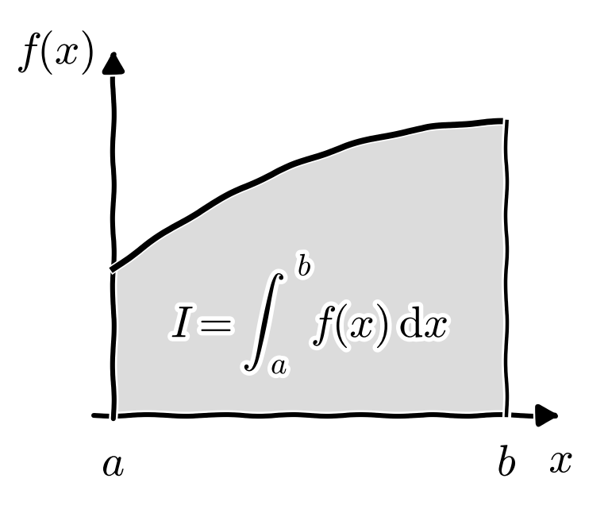
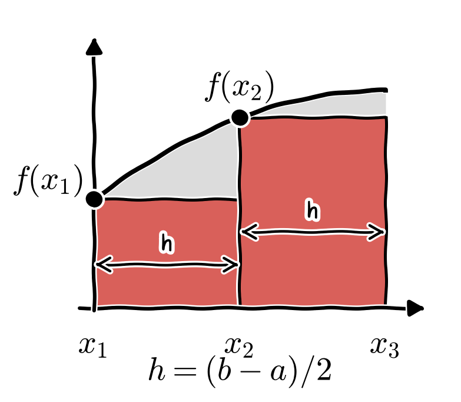
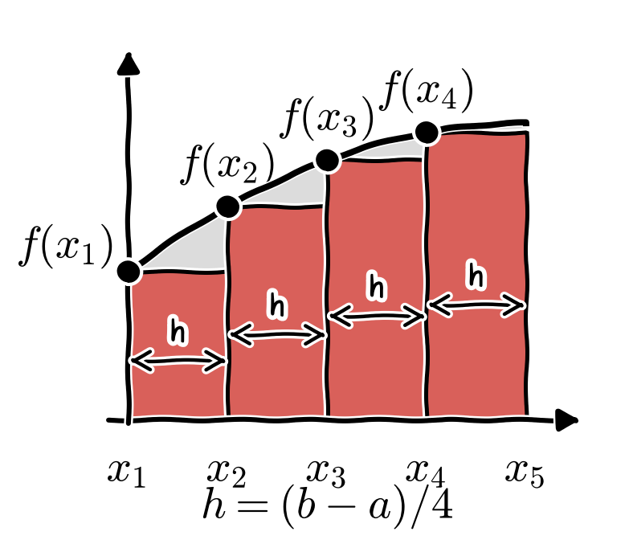
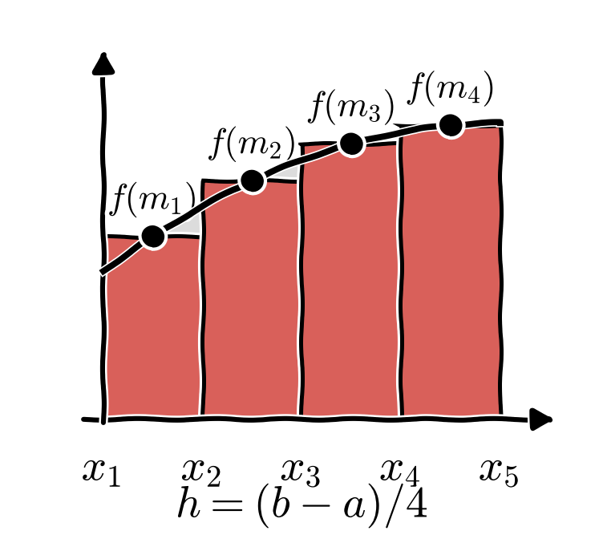
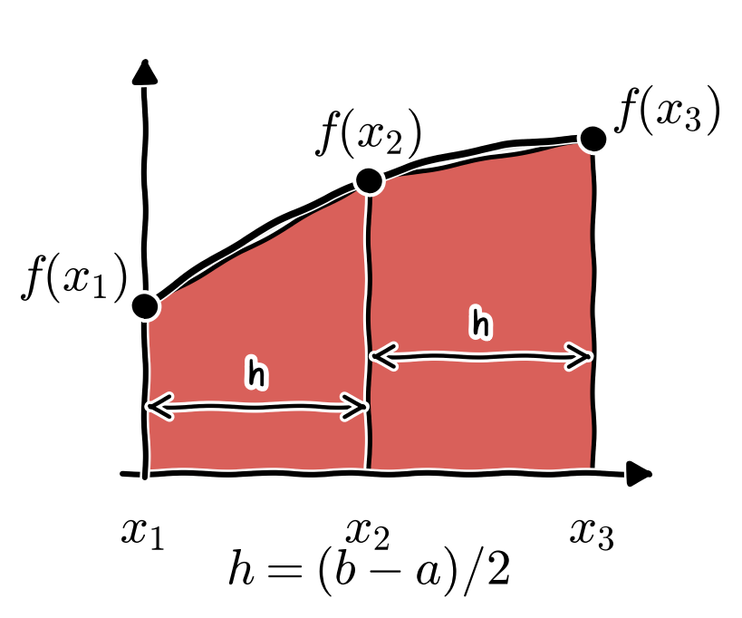
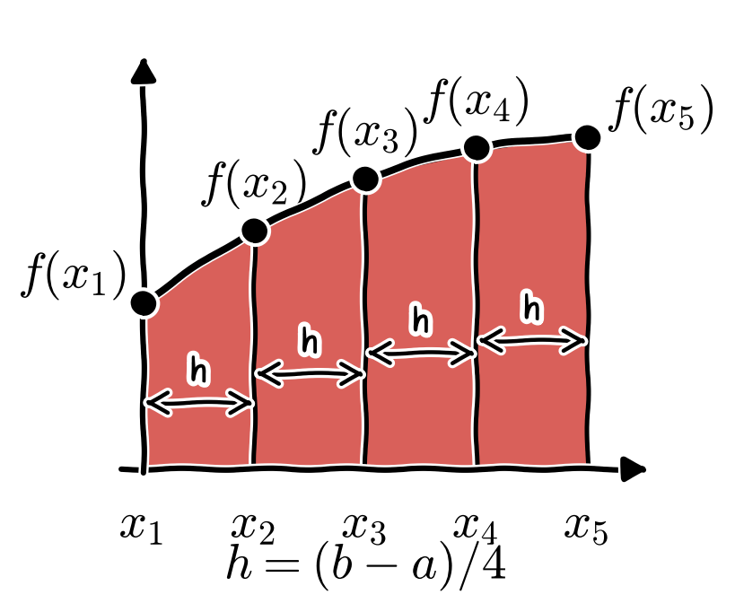

::: {.callout-note title="Up-front note regarding the rectangular rule"}
- If you search for "Riemann sum" and read [Wikipedia: Riemann sum](https://en.wikipedia.org/wiki/Riemann_sum), you will find that the first explanation corresponds to the **left Riemann sum**. We therefore call it the "*left rule*". The conventional "*rectangular rule*" corresponds to the **middle Riemann sum** and is hence also called the "**midpoint rule**"; see this [Lecture Note from UCL](https://www.ucl.ac.uk/~zcahge7/files/week9.pdf).
- If you have seen the original version of this assignment by Prof. Scott Roy, you will notice that his "rectangular rule" corresponds to our "left rule". As this assignment is adapted from one of his assignments, I have changed the name of the rule to avoid confusion in case you consult other online resources.
- You can implement either the *left rule* as described below, or the *midpoint rule* as described in the [Lecture Note](https://www.ucl.ac.uk/~zcahge7/files/week9.pdf), or both of these "Riemann" rules.
- Whichever of the Riemann rules you choose to implement, you [**must**]{.underline} implement the *trapezoidal rule*.
:::

# Task

Write a program to calculate the integral of a function using the **left rule** (or the **midpoint rule**, or both) and the **trapezoidal rule**. That is, we want to calculate an approximation to

$$
I = \int_a^b f(x)\,\mathrm{d}x,
$$

which is the area under the curve, as shown below.

{fig-align="center" width="450px"}

We can usually approximate integrals numerically by splitting the area up into slices and then adding up the slices. More, thinner slices lead to a closer approximation, but this also requires more work when we do the calculation by hand. Automating this is a perfect job for a computer.

Your program should first define the limits of the integral (i.e. the values $a$ and $b$ in the equation) and the number of slices $n$. Please don't simply use a library function to compute these integrals: we want to see you implement the algorithms yourself, both for the Riemann rule(s) of your choice (left rule, midpoint rule, or both) and for the trapezoidal rule (explained below).

Your program should calculate the integrals of the following functions

- $f_{1}(x) = x$,
- $f_{2}(x) = \sin(x)$, and
- $f_{3}(x) = \mathrm{e}^{-x} \sin(x)$

between $a=0$ and $b=1$ using each of the rules you have implemented. You should output the value of the approximation for $n=2$ (two slices) up to $n=100$, and graph the results (for example, by plotting the approximation against $n$), showing how the answer approaches the correct value as $n$ increases.

**Remark**$\qquad$ [You can go beyond and do much more than the above requirements.]{.underline}

# The integration rules

For all the rules below, we divide the interval $[a, b]$ into $n$ slices of equal width $h = (b-a)/n$. The points that separate the slices are $x_1 = a,\ x_2 = a + h,\ \ldots,\ x_{n+1} = b$.

::: {.callout-tip title="About the figures"}
The figures in this assignment are schematic sketches of a generic increasing function. They are *not* plots of the function $f(x) = x^3$ that we use in the examples.
:::

## Left rule

::: {.callout-note title="Note"}
As explained in the note above, the description in this section corresponds to the **left Riemann sum**, and not to the usual definition of the **rectangular rule**, which is also known as the **midpoint rule**.
:::

The **left rule** works by dividing the area under the curve into rectangular slices, where the height of each rectangle is the value of the function at the *left* end of the slice, as shown below.

- Let us take an example of how to apply this to calculate the integral

    $$
    I= \int_0^1 x^3 \,\mathrm{d}x
    $$

    for $n = 2$. We first calculate the step size $\displaystyle h = \frac{1 - 0}{2} = 0.5$. We now add the two rectangles to get an approximate integral $I_h$ (see the figure below):

    $$
    \begin{aligned}
    I \approx I_{h} &= h f(x_1) + h f(x_2) = 0.5 \cdot f(0) + 0.5 \cdot f(0.5) \\
    &= 0.5 \cdot 0 + 0.5 \cdot 0.125 \\
    &= 0.0625.
    \end{aligned}
    $$

    {fig-align="center" width="350px"}

- The same procedure can be done with $n=4$ and $\displaystyle h = \frac{1 - 0}{4} = 0.25$ (see the figure below). The approximate integral $I_h$ is computed by adding up the $4$ slices

    $$
    \begin{aligned}
    I \approx I_h &= h f(x_1) + h f(x_2) + h f(x_3) + h f(x_4) \\
    &= 0.25\cdot f(0) + 0.25 \cdot f(0.25) + 0.25 \cdot f(0.5) + 0.25 \cdot f(0.75) \\
    &= 0.25 \cdot 0 +  0.25 \cdot 0.015625 + 0.25 \cdot 0.125 + 0.25 \cdot  0.421875 \\
    &= 0.140625.
    \end{aligned}
    $$

    {fig-align="center" width="350px"}

    If we work out this integral by hand, we find that the exact answer is $0.25$. As we increase $n$, we are at least getting closer to $0.25$, although the approximation isn't great.

## Midpoint rule

The key difference between the **midpoint rule** and the **left rule** is that the function is evaluated at the midpoints $\displaystyle m_i = \frac{x_{i} + x_{i+1}}{2}$ of the subintervals $[x_{i}, x_{i+1}]$.

- Let us come back to the above example of computing

    $$
    I = \int_{0}^{1} x^3 \,\mathrm{d}x
    $$

    and apply the midpoint rule with $n = 4$ slices. As before, the size of one slice is $h = 1/4 = 0.25$. The midpoint rule approximates $I$ by (see the figure below)

    $$
    \begin{aligned}
    I \approx I_h &= h f\Big( \frac{x_1 + x_2}{2} \Big) + h f\Big( \frac{x_2 + x_3}{2} \Big) + h f\Big( \frac{x_3 + x_4}{2} \Big) + h f\Big( \frac{x_4 + x_5}{2} \Big) \\[6pt]
    &= 0.25 \cdot f(0.125) + 0.25 \cdot f(0.375) + 0.25 \cdot f(0.625) + 0.25 \cdot f(0.875) \\
    &= 0.25 \cdot 0.00195312 + 0.25 \cdot 0.05273438 + 0.25 \cdot 0.24414062 + 0.25 \cdot 0.66992188 \\
    &= 0.2421875.
    \end{aligned}
    $$

    {fig-align="center" width="350px"}

- As the exact integral is $I= 0.25$, we can observe that the midpoint rule gives a much better approximation than the left rule in this example. In fact, the error estimates show that the error of the midpoint rule decreases much faster than the errors of the left rule and the right rule as the slices become thinner. See the error estimates for the three rules (left rule, right rule and midpoint rule) at [Wikipedia: Riemann sum](https://en.wikipedia.org/wiki/Riemann_sum).

    This is an excerpt from Wikipedia: "$\ldots$ as such the middle Riemann sum is the most accurate approach to the Riemann sum".

## Trapezoidal rule

The **trapezoidal rule** approximates the integral by constructing **trapezoids** under the function, as shown below. From the figures, we can see that this rule provides a more accurate approximation of the integral than the left rule.

- Let us take an example of how to apply this to calculate the integral

    $$
    I = \int_{0}^{1} x^3 \,\mathrm{d} x
    $$

    for $n = 2$. As above, we calculate the step size $\displaystyle h = \frac{1 - 0}{2} = 0.5$, and then add the two *trapezoids* to get an approximate integral $I_{h}$ (double-check the formula to make sure that you see why it works)

    $$
    \begin{aligned}
    I \approx I_{h} &= \frac{h}{2}\big[ f(x_1)+2f(x_2)+f(x_3) \big] \\[6pt]
    &= \frac{0.5}{2} \big[ f(0)+2f(0.5)+f(1.0) \big] = 0.3125.
    \end{aligned}
    $$

    {fig-align="center" width="300px"}

- We can also do the same for $n=4$. In the figure below, $\displaystyle h= \frac{1 - 0}{4} = 0.25$.

    {fig-align="center" width="300px"}

    The approximate integral $I_{h}$ is found by adding up the $4$ slices

    $$
    \begin{aligned}
    I \approx I_{h} &= \frac{h}{2}\big[ f(x_1) + 2f(x_2) + 2f(x_3) + 2f(x_4) + f(x_5) \big] \\[6pt]
    &= \frac{0.25}{2}\big[ f(0) + 2f(0.25) + 2f(0.5) + 2f(0.75) + f(1.0)\big] \\[6pt]
    &= 0.125 \big( 0+ 2\cdot 0.015625 + 2 \cdot 0.125 + 2 \cdot 0.421875 +1 \big) = 0.265625.
    \end{aligned}
    $$

    Obviously, after only $4$ slices we are already closely approaching the correct answer.

# Testing

The obvious way to test your program is to compare your results against integrals that you have computed exactly by hand. For example, for the integral of $x^3$ in the examples above, we know that the exact result is $0.25$. The values computed above, and the values for the midpoint rule with $n = 2$, are summarised below. Your program should reproduce them.

| $\displaystyle\int_0^1 x^3\,\mathrm{d}x$ | $n = 2$ | $n = 4$ |
|:-----------------|----------:|-----------:|
| Left rule        | $0.0625$  | $0.140625$ |
| Midpoint rule    | $0.21875$ | $0.2421875$ |
| Trapezoidal rule | $0.3125$  | $0.265625$ |

For the three functions of the task, the exact values of the integrals between $a = 0$ and $b = 1$ are

- $\displaystyle\int_0^1 x\,\mathrm{d}x = \frac{1}{2} = 0.5$,
- $\displaystyle\int_0^1 \sin(x)\,\mathrm{d}x = 1 - \cos(1) \approx 0.459698$, and
- $\displaystyle\int_0^1 \mathrm{e}^{-x}\sin(x)\,\mathrm{d}x = \frac{1}{2}\Big[1 - \mathrm{e}^{-1}\big(\sin(1) + \cos(1)\big)\Big] \approx 0.245837$.

# References

[Lecture Note from UCL](https://www.ucl.ac.uk/~zcahge7/files/week9.pdf)
