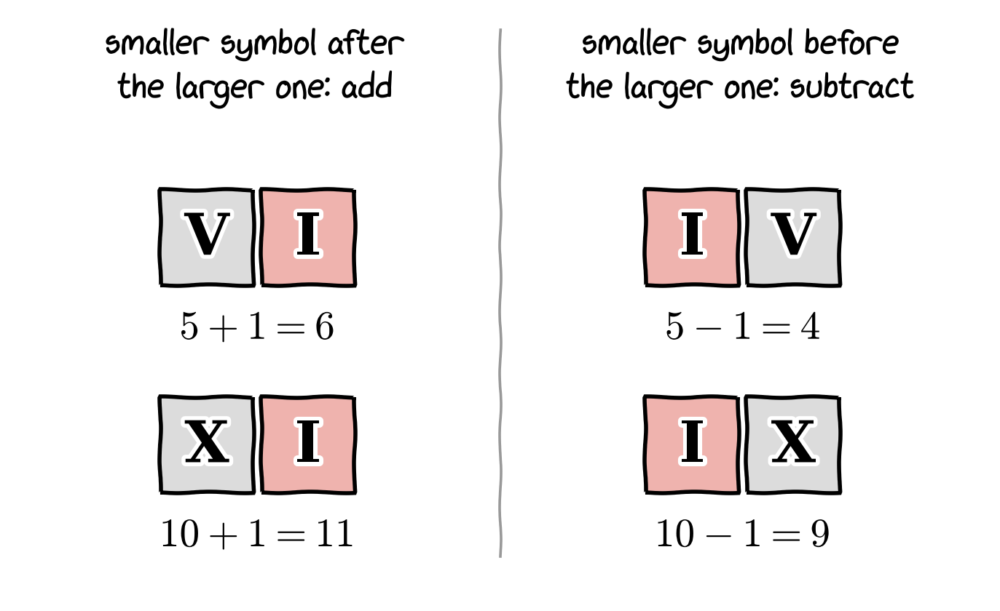
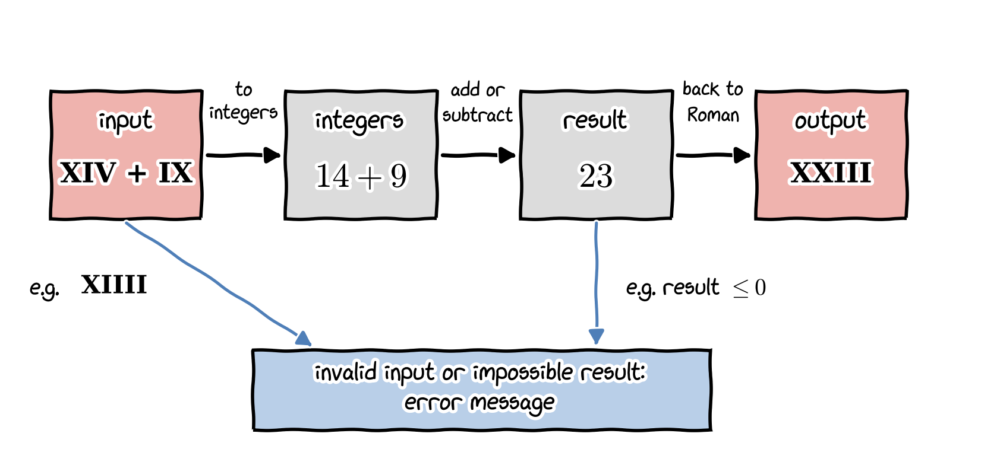

::: {.callout-note title="Note"}
This project comes with a rather loose explanation and thus requires a bit more research before you start writing code. You need to plan your research, develop an algorithm, and explain your algorithm in the report.
:::

# Roman numeral system basics

**Roman numerals** are a numeral system that originated in ancient Rome and remained the usual way of writing numbers throughout Europe well into the Late Middle Ages. Numbers are written with combinations of letters from the Latin alphabet, each with a fixed integer value. The modern style uses only these seven:

| Symbol | Value |
|--------|-------|
| $\mathrm{I}$    | $1$   |
| $\mathrm{V}$    | $5$   |
| $\mathrm{X}$    | $10$  |
| $\mathrm{L}$    | $50$  |
| $\mathrm{C}$    | $100$ |
| $\mathrm{D}$    | $500$ |
| $\mathrm{M}$    | $1000$|

For instance, on the clock of Big Ben (designed in 1852), the hours from 1 to 12 are written with Roman numerals, as shown in the photo below. In the modern style, they read $\mathrm{I, II, III, IV, V, VI, VII, VIII, IX, X, XI, XII}$.

{fig-align="center" width="350px"}
{fig-align="center" width="700px"}

Look closely at the photo: like many clock faces, Rolex watch writes $4$ as $\mathrm{IIII}$ instead of $\mathrm{IV}$. In this assignment, however, $\mathrm{IIII}$ is **not** valid. The correct form is $\mathrm{IV}$. Luckily, Big Ben Clock did it right.

The notations $\mathrm{IV}$ and $\mathrm{IX}$ can be read as "one less than five" ($4$) and "one less than ten" ($9$). In other words, the same symbols can mean different numbers depending on their order.

{fig-align="center" width="520px"}

The full description of how Roman numerals work can easily be found online. As the explanation of the writing system is quite lengthy, it is not written here, but you can find it on [Wikipedia: Roman numerals](https://en.wikipedia.org/wiki/Roman_numerals).

# Objectives

- The primary goal of this assignment is to develop a program that can perform basic arithmetic operations (addition and subtraction) on Roman numerals by first converting them to integers, performing the calculation, and then converting the result back to the appropriate Roman numeral format, as illustrated below.

    {fig-align="center" width="700px"}

- The program should handle invalid characters and malformed Roman numerals gracefully. That is, it should report a clear error message instead of crashing. For example, $\mathrm{XIIII}$ should be invalid because it can be written in the shorter form $\mathrm{XIV}$. Similarly, $\mathrm{XIA}$ should be invalid because it contains a character that is not a Roman numeral symbol.
- Roman numerals have no symbol for zero and no negative numbers, and the standard notation with the seven symbols above covers the numbers from $1$ to $3999$. Decide how your program should handle a result outside this range (for example, $\mathrm{XIV} - \mathrm{XIV} = 0$), and explain your decision in the report.
- You can decide how the user enters the numbers and the operations.
- The report should explain up front how to enter the input and how to observe the output, so that the marker (me) can test your program easily.
