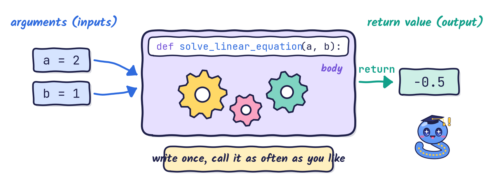
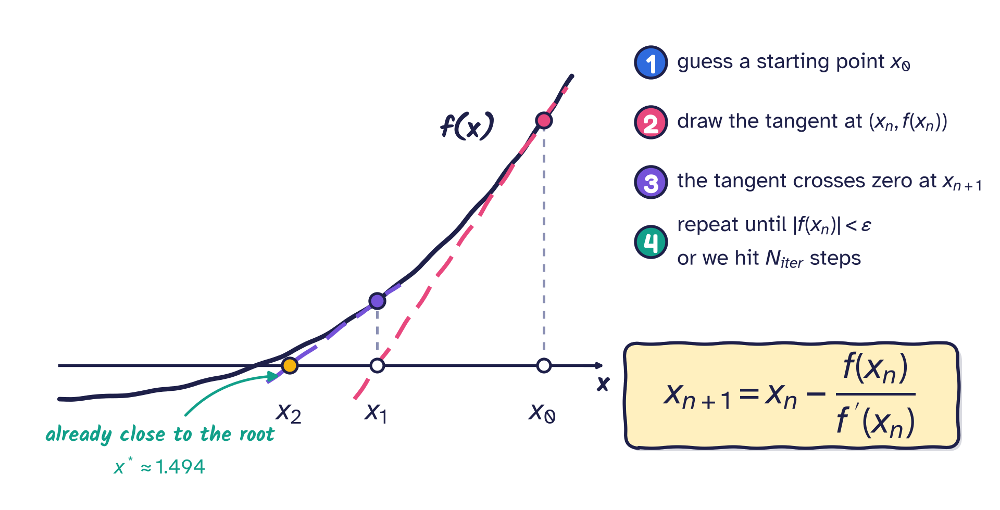
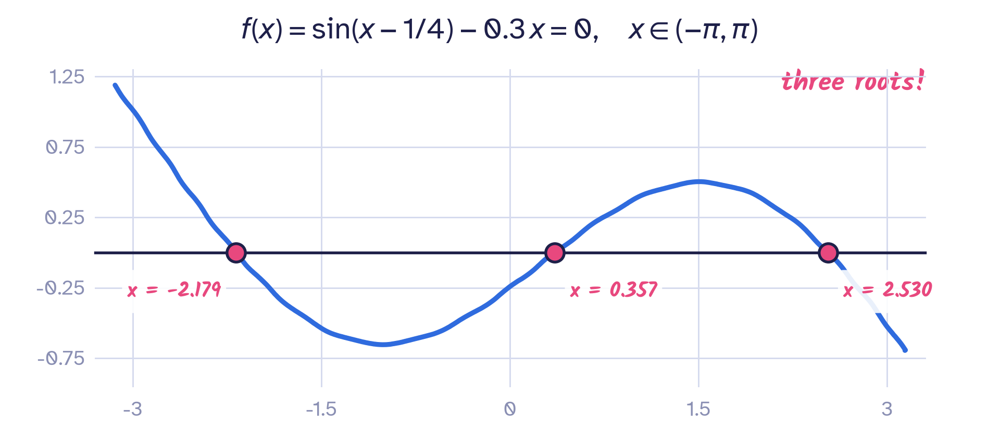
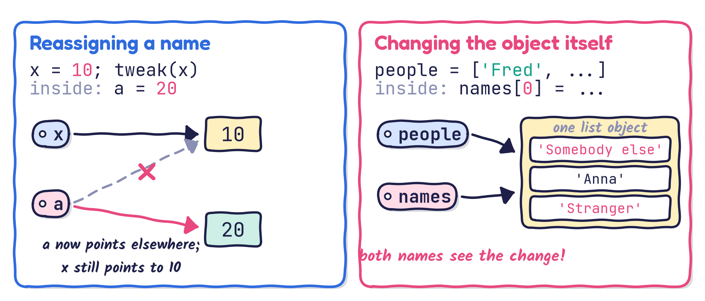
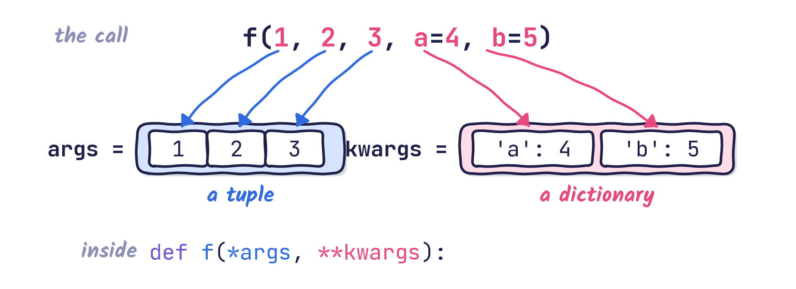

# Intended learning outcomes {background-image="theme/section-bg.svg"}

## Intended learning outcomes

By the end of this lecture you should be able to:

- explain **why** we write functions
- write a function with a **docstring**, and call it
- use **positional**, **keyword** and **default** arguments
- predict what happens to arguments that are **reassigned** or **modified** inside a function
- **return** one or several values
- accept an **arbitrary number** of arguments with `*args` and `**kwargs`

# Why functions? {background-image="theme/section-bg.svg"}

## Why functions?

- We have used functions all the time: `print()`, `max()`, `len()`, ...
- Now we need to write our own.

:::: {.columns}
::: {.column width="58%"}
**Functions help us to**

- make a program more **readable** and understandable
- **break down** a big problem into smaller, solvable tasks, then assemble them to solve the original problem
- **reuse** code instead of copying and pasting it
:::

::: {.column width="42%"}
::: {.keybox .center}
**Golden rule**

[Do not reinvent the wheel!]{.big}
:::
:::
::::

## A function is a little machine

{fig-align="center" width="96%"}

Arguments go **in**, the body does the work, and a **return** value comes **out**.

# Defining and calling functions {background-image="theme/section-bg.svg"}

## Function: syntax

```python
def function_name(argument1, argument2, argument3, ...):
    """
    Text description: explain what the function does, the meaning
    of the input arguments and, possibly, the outputs.
    """
    <statement>
    <statement>
    return expression   # optional: the value the function gives back
```

- `def`, the function name, parentheses and a **colon**; the body is **indented**.
- Always write a docstring unless the function is very short and self-explanatory.

## Docstrings {.compact}

```{python}
def call_me_maybe(number):
    """
    This function is inspired by a famous song.
    This second line explains absolutely nothing.
    """
    print(f"Call me on {number}")
```

Python stores the docstring and shows it on request:

- in Jupyter, type `call_me_maybe?` (live demo)
- anywhere, use `help()`:

```{python}
help(call_me_maybe)
```

## Function: example

```{python}
def cat_age_to_human_age(cat_age):
    """Translate a cat's age into human years."""
    multiplier = 4
    if cat_age == 1:
        return 15
    if cat_age == 2:
        return 24
    return cat_age * multiplier + 16
```

Once the function is defined, we can call it:

```{python}
cat_age_to_human_age(12)               # pointless: the answer is ignored
felix_age = cat_age_to_human_age(4)    # felix_age = 32
print(cat_age_to_human_age(12))        # a very old cat
```

## Calling a function

Every value in Python is an object, and a function is an object too.

```{python}
def greet():
    """Simple function to greet people."""
    print("Hello there!")
```

We **call** a function by writing parentheses after its name:

```{python}
greet()      # calls the function
greet        # just the function object itself: nothing is executed
```

::: {.callout-note}
**Use the parentheses when calling a function**, not just the name of the function.
:::

## Multiple input arguments {.compact}

A function definition can declare many input arguments (recall the syntax):

```{python}
def print_max(a, b):
    """Print the larger of a and b."""
    if a > b:
        print(a)
    else:
        print(b)

print_max(3, 4)           # accepts literals: prints 4
fred, anne = 7, 6         # multiple assignment
print_max(fred, anne)     # accepts variables too: prints 7
```

::: {.question .fragment}
Here the order of `a` and `b` does not matter: they play the same role. Can you give me an example in which the positions of the input arguments are important?
:::

# Positional, keyword and default arguments {background-image="theme/section-bg.svg"}

## Positional arguments

Solve the linear equation $a x + b = 0$:

```{python}
def solve_linear_equation(a, b):
    """Solve the equation a x + b = 0 for x."""
    if a != 0:
        return -b / a
    else:
        if b == 0:
            print("The equation has infinitely many solutions.")
        else:
            print("The equation has no solution.")
```

Here the order matters: the first value is `a`, the second is `b`.

::: {.question .fragment}
What happens, and what does this function return, when $a = b = 0$?
:::

## Positional arguments: usage

```{python}
print("Solve 2 x + 1 = 0:", solve_linear_equation(2, 1))
print("Solve   x + 2 = 0:", solve_linear_equation(1, 2))
print("Solve   x     = 0:", solve_linear_equation(1, 0))
print("Solve 0 x + 1 = 0:", solve_linear_equation(0, 1))
```

::: {.question .fragment}
How can we remember the meaning of every input argument if the function needs a long list of them?
:::

::: {.answer .fragment}
Use **keyword** arguments: we state explicitly which argument receives which value.
:::

## Keyword arguments

Functions can also be called with **keyword arguments** of the form `kwarg=value`:

```{python}
# These two calls are equivalent: a and b receive the same values.
print("Solve 2 x + 1 = 0:", solve_linear_equation(b=1, a=2))
print("Solve 2 x + 1 = 0:", solve_linear_equation(2, 1))
```

- With keywords, the **order no longer matters**.
- Positional arguments must come **before** keyword arguments in a call.

## Keyword arguments: `a=a`?

You will often see calls such as `function(a=a, b=b, c=c, ...)`. The name on the **left** of `=` is the argument; the value on the **right** comes from your own variable.

```{python}
v1, v2 = 2, 1
print("Solve 2 x + 1 = 0:", solve_linear_equation(a=v1, b=v2))

a, b = 2, 1
# "a=a": the argument a (left) receives the value of our variable a (right)
print("Solve 2 x + 1 = 0:", solve_linear_equation(b=b, a=a))
```

::: {.question .fragment}
Can you name a scenario that needs many input arguments, where keyword arguments would help?
:::

## Brainstorm: the Newton–Raphson method

Let us examine the Newton–Raphson method for solving the algebraic equation $f(x) = 0$.

{fig-align="center" width="88%"}

## Brainstorm: which inputs does it need?

To write `newton(...)` we need: the function $f$, its derivative $f'$, a starting point $x_0$, a **tolerance** $\varepsilon$ (stop when $|f(x)| < \varepsilon$) and a **maximum number of iterations** $N_\text{iter}$.

::: {.question .fragment}
What happens if we don't want to supply values for all the input arguments?
:::

::: {.answer .fragment}
Some input arguments can take **default** values when no value is supplied. Very often we are happy for $N_\text{iter}$ and $\varepsilon$ to default to sensible numbers, e.g. $N_\text{iter} = 10^{4}$ and $\varepsilon = 10^{-6}$.
:::

::: {.fragment}
This leads to **default argument values**.
:::

## Default argument values

An argument takes its **default value** when the call does **not** specify a value for it.

```python
# retries defaults to 4 and reminder to 'Only "yes" or "no"'
def ask_ok(prompt, retries=4, reminder='Only "yes" or "no"'):
    """Ask until the user answers yes or no."""
    while True:
        ok = input(prompt)
        if ok in ('y', 'ye', 'yes'):
            return True
        if ok in ('n', 'no', 'nah'):
            return False
        retries = retries - 1
        if retries < 0:
            print(reminder)
            return False    # or return None
```

- Arguments **with** defaults must come **after** arguments without them.

## Default argument values: calls

The same function can be called in several ways:

```python
ask_ok("Want a quiz?")                    # retries=4, default reminder
ask_ok("Want a quiz?", retries=2)         # default reminder
ask_ok("Want a quiz?", 2, "Yes or no!")   # everything given by position
ask_ok("Want a quiz?", reminder="Pardon?")   # skip retries, set reminder
```

## Putting it together: Newton–Raphson

```{python}
def newton(f, df, x0, tol=1e-6, max_iter=100):
    """Solve f(x) = 0 with the Newton-Raphson method.

    f, df    : the function and its derivative (functions are objects too!)
    x0       : starting guess
    tol      : stop when |f(x)| < tol
    max_iter : give up after this many iterations
    Returns the root and the number of iterations used.
    """
    x = x0
    for k in range(max_iter):
        fx = f(x)
        if abs(fx) < tol:
            return x, k
        x = x - fx / df(x)
    print("Warning: no convergence after", max_iter, "iterations")
    return x, max_iter
```

## Solving $\sin(x - 1/4) - 0.3\,x = 0$

{fig-align="center" width="62%"}

```{python}
import numpy as np
def f(x):
    return np.sin(x - 0.25) - 0.3 * x
def df(x):
    return np.cos(x - 0.25) - 0.3

for guess in [-2.0, 0.0, 2.0]:
    root, n_it = newton(f, df, guess)        # tol and max_iter use their defaults
    print(f"x0 = {guess:4.1f}  ->  root = {root:.6f}  ({n_it} iterations)")
```

## Test yourself: arguments

```python
root, n_it = newton(f, df, x0=2.0, tol=1e-10)
```

::: {.question}
In this call, which arguments are passed **by position**, which **by keyword**, and which take their **default** value?
:::

::: {.answer .fragment}
`f` and `df` are positional; `x0` and `tol` are keyword arguments; `max_iter` is not given, so it takes its default value `100`.
:::

# Scope and mutability {background-image="theme/section-bg.svg"}

## Scope of variables in functions

- The **scope of variables** is a big topic in programming and could fill a lecture of its own.
- It is about which parts of a program can "see" a variable, and where the variable is no longer visible.

::: {.fragment}
- Here we focus on what happens to variables when we use functions.
:::

::: {.fragment}
- We look at two cases:
    - reassigning an input argument inside a function
    - passing a list as an input argument
:::

## Reassigning an argument inside a function

```{python}
def tweak(a):
    print(a)        # print a before changing it
    a = 20          # assign 20 to a
    print(a)        # print a after changing it
    # no return statement: we talk about this later
```

::: {.question .fragment}
What output do you expect from the following code snippet?

```python
x = 10
tweak_output = tweak(x)
print(x)
print(tweak_output)
```
:::

## Reassigning an argument: answer

```{python}
x = 10
tweak_output = tweak(x)
print(x)
print(tweak_output)
```

::: {.fragment}
**Explanation**

- Calling `tweak(x)` makes `a` a **second name** for the object `10`. No copy is made.
- `a = 20` makes the name `a` point to a **new** object; `x` is untouched, so `print(x)` gives `10`.
- `tweak()` has no `return` statement, so it returns `None`; `tweak_output` is `None`.
:::

## Understanding a list

```python
my_list = ["element 1", "element 2", "element 3"]
list_alias = my_list
print("id(my_list)    =", id(my_list))
print("id(list_alias) =", id(list_alias))
print("my_list    =", my_list)
print("list_alias =", list_alias)
# Let us change the first element of list_alias
list_alias[0] = "something"
print("After changing list_alias:")
print("my_list    =", my_list)
print("list_alias =", list_alias)
```

::: {.question}
What output do you expect to see?
:::

## Understanding a list: answer

```{python}
my_list = ["element 1", "element 2", "element 3"]
list_alias = my_list      # list_alias and my_list name the SAME list
print("id(my_list)    =", id(my_list))
print("id(list_alias) =", id(list_alias))
list_alias[0] = "something"
print("After changing list_alias:")
print("my_list    =", my_list)
print("list_alias =", list_alias)
```

## A list as input to a function

```{python}
def greeting(names):
    """Say hello to everyone."""
    print("id(input argument) =", id(names))
    for name in names:
        print("Hello " + name + "!", end="\t")
    names[0] = "Somebody else"   # change the first element of the list
    names[-1] = "Stranger"       # change the last element of the list
```

```python
people = ["Fred", "Anna", "Bob"]
print("people (before the call) =", people)
print("id(people) =", id(people))
print(15 * "=" + " Function call " + 15 * "=")
greeting(people)
print("\n" + 45 * "=")
print("people (after the call)  =", people)
```

::: {.question}
What output do you expect to see?
:::

## A list as input to a function: answer

```{python}
people = ["Fred", "Anna", "Bob"]
print("people (before the call) =", people)
print("id(people) =", id(people))
print(15 * "=" + " Function call " + 15 * "=")
greeting(people)
print("\n" + 45 * "=")
print("people (after the call)  =", people)    # the list has changed!
```

## Names are labels, not boxes

{fig-align="center" width="94%"}

- **Reassigning** a parameter (`a = 20`) never affects the caller.
- **Modifying** a mutable object (`names[0] = ...`) is visible to everyone who holds it.

## Test yourself: a default-value trap

```python
def add_item(item, basket=[]):
    basket.append(item)
    return basket

print(add_item("apple"))
print(add_item("pear"))
```

::: {.question}
What do the two `print` calls show?
:::

::: {.answer .fragment}
`['apple']` and then `['apple', 'pear']`. The default list is created **once**, when `def` runs, and every call shares and modifies it. Use `basket=None` and create a new list inside the function instead.
:::

# Return values {background-image="theme/section-bg.svg"}

## Function outputs

- Every function returns exactly one thing (just like in maths), using the `return` statement.
- A function without `return` still returns something: the value `None`.

::: {.fragment}
```{python}
def addition(a, b):
    """Is there a duller function?"""
    return a + b

s = addition(3, 7)      # the usage is dull too
print(s)
```
:::

## A function without `return`

```{python}
def say_hello(name):
    print("Hello", name, "!")

output = say_hello("Khiem")
```

::: {.question .fragment}
What is the value of `output`?
:::

::: {.fragment}
```{python}
print(output)
```
:::

## Returning several values

To return several outputs, return a **tuple**, a **list** or a **dictionary**. The purpose of the function usually suggests which one is best; a tuple is the most common choice.

```{python}
def find_min_max(array):
    """Return the smallest and largest values of a list."""
    min_val, max_val = array[0], array[0]
    for i in range(1, len(array)):
        if array[i] < min_val:
            min_val = array[i]
        if array[i] > max_val:
            max_val = array[i]
    return min_val, max_val      # packs both values into one tuple

min_val, max_val = find_min_max([-1, -4, 3, 5, 2])   # unpacks the tuple
print(f"min value = {min_val}, max value = {max_val}")
```

**Note**: do not use `min` and `max` as variable names; they are built-in Python functions.

## Returning several values: test yourself

```python
def find_min_max(array):
    ...   # as on the previous slide
```

::: {.question .fragment}
What is the code for finding the minimum and maximum of the list $\begin{bmatrix} 1 & 3 & 5 & \ldots & 999 \end{bmatrix}$?
:::

::: {.fragment}
```{python}
find_min_max(list(range(1, 1000, 2)))
```
:::

# Arbitrary number of arguments {background-image="theme/section-bg.svg"}

## Variable number of inputs: `*args`

**Syntax**

```python
def function_name(normal_arg1, normal_arg2, ..., *args):
    <statements>
```

- Sometimes a function should accept **any number** of inputs. By convention, they are collected in a parameter called `args`.
- In a definition, the asterisk `*` **packs** all the extra positional arguments into **one tuple**, `args`. Access them by indexing or with a loop.
- Any parameter written **after** `*args` can only be given **by keyword** (see `sep` in the `concat` example soon).

## `*args`: example

```{python}
def print_out_info(name, age, *args):
    print("Name:", name)
    print("Age:", age)
    print("Gender:", args[0])
    print("Profession:", args[1])
    print("Years of experience:", args[2])
```

Using this function:

```{python}
print_out_info("Khiem", 38, "male", "lecturer", 4)
```

## Arguments wrapped up in a tuple {.compact}

We want a function `concat` that joins all its inputs with a separator, which defaults to `"--"`:

- `concat("earth", "mars", "venus")` returns `"earth--mars--venus"`
- `concat("Mech", "Engineering", "Skills", "3", sep=" ")` returns `"Mech Engineering Skills 3"`

First, a useful string method, `join`:

```{python}
my_tuple = ("This", "is", "a", "short", "sentence")
my_string = " -- "
print(my_string.join(my_tuple))
```

::: {.question}
How can we define the function `concat` as described above?
:::

## Arguments wrapped up in a tuple: answer

Define `concat`, receiving an arbitrary number of inputs, so that

- `concat("earth", "mars", "venus")` returns `"earth--mars--venus"`
- `concat("Mech", "Engineering", "Skills", "3", sep=" ")` returns `"Mech Engineering Skills 3"`

::: {.fragment}
*Answer*

```{python}
def concat(*args, sep="--"):
    return sep.join(args)

print(concat("earth", "mars", "venus"))
print(concat("Mech", "Engineering", "Skills", "3", sep=" "))
```
:::

## Arguments wrapped up in a dictionary: `**kwargs` {.compact}

**Syntax**

```python
def function_name(..., *args, **kwargs):
    <statements>
```

**Best shown by example**

```{python}
def print_kwargs(**kwargs):
    print(kwargs)

print_kwargs(one=1, two=2, three=3, four=4)
```

- Python packs the keyword arguments `one=1`, ..., `four=4` into a **dictionary**.
- Inside the function, use `kwargs` as a regular dictionary.
- Any name works, but `kwargs` (short for **keyword arguments**) is the widely used convention.

## How Python packs `*args` and `**kwargs`

{fig-align="center" width="96%"}

## Unpacking when you call a function {.compact}

The stars also work the other way round: in a **call**, `*` unpacks a list or tuple into positional arguments and `**` unpacks a dictionary into keyword arguments.

```{python}
coefficients = [2, 1]
print(solve_linear_equation(*coefficients))   # same as solve_linear_equation(2, 1)

params = {"a": 2, "b": 1}
print(solve_linear_equation(**params))        # same as solve_linear_equation(a=2, b=1)
```

::: {.question .fragment}
What does `print(*[1, 2, 3], sep="-")` display?
:::

::: {.answer .fragment}
`1-2-3`: the list is unpacked into three separate arguments, which `print` joins with `sep`.
:::

## Key takeaways

- Functions make code **readable** and **reusable**: define with `def`, document with a docstring, call with `()`.
- Arguments can be passed **by position** or **by keyword**; **defaults** make arguments optional.
- Python passes **references to objects**: reassigning a parameter is local, modifying a mutable object is not.
- Without `return`, a function returns `None`; return a tuple to give back several values.
- `*args` collects extra positional arguments in a tuple; `**kwargs` collects extra keyword arguments in a dictionary.
