# A gentle introduction to NumPy {background-image="theme/section-bg.svg"}

## NumPy in a nutshell

- **Open-source** Python library used in almost every field of science and engineering
- The universal standard for working with numerical data
- The core of the scientific Python and PyData (data science) ecosystem
- Used extensively by pandas, matplotlib, scikit-learn, and many more
- Official website: [numpy.org](https://numpy.org)

{fig-align="center" width="34%"}

## Install, import, documentation {.compact}

- Install NumPy
    1. in a Conda environment: `conda install numpy`
    2. with pip: `pip install numpy`
- Import NumPy

```python
import numpy as np
```

- Where to start? Tutorials in order of difficulty:
    1. [NumPy: the absolute basics for beginners](https://numpy.org/doc/stable/user/absolute_beginners.html)
    2. [NumPy fundamentals](https://numpy.org/doc/stable/user/basics.html)
    3. [NumPy user guide](https://numpy.org/doc/stable/user/index.html)

**The absolute basics for beginners** is *more than enough* for this course.

## Arrays in NumPy

- The **array** is the central data structure of NumPy: a grid of values plus information about them (data type, layout in memory, ...).
- All elements have the **same type**: **homogeneous data**.
- An array is an object of type `ndarray`. The concept of an **axis** is essential.

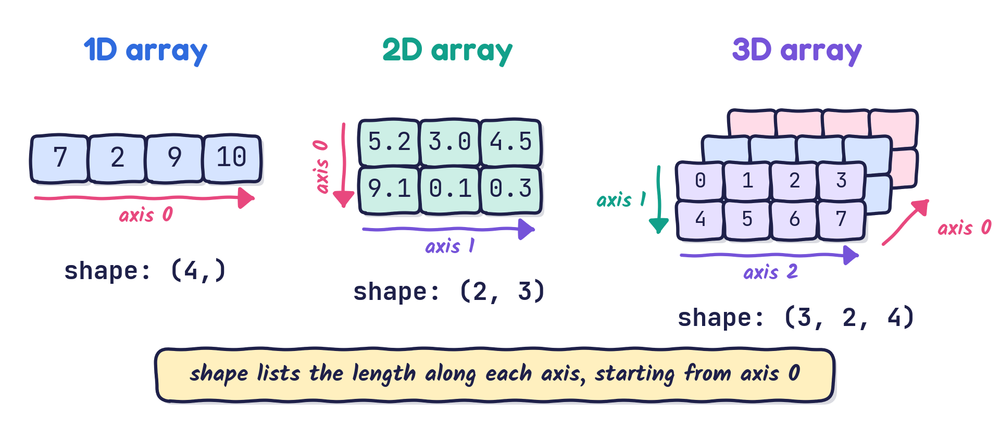{fig-align="center" width="84%"}

## Why NumPy instead of Python lists?

- Fast and efficient ways of creating arrays
- Homogeneous data (`ndarray`) versus heterogeneous data (`list`)
- Many built-in mathematical and linear-algebra operations
- **Faster**: much shorter running times
- **More compact**: shorter code that looks like the maths
- **Less memory**
- ... and much more

## Easy in NumPy, painful with lists {.compact}

- Dot product of two vectors; matrix–vector multiplication
$$
\mathbf{a}=(1, 2, 3), \quad \mathbf{b} = (4, 5, 6)\quad\Rightarrow\quad \mathbf{a}\cdot \mathbf{b} = 1\cdot 4 + 2\cdot 5 + 3 \cdot 6 = ?
\qquad
\mathbf{A}= \begin{bmatrix} 1 & 2 \\ 3 & 4 \end{bmatrix}, \quad \mathbf{b} = \begin{bmatrix} 5 \\ 6 \end{bmatrix} \quad\Rightarrow\quad \mathbf{A}\mathbf{b} = ?
$$
- Sums of a series, with or without weights
$$
\mathbf{q} = \bigg(1, \frac{1}{2}, \frac{1}{3}, \frac{1}{4}, \cdots, \frac{1}{100}\bigg) \quad\Rightarrow\quad
\sigma = \sum\limits_{i=1}^{100} q_i = ?, \qquad
\gamma = \sum\limits_{i=1}^{50}\frac{q_{2i-1}^2}{(2i + 1)^2} = ?
$$
- Extracting the numbers that satisfy a condition
$$
\mathbf{r} = (1, 2, \cdots, 10, 9, 8, \cdots, 3) \quad\Rightarrow\quad \big\{r_i \;|\; 3 < r_i < 8 \big\} = ?
$$

We will answer all of these with NumPy by the end of the lecture.

## Accessing elements: `ndarray` versus `list`

- Accessing elements of a NumPy array is **not** quite like accessing elements of a list.
- NumPy offers more, and more convenient, ways:
    1. indexing by a tuple of integers, e.g. `a[1, 2]`
    2. indexing by booleans (`True` keeps an element, `False` drops it)
    3. slicing, as with Python lists

:::: {.columns}
::: {.column width="50%"}
NumPy `ndarray`

```python
a = np.array([[1, 2, 3], [4, 5, 6]])
print(a[1, 2])      # OK
print(a[[0, 1]])    # OK
print(a[a > 3])     # OK
```
:::

::: {.column width="50%"}
Python `list`

```python
a = [[1, 2, 3], [4, 5, 6]]
print(a[1, 2])      # error
print(a[[0, 1]])    # error
print(a[a > 3])     # error
```
:::
::::

## How to learn NumPy

- In the end, NumPy is a programming library.
- Learning one is like learning a spoken language, only much easier!

{fig-align="center" width="92%"}

Learn the **syntax**, then **examples**, **examples**, **examples**, then **practise on your own problem**.

## How to learn NumPy: read the documentation

Search for "numpy array" or "create array in numpy" and you land here:

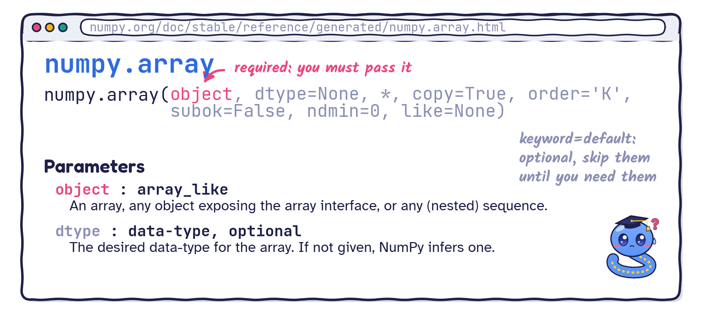{fig-align="center" width="90%"}

## How to learn NumPy: copy the examples

Scroll down to the examples, then run and modify them:

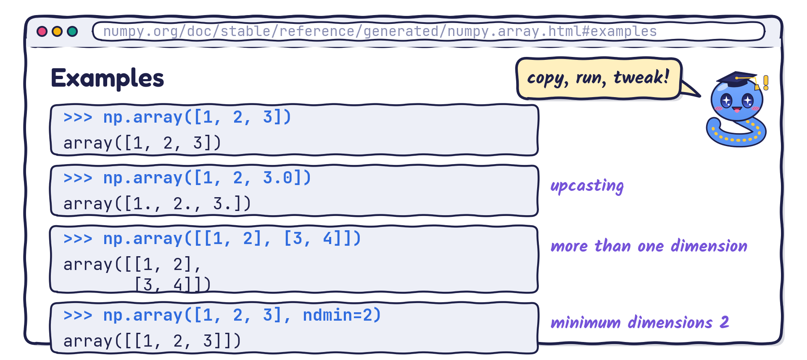{fig-align="center" width="90%"}

# Creating arrays {background-image="theme/section-bg.svg"}

## Functions that create arrays {.compact}

- Create an array from a list (or any sequence)
```python
numpy.array(object, dtype=None, *, copy=True, order='K', subok=False, ndmin=0, like=None)
```
- Arrays of zeros or ones
```python
numpy.zeros(shape, dtype=float, ...)       numpy.ones(shape, dtype=None, ...)
```
- A range (like the built-in `range`, but the step can be a float)
```python
numpy.arange([start, ]stop, [step, ]dtype=None, ...)
```
- Evenly spaced numbers over an interval
```python
numpy.linspace(start, stop, num=50, endpoint=True, ...)
```

## Reading a function signature

```python
numpy.array(object, dtype=None, *, copy=True, order='K', subok=False, ndmin=0, like=None)
```

> - Arguments written `keyword=value` have default values: you do not need to memorise them. Your editor suggests them when you need them.
> - You only need to remember the **required** arguments (the ones without a default).
> - Recall the functions lecture: everything after `*` must be passed **by keyword**.

## Creating arrays: example

```{python}
#| output-location: column
import numpy as np
a1 = np.array([1, 2, 3])
a2 = np.zeros((2, 3))
a3 = np.ones((2, 3))
a4 = np.arange(0.5, 1.5, 0.2)
a5 = np.linspace(0.5, 1.5, 6)
print(f"a1 = {a1}")
print(f"a2 = \n{a2}")
print(f"a3 = \n{a3}")
print(f"a4 = {a4}")
print(f"a5 = {a5}")
a5      # developer-friendly representation: repr(a5)
```

**Tip**: with a float step, prefer `linspace`: you control exactly how many points you get.

# Indexing, slicing and shape {background-image="theme/section-bg.svg"}

## Indexing and slicing: list versus `ndarray` {.compact}

Indexing and slicing NumPy arrays versus Python lists: **same same, but different**.

:::: {.columns}
::: {.column width="50%"}
Python `list`

```{python}
a = [0, 1, 2, 3, 4, 5]
print(a[1:4])   # [1, 2, 3]
print(a[1::2])  # [1, 3, 5]
print(a[::-1])  # reversed
print(a[-1])    # last element
```

```python
A = [[0, 1, 2], [3, 4, 5], [6, 7, 8]]
A[0][1]     # 1
A[0]        # first row: row 0
A[0:2]      # rows 0 and 1
A[[0, 2]]   # ERROR
# columns need a list comprehension
```
:::

::: {.column width="50%"}
NumPy `ndarray`

```{python}
a = np.arange(6)
print(a[1:4])   # [1 2 3]
print(a[1::2])  # [1 3 5]
print(a[::-1])  # reversed
print(a[-1])    # last element
```
:::
::::

## Indexing 2D arrays

```{python}
A = np.array([[0, 1, 2],
              [3, 4, 5],
              [6, 7, 8]])
print(A[0, 1])          # row 0, column 1
print(A[0, :])          # first row: row 0
print(A[0:2, :])        # rows 0 and 1
print(A[[0, 2], :])     # rows 0 and 2
print(A[:, 0])          # first column: column 0
print(A[:, 0:2])        # columns 0 and 1
```

## Indexing 2D arrays: the picture

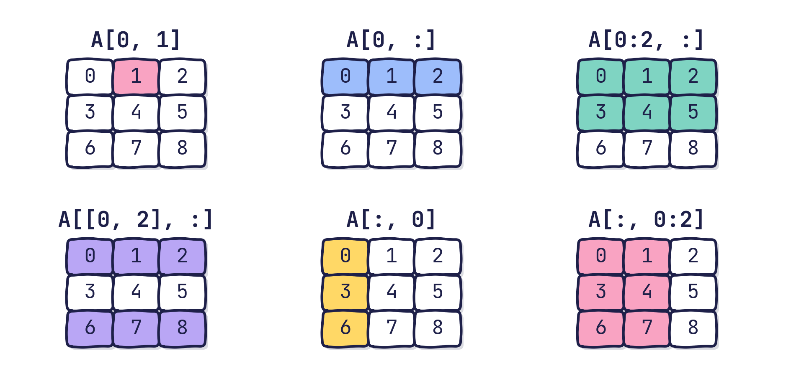{fig-align="center" width="86%"}

## Boolean indexing (masks)

A comparison produces an array of `True`/`False`; using it as an index keeps only the `True` positions.

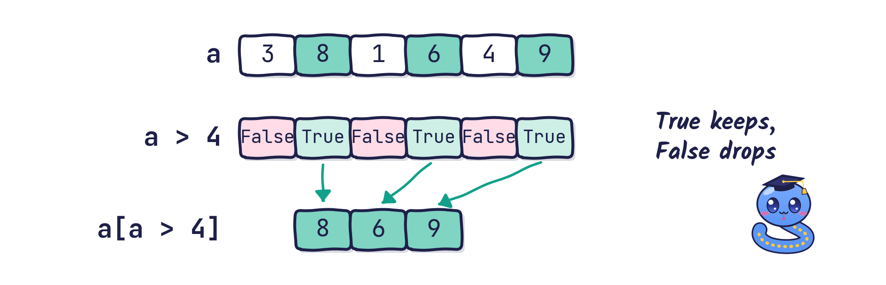{fig-align="center" width="72%"}

```{python}
a = np.array([3, 8, 1, 6, 4, 9])
print(a > 4)                         # the mask
print(a[a > 4])                      # keep where True
print(a[(a > 2) & (a < 7)])          # combine conditions with & (and) or | (or)
```

## Boolean indexing: test yourself

```python
a = np.arange(10)
print(a[a % 3 == 0])
```

::: {.question}
What does this print?
:::

::: {.answer .fragment}
`[0 3 6 9]`: the mask is `True` wherever the remainder after dividing by 3 is zero.
:::

## Dimension, shape, size

- An `ndarray` object has many attributes (properties).
- Among them, dimension, shape and size are the ones you will use most.
- Knowing the data type of the elements is sometimes helpful too.

Useful attributes:

- `ndarray.ndim`: number of array dimensions (axes)
- `ndarray.shape`: tuple of array dimensions
- `ndarray.size`: number of elements (equals `np.prod(a.shape)`, the product of the dimensions)
- `ndarray.dtype`: data type of the elements

## Dimension, shape, size: example

:::: {.columns}
::: {.column width="50%"}
```{python}
array2d = np.array([[1, 2, 3],
                    [4, 5, 6]])

print(f"ndim  = {array2d.ndim}")
print(f"shape = {array2d.shape}")
print(f"size  = {array2d.size}")
print(f"dtype = {array2d.dtype}")
```
:::

::: {.column width="50%"}
```{python}
array3d = np.array([[[0, 1, 2, 3],
                     [4, 5, 6, 7]],

                    [[0, 1, 2, 3],
                     [4, 5, 6, 7]],

                    [[0, 1, 2, 3],
                     [4, 5, 6, 7]]])
print(f"ndim  = {array3d.ndim}")
print(f"size  = {array3d.size}")
print(f"shape = {array3d.shape}")
```
:::
::::

## Changing the shape of an array

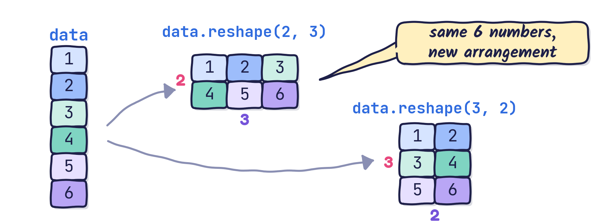{fig-align="center" width="92%"}

## Changing the shape of an array

- Methods of an `ndarray` object:
    - `ndarray.reshape(shape)`: give a new shape without changing the data
    - `ndarray.ravel()`: return a flattened (1D) array, sharing data when possible
    - `ndarray.flatten()`: return a flattened **copy**
- NumPy also has functions that take the array as input and do the same:
    - `np.reshape(a, shape)`, `np.ravel(a)`
- **Tip**: one dimension may be `-1`, meaning "work it out for me".

**What to remember**: NumPy `reshape` / `ravel` / `flatten` + the documentation.

## Changing the shape: example

:::: {.columns}
::: {.column width="50%"}
```{python}
a1 = np.arange(6).reshape(2, 3)
b1 = np.reshape(np.arange(6), (2, 3))
a2 = a1.flatten()
b2 = np.ravel(b1)
print(f"a1 =\n{a1}")
print(f"b1 =\n{b1}")
print(f"a2 = {a2}")
print(f"b2 = {b2}")
```
:::

::: {.column width="50%"}
```{python}
A2d = np.arange(12).reshape((3, 4))
A3d = A2d.reshape((3, 2, 2))
print(f"A2d =\n{A2d}")
print(f"A3d =\n{A3d}")
```
:::
::::

## Reshaping: test yourself

```python
print(np.arange(12).reshape(3, -1).shape)
print(np.arange(12).reshape(-1, 6).shape)
```

::: {.question}
What shapes are printed?
:::

::: {.answer .fragment}
`(3, 4)` and `(2, 6)`: with 12 elements, NumPy fills in the `-1` so that the sizes multiply to 12.
:::

## Transpose

Particularly useful in computations:

- the transpose of a matrix, or even of a higher-dimensional array
- after all, a matrix is just a two-dimensional array

Syntax:

- `numpy.transpose(a, axes=None)`: returns a view of the array with its axes permuted. `axes` is an optional tuple or list of integers.
- `ndarray.transpose(*axes)`: the same, as a method. `a.T` is a shortcut for the full transpose.

## Transpose: example

```{python}
#| output-location: column
a = np.array([[1, 2],
              [3, 4]])
b1 = a.transpose()
b2 = a.transpose((1, 0))
b3 = a.transpose(1, 0)
print(f"a =\n{a}")
print(f"b1 =\n{b1}")
print(f"b2 =\n{b2}")
print(f"b3 =\n{b3}")
```

## Transpose of a 3D array {.compact}

```{python}
a = np.array([[[1, 2], [3, 4]],
              [[1, 0], [0, 1]]])
print(a.shape)
print(a)
```

```{python}
#| output-location: column
print(a[0]); print(15 * "-"); print(a[1])
print(a[0, 1, :])   # second row of the first matrix
print(a[0, :, 1])   # second column of the first matrix
```

## Transpose of a 3D array {.compact}

```{python}
# This does NOT swap the two blocks: it transposes each block!
b = a.transpose((0, 2, 1))
print(b)
```

```{python}
# What truly happens
c = np.zeros(shape=(2, 2, 2))    # float array
for i in range(2):
    for j in range(2):
        for k in range(2):
            c[i, j, k] = a[i, k, j]
print(c)
```

## Transpose: questions

```{python}
rng = np.random.default_rng(42)
a = rng.random((2, 3, 4, 5))      # array of shape 2 x 3 x 4 x 5
b = a.transpose((0, 1, 2, 3))
c = a.transpose((3, 2, 1, 0))
```

::: {.question}
- What is the shape of `b`, i.e. `b.shape`?
- What is the shape of `c`, i.e. `c.shape`?
:::

::: {.fragment}
```{python}
print(b.shape)
```
:::

::: {.fragment}
```{python}
print(c.shape)
```
:::

# Doing maths with NumPy {background-image="theme/section-bg.svg"}

## Basic operations

Arithmetic operators such as `+`, `-`, `*`, `/` act **element by element**:

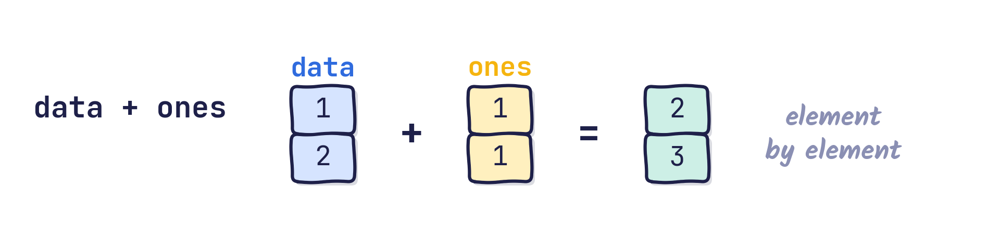{fig-align="center" width="58%"}

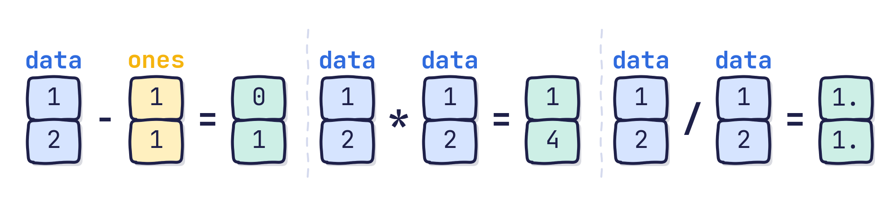{fig-align="center" width="86%"}

## Arrays and numbers: broadcasting

An operation between an array and a single number applies the number to **every** element:

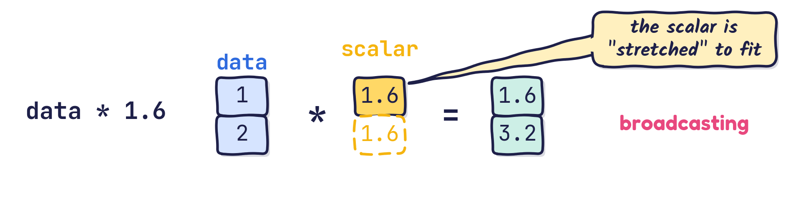{fig-align="center" width="78%"}

```{python}
data = np.array([1, 2])
print(data * 1.6)
```

::: {.question .fragment}
What does `np.array([1, 2, 3]) * 2 + 1` give?
:::

::: {.answer .fragment}
`[3 5 7]`: every element is doubled, then 1 is added to every element.
:::

## Basic operations on matrices

Element-by-element arithmetic works for $n$-dimensional arrays too:

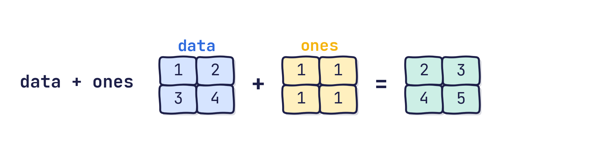{fig-align="center" width="82%"}

```{python}
data = np.array([[1, 2], [3, 4]])
ones = np.ones((2, 2))
print(data + ones)
```

## Aggregation {.compact}

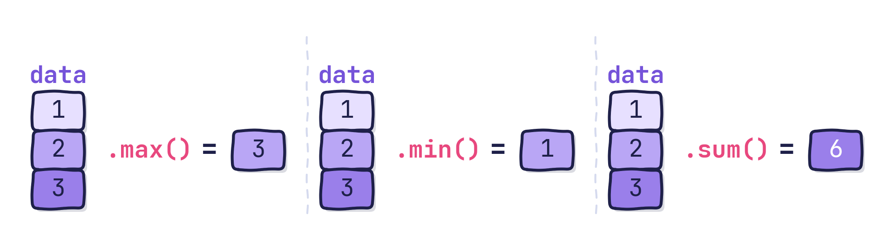{fig-align="center" width="58%"}

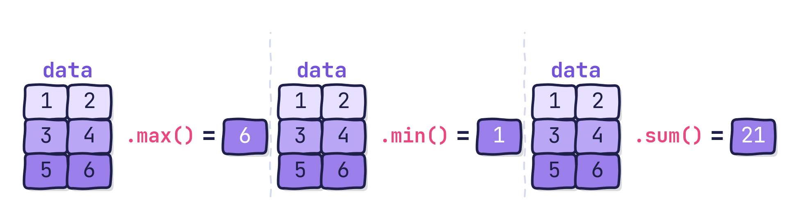{fig-align="center" width="58%"}

The same operations exist as NumPy functions: `np.max(data)`, `np.min(data)`, `np.sum(data)`.

## `axis`: an important concept

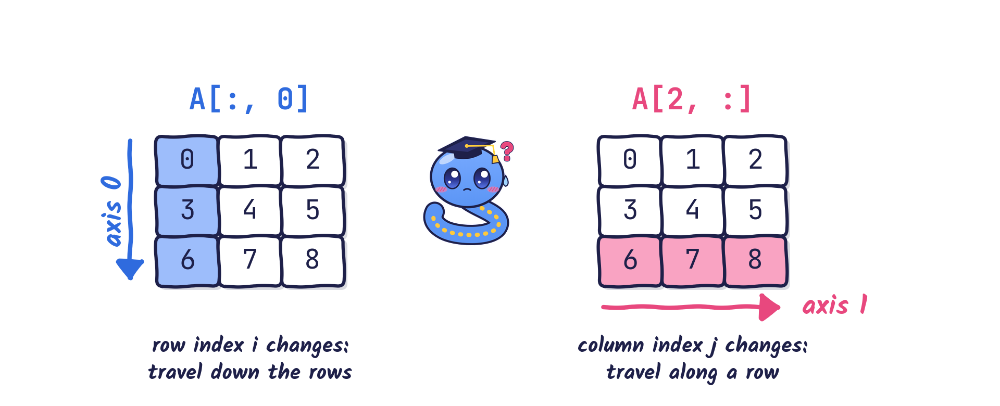{fig-align="center" width="94%"}

## Aggregation along a specific `axis`

```python
ndarray.max(axis=None, out=None, keepdims=False, initial=<no value>, where=True)
ndarray.min(axis=None, out=None, keepdims=False, initial=<no value>, where=True)
ndarray.sum(axis=None, dtype=None, out=None, keepdims=False, initial=0, where=True)
```

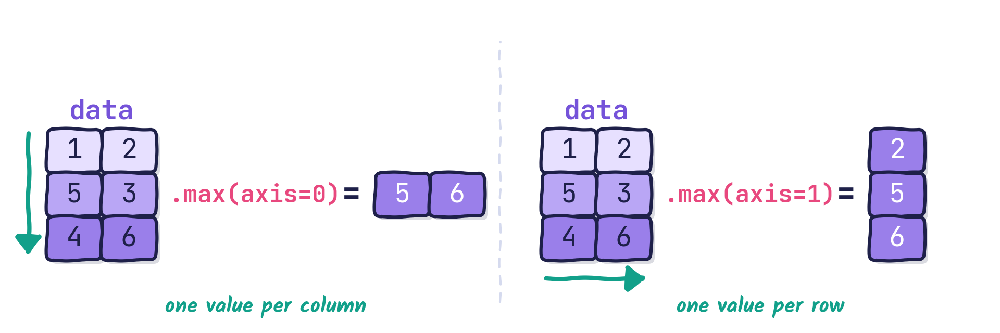{fig-align="center" width="86%"}

*What to remember*: `ndarray.max()` / `.min()` / `.sum()` + the documentation. *What to understand*: the `axis` keyword argument.

## `axis`: a small challenge

```{python}
A = np.arange(12).reshape((3, 4))
print(A)
```

::: {.question}
What are the results of `A.sum(axis=0)` and `A.sum(axis=1)`?
:::

::: {.fragment}
```{python}
print(A.sum(axis=0))
print(A.sum(axis=1))
```
:::

## `axis`: the maths behind it {.compact}

For $\mathbf{A} = \begin{bmatrix} 0 & 1 & 2 & 3 \\ 4 & 5 & 6 & 7 \\ 8 & 9 & 10 & 11 \end{bmatrix}$, `A.sum(axis=0)` adds down each column (the row index changes):

$$
\sum\limits_{k=1}^{3}{A_{k \diamond}} = \begin{bmatrix}
\underbrace{0 + 4 + 8}_{12} & \underbrace{1 + 5 + 9}_{15} & \underbrace{2 + 6 + 10}_{18} & \underbrace{3 + 7 + 11}_{21} \end{bmatrix}
=\begin{bmatrix} 12 & 15 & 18 & 21 \end{bmatrix}
$$

`A.sum(axis=1)` adds along each row (the column index changes):

$$
\sum\limits_{k=1}^{4}{A_{\diamond k}} = \begin{bmatrix}
0 + 1 + 2 + 3 \\ 4 + 5 + 6 + 7 \\ 8 + 9 + 10 + 11 \end{bmatrix}
= \begin{bmatrix} 6 \\ 22 \\ 38 \end{bmatrix}
$$

# Linear algebra {background-image="theme/section-bg.svg"}

## Linear algebra with Python lists

Objectives: the dot product of two vectors, and the product of two matrices. With Python lists, both are **cumbersome**:

:::: {.columns}
::: {.column width="45%"}
```{python}
a = list(range(1, 100, 1))
b = list(range(1, 199, 2))
total = 0         # not "sum": that is a built-in function
for i in range(len(a)):
    total += a[i] * b[i]
print(total)
```
:::

::: {.column width="55%"}
```{python}
A = [[1, 2, 3], [4, 5, 6], [7, 8, 9]]
B = [[1, 2], [3, 4], [5, 6]]
C = []
mC, nC, nA = 3, 2, 3
for i in range(mC):
    C_row = []
    for j in range(nC):
        total = 0
        for k in range(nA):
            total += A[i][k] * B[k][j]
        C_row.append(total)
    C.append(C_row)
print(C)
```
:::
::::

## Dot product of two vectors

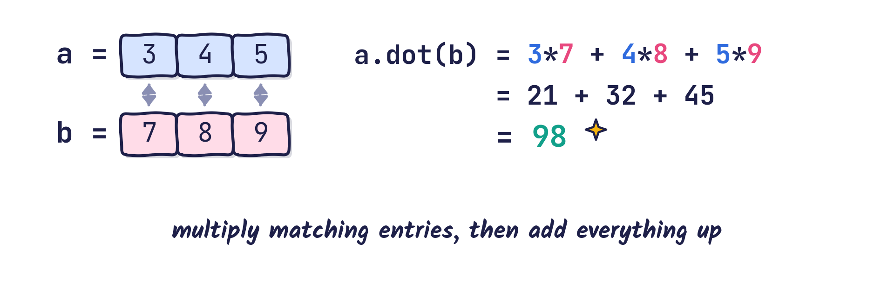{fig-align="center" width="74%"}

Official syntax: `ndarray.dot(b)` or `numpy.dot(a, b)`

```{python}
a = np.array([3, 4, 5])
b = np.array([7, 8, 9])
print(a.dot(b))         # method
print(np.dot(a, b))     # function: either is fine
```

## Matrix multiplication

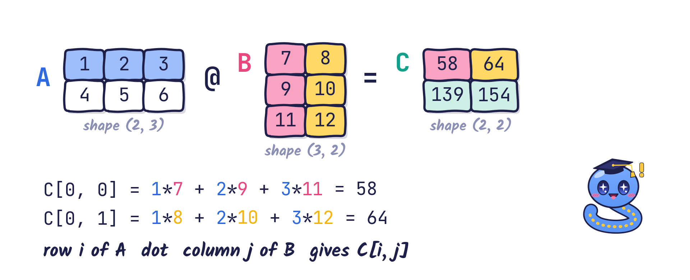{fig-align="center" width="82%"}

The **last axis** of $\mathbf{A}$ is combined, by a dot product, with the **second-to-last axis** of $\mathbf{B}$:
$$
C_{ij} = \sum\limits_{k=1}^{N} A_{ik} B_{kj} = \texttt{A[i, :].dot(B[:, j])}
$$

## Matrix multiplication in code {.compact}

```{python}
# What happens inside, written out (not necessary in practice)
A = np.array([[1, 2, 3], [4, 5, 6]])
B = np.array([[7, 8], [9, 10], [11, 12]])
C = np.zeros((2, 2))
for i in range(A.shape[0]):
    for j in range(B.shape[1]):
        C[i, j] = A[i, :].dot(B[:, j])
print(C)
```

```{python}
# Use this instead!
C = A.dot(B)          # or
C = np.dot(A, B)      # or
C = A @ B             # or
C = np.matmul(A, B)
print(C)
```

# Working with formulas: mean squared error {background-image="theme/section-bg.svg"}

## Mean squared error

In machine learning, error estimation and engineering, we often need the **mean squared error**:

$$
\mathrm{MSE} = \frac{1}{n}\sum\limits_{j=1}^{n}\big(y_{j}^\text{prediction} - y_{j}^{\text{label}} \big)^2
$$

- Assume we have two 1D arrays, `ypred` and `ylabel`.
- Then **one line** of code computes the MSE, and the code looks almost like the formula itself:

```python
mse = 1/n * np.sum(np.square(ypred - ylabel))
```

## Mean squared error, step by step

$$
\mathrm{MSE} = \frac{1}{n}\sum\limits_{j=1}^{n}\big(y_{j}^\text{prediction} - y_{j}^{\text{label}} \big)^2
$$

- Step 1 $\longrightarrow$ `ypred - ylabel`
- Step 2 $\longrightarrow$ `(ypred - ylabel) ** 2`
- Step 3 $\longrightarrow$ `np.sum((ypred - ylabel) ** 2)`
- Step 4 $\longrightarrow$ `1/n * np.sum((ypred - ylabel) ** 2)`

All in all, using `np.square` instead of `** 2`:

```python
mse = 1 / ypred.shape[0] * np.sum(np.square(ypred - ylabel))
```

## Mean squared error: example {.compact}

- With a `for` loop:

```{python}
ypred = np.array([1, 1, 1])
ylabel = np.array([1, 2, 3])
mse = 0
for i in range(ypred.shape[0]):
    mse += (ypred[i] - ylabel[i]) ** 2
mse /= ypred.shape[0]
print(mse)
```

- With the power of NumPy:

```{python}
mse = 1 / ypred.shape[0] * np.sum(np.square(ypred - ylabel)); print(mse)
mse = np.mean((ypred - ylabel) ** 2); print(mse)     # shortest of all
```

## Mean squared error: the picture

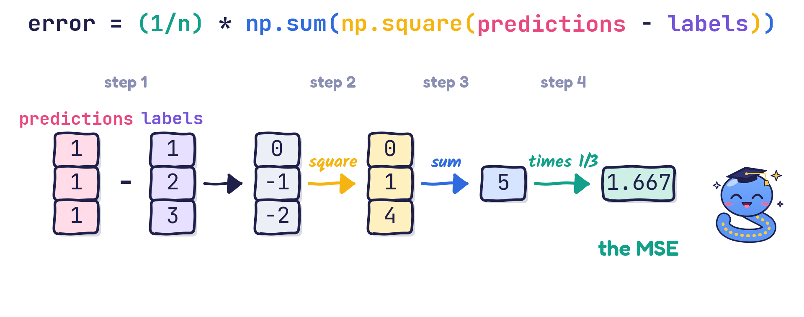{fig-align="center" width="100%"}

## Back to the warm-up problems

```{python}
a, b = np.array([1, 2, 3]), np.array([4, 5, 6])
A, v = np.array([[1, 2], [3, 4]]), np.array([5, 6])
print("a . b =", a.dot(b), "   A b =", A @ v)

q = 1 / np.arange(1, 101)                      # q_i = 1/i for i = 1..100
i = np.arange(1, 51)
sigma = q.sum()
gamma = np.sum(q[2 * i - 2] ** 2 / (2 * i + 1) ** 2)   # q_{2i-1}: index 2i-2 from 0
print(f"sigma = {sigma:.4f},   gamma = {gamma:.4f}")

r = np.concatenate([np.arange(1, 11), np.arange(9, 2, -1)])
print("r =", r)
print("3 < r < 8:", r[(r > 3) & (r < 8)])
```

## Key takeaways

- An `ndarray` holds **homogeneous** data on a grid; `shape` gives its length along each **axis**.
- Create arrays with `np.array`, `np.zeros`, `np.ones`, `np.arange`, `np.linspace`; change their shape with `reshape` and `transpose`.
- Index with integers, slices and **boolean masks**.
- Arithmetic is **element by element**, and numbers **broadcast** to every element.
- Aggregations (`sum`, `max`, `min`, `mean`) work on the whole array or along an `axis`.
- `a.dot(b)` and `A @ B` do linear algebra; formulas such as the MSE become one line of code.
