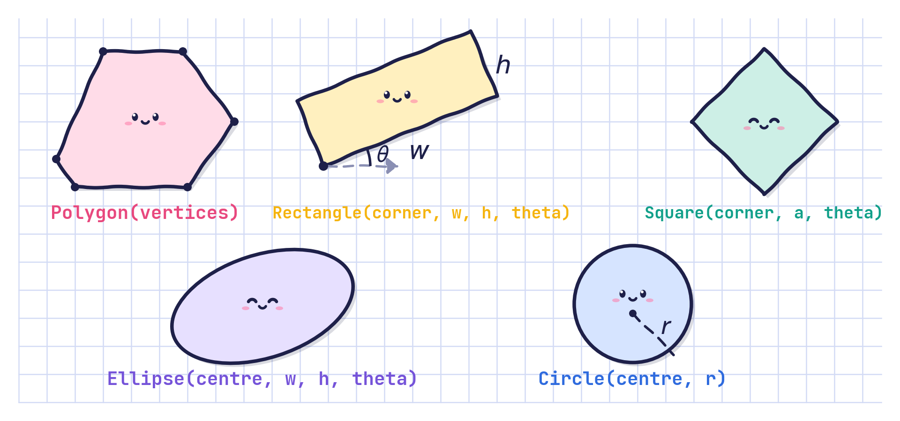
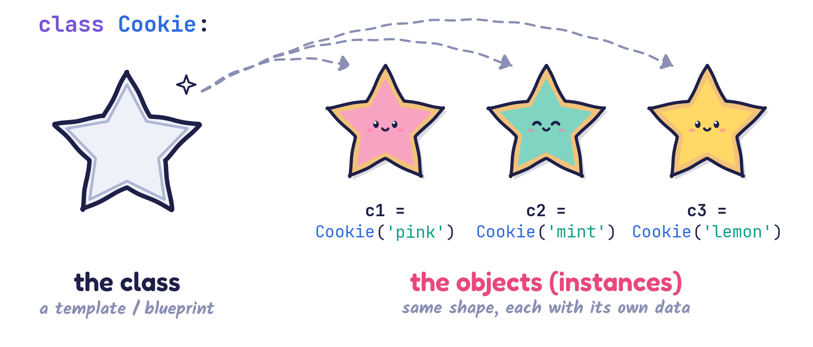
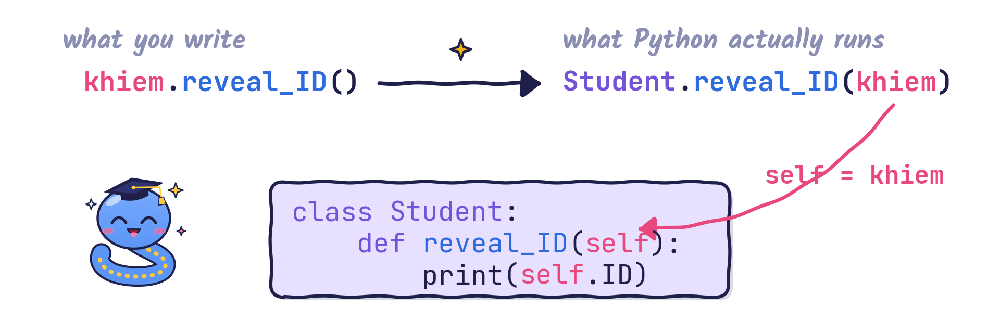
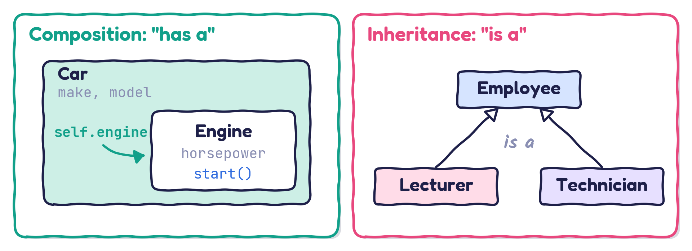
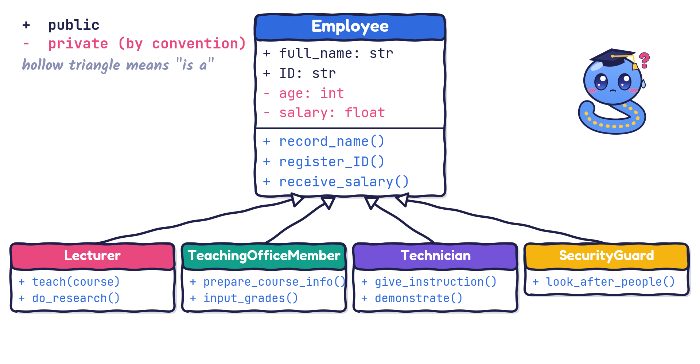
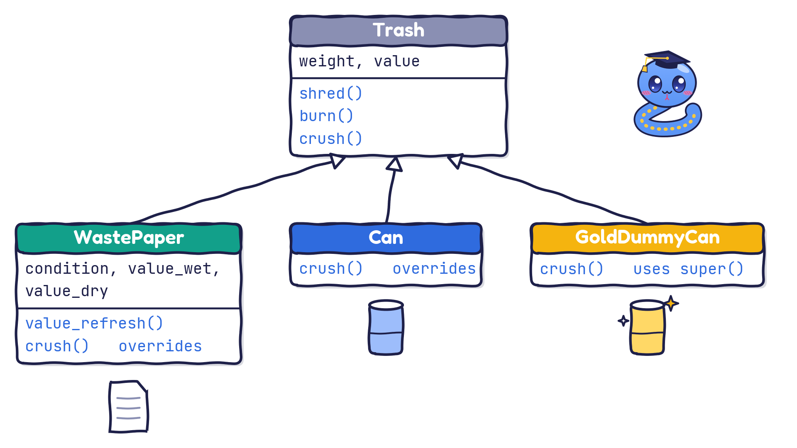

# OOP: principles and rationale {background-image="theme/section-bg.svg"}

## What is OOP?

> **Object-oriented programming** (OOP) is a programming paradigm that organises software around **objects**, which are instances of **classes**. Objects bundle **data** (attributes) with **behaviour** (methods), which makes it easier to model real-world entities in code.

{fig-align="center" width="70%"}

## Four core principles of OOP {.compact}

:::: {.columns}
::: {.column width="50%"}
1. [**Encapsulation**]{.pink}
    - Bundle data and the methods that work on it into a single unit: a class.
    - Control access to the internal state through a public interface.
2. [**Inheritance**]{.pink}
    - Let a class inherit attributes and behaviour from another class.
    - Promotes code reuse and hierarchies.
:::

::: {.column width="50%"}
3. [**Polymorphism**]{.pink}
    - Treat objects of different classes through a common interface.
    - Example: `Circle` and `Square` both provide `draw()`.
4. [**Abstraction**]{.pink}
    - Hide complex implementation details.
    - Expose only the essential features.
:::
::::

## Why do we need OOP?

- [**Modularity**]{.pink}: code is organised into classes, which makes it easier to maintain and debug.
- [**Reusability**]{.pink}: inheritance and polymorphism let you reuse existing code.
- [**Scalability**]{.pink}: large systems are easier to manage because functionality is grouped logically.
- [**Maintainability**]{.pink}: changes in one part of the system have minimal impact on the others.
- [**Real-world modelling**]{.pink}: classes map naturally onto real-world entities, so the design feels intuitive.

## Procedural programming

- **Definition**: a programming paradigm based on procedures (functions) and the sequential execution of instructions.
- **Structure**: code is organised into functions that operate on data, but data and behaviour are kept separate.
- **Examples**: C, Pascal, early Python scripts, MATLAB (MATLAB supports OOP, but it is not widely used there).

## Procedural programming versus OOP

[**Procedural programming**]{.pink}

| **Pros** | **Cons** |
|:---------|:---------|
| Simple and easy to learn for small programs | Harder to maintain as the code grows ("spaghetti code") |
| Good for linear, algorithmic tasks | Poor modelling of real-world entities |
| Less overhead than OOP for small projects | Limited reuse; copy-and-paste duplication is common |
| | Changing a data structure often means changing many functions |

## Procedural programming versus OOP

[**Object-oriented programming**]{.pink}

| **Pros** | **Cons** |
|:---------|:---------|
| *Encapsulation*: data and methods together, improving *modularity* | More complex for beginners |
| *Reusability*: inheritance and polymorphism reduce duplication | Slightly more overhead (memory and design time) |
| *Maintainability*: easier to update and extend large systems | Can lead to over-engineering for simple tasks |
| *Real-world modelling*: classes map naturally to entities | |

::: {.fragment}
::: {.keybox}
**Key difference.** *Procedural* code focuses on functions acting on data. *OOP* focuses on objects that hold both data and behaviour.
:::
:::

## We have used objects all along

**Strings** and **lists** are objects with their own methods and operators:

```{python}
sep = '--'
t = 'Mechanical', 'Engineering', 'Skills', '3'
sep.join(t)          # join() is a method of the string object sep
```

```{python}
a = [i for i in range(4)]
b = [4 - i for i in range(4)]
print(f"a + b = {a + b}")
```

## Objects everywhere: matplotlib

**Figure** and **Axes** objects:

```{python}
#| fig-align: center
import matplotlib.pyplot as plt
fig = plt.figure(figsize=(5, 2.6))   # creates a Figure object
print(type(fig))                     # <class 'matplotlib.figure.Figure'>
ax = fig.add_subplot(111)            # adds an Axes object to the figure
ax.plot([1, 2, 3], [4, 5, 6])
plt.show()
```

## Objects everywhere: NumPy

Many Python libraries are written in the OOP paradigm. **NumPy arrays** are objects:

```{python}
import numpy as np
a = np.array([1, 2, 3, 4])
b = np.array([4, 3, 2, 1])
print(type(a))
print(f"a + b = {a + b}")
```

## Objects everywhere: scikit-learn

**Linear regression models** are objects too:

```{python}
from sklearn.linear_model import LinearRegression
import numpy as np
model = LinearRegression()                    # create a LinearRegression object
X = np.array([[1], [2], [3], [4], [5]])       # features
y = np.array([2, 4, 6, 8, 10])                # targets
model.fit(X, y)                               # fit the model to the data
predictions = model.predict(np.array([[1.5], [2.5]]))
print(type(model))
print(type(predictions))
print(predictions)
```

## Objects everywhere: shapes

**Circle** and **Rectangle** from `matplotlib.patches`:

```{python}
#| fig-align: center
import matplotlib.pyplot as plt
from matplotlib.patches import Circle, Rectangle
fig, ax = plt.subplots(figsize=(3, 3))
circle = Circle((0.5, 0.5), 0.3, color='skyblue', alpha=0.7)
ax.add_patch(circle)
rect = Rectangle((0.1, 0.1), 0.3, 0.2, color='orange', alpha=0.8)
ax.add_patch(rect)
plt.show()
```

## Why OOP: a practical point of view

Last but not least, you will meet OOP all the time in advanced courses:

- [**ENG3091**]{.pink} Advanced Programming and Software Engineering
- [**ENG4200**]{.pink} Introduction to Artificial Intelligence and Machine Learning
- [**ENG5337**]{.pink} Advanced Artificial Intelligence and Machine Learning

# Classes and objects {background-image="theme/section-bg.svg"}

## Concept: class versus object

{fig-align="center" width="96%"}

## Syntax: class definition

```python
class ClassName:
    <statement-1>
    .
    .
    .
    <statement-N>
```

> A **class** is defined by the keyword `class` followed by the name of the class. Note the colon `:` and the indentation.

The statements inside a class can

- define variables
- define functions (called **methods**)
- implement anything else you need

## A gentle introduction

A template for a **Circle**:

```{python}
class Circle:                               # <- class name

    def __init__(self, center_outside, radius_outside):   # constructor
        self.center = center_outside        # <- data, local to each object
        self.radius = radius_outside        # <- data, local to each object

    def draw(self):                         # <- method
        print("Drawing is done")            # the plotting would happen here

    def show_data(self):                    # <- method
        print(f"Circle: center={self.center}, radius={self.radius}")
```

## Creating and using a Circle

```{python}
class Circle:
    def __init__(self, center_outside, radius_outside):   # constructor
        self.center = center_outside
        self.radius = radius_outside
    def draw(self):
        print("Drawing is done")
    def show_data(self):
        print(f"Circle: center={self.center}, radius={self.radius}")
```

A **Circle** can now be created and used:

```{python}
c = Circle(center_outside=(1, 1), radius_outside=0.5)   # create an object
c.show_data()     # run the method "show_data" of the object c
c.draw()          # run the method "draw" of the object c
```

## Terminology: object, attribute, method

- Each object is "an **instance** of a particular class".
- Variables attached to an object are called [**attributes**]{.pink}, [**members**]{.pink} or [**properties**]{.pink}, depending on the community you talk to.
- Functions attached to an object are called [**methods**]{.pink}.

## About the constructor

```{python}
c = Circle(center_outside=(1, 1), radius_outside=0.5)
c.show_data()
c.draw()
```

::: {.fragment}
What has just happened?

- When `c = Circle((1, 1), 0.5)` runs, Python creates a new `Circle` object and calls its `__init__()` method to fill in the data.
- The new object is then assigned to the variable `c`.
- The variable `c` now refers to an object of type `Circle`.
:::

::: {.fragment}
`__init__(self, ...)` is the **constructor** of the class `Circle`.
:::

## A simple example

```{python}
class SimpleClass:
    class_value = 42                     # class variable

    def __init__(self, value_outside):   # constructor
        self.value = value_outside       # object (instance) variable

    def say_hello(self):                 # method
        print("Hello there!")
```

How to use it:

```{python}
print(SimpleClass.class_value)           # value associated with the class

obj = SimpleClass(24)                    # create an object
print(f"obj.value = {obj.value}")        # value associated with the object
obj.say_hello()                          # the object calls say_hello()
```

## A simple example: further explanation {.compact}

- `value_outside` is just a parameter name.
- `self.value` is data stored **in the object** `self`.
- `value_outside` cannot be confused with `self.value`, even if we rename it to `value`.
- The variable `self` is explained shortly.

::: {.fragment}
So Python happily accepts:

```{python}
class SimpleClass:
    class_value = 42                # class variable
    def __init__(self, value):      # constructor
        self.value = value          # object variable
    def say_hello(self):            # method
        print("Hello there!")
```

> This is the **recommended** way of writing a **constructor**.
:::

## Questions and sweets 🍬 {.compact}

::: {.question}
- How do we write the constructor `__init__()` for the class `Circle` using the recommended practice?
- How can we write methods that set the center and the radius to new values?
:::

::: {.fragment}
```{python}
class Circle:
    def __init__(self, center, radius):     # constructor
        self.center = center
        self.radius = radius

    def set_center(self, center):
        self.center = center

    def set_radius(self, radius):
        self.radius = radius
```

> Remember: the first argument of every method is `self`.
:::

## Calling a method through the class

```{python}
class SimpleClass:
    class_value = 42
    def __init__(self, value):
        self.value = value
    def say_hello(self):
        print("Hello there!")
obj = SimpleClass(24)
```

::: {.fragment}
A simple interpretation of `say_hello()`:

```{python}
obj.say_hello()                  # this works
SimpleClass.say_hello(obj)       # this works too: we pass the object ourselves
try:
    SimpleClass.say_hello()      # no object given: error!
except TypeError as err:
    print("TypeError:", err)
```
:::

## Interpreting the `self` variable {.compact}

```{python}
class Student:
    def __init__(self, ID):
        self.ID = ID
    def do_job(self):
        print("I am studying")
    def reveal_ID(self):
        print(self.ID)
```

::: {.fragment}
Create an object:

```{python}
khiem = Student(3040787)
print(khiem.ID)             # print the ID through the object variable
khiem.reveal_ID()           # print the ID through a method call
Student.reveal_ID(khiem)    # this gives the same result
```
:::

::: {.fragment}
> Inside the class, no object exists yet: `self` stands for "whichever object this method is called on".
:::

## How `self` gets filled in

{fig-align="center" width="96%"}

- `self` is an ordinary first parameter; Python passes the object for you.
- `__init__(self, ID)` is just a method too.

## Interpreting `self`: questions

```{python}
stuart = Student(3000000)   # create Stuart
stuart.reveal_ID()          # show his ID
```

::: {.question .fragment}
- How do we change his ID?
- How do we reveal his ID using the class name instead of the object?
:::

## Interpreting `self`: solutions {.compact}

::: {.question}
- How do we change his ID?
- How do we reveal his ID using the class name instead of the object?
:::

::: {.fragment}
```{python}
stuart.ID = 3456789         # change the object variable directly
stuart.reveal_ID()
```
:::

::: {.fragment}
```{python}
stuart.__init__(9876543)    # we've just changed Stuart's ID
Student.reveal_ID(stuart)   # reveal the ID using the class name
```
:::

::: {.fragment}
```{python}
Student.__init__(stuart, 1234567)   # works, but not recommended
stuart.reveal_ID()
```
:::

## `self` is just a name

Recall that in

```{python}
def do_useless(*args, **kwargs):
    """args and kwargs can take different names."""
    print(args, kwargs)

do_useless(1, 2, 3, one=1, two=2, three=3)
```

`args` and `kwargs` could have any other names:

```{python}
def do_useless(*stuffs, **things):
    """Works exactly as above, with different argument names."""
    print(stuffs, things)

do_useless(1, 2, 3, one=1, two=2, three=3)
```

## `self` is just a name

In the same way, `self` is simply the first parameter of every method in a class, and it could have another name:

```{python}
class Student:
    def __init__(this, ID):     # "this" is the first argument
        this.ID = ID
    def reveal_ID(that):        # "that" is the first argument
        print(that.ID)
    def do_job(self):           # you can even mix the names
        print(f"{self.ID} is studying.")

khiem = Student(42424242)
khiem.do_job()
```

> By convention, **always use `self`**, please!

## Objects with several inputs {.compact}

Objects of more complicated concepts need several inputs to be created:

```{python}
class Complex:
    def __init__(self, real=0, imag=0):
        self.real = real
        self.imag = imag

a, b, c = Complex(0, 0), Complex(), Complex(0, 1)
```

::: {.question}
What do `print(a)`, `print(b)` and `print(c)` give us?
:::

::: {.fragment}
```{python}
print(a)
print(b)
print(c)
```
:::

## Showing a complex number

::: {.question}
How do we show the complex number in a human-readable form?
:::

::: {.fragment}
We write a method that displays the number:

```{python}
class Complex:
    def __init__(self, real=0, imag=0):
        self.real = real
        self.imag = imag

    def display(self):
        print(f"{self.real} + {self.imag}i")
```
:::

## Using the `display()` method

::: {.question}
How do we use this method?
:::

::: {.fragment}
```{python}
a = Complex(1, 0)
b = Complex(0, 1)
a.display()
b.display()
```
:::

## Documentation strings {.compact}

We can write docstrings for a class and for its methods:

```{python}
class Car:
    """Model a car."""
    def __init__(self, make, model):
        """The constructor receives the manufacturer and model of the car."""
        self.make = make
        self.model = model
        self.tank_cap = 60    # 60-litre tank
        self.tank = 0         # the tank starts empty

    def fill_up(self):
        """Fill the tank to full."""
        self.tank = self.tank_cap
        print("Fill-up done: full!")

my_car = Car("Nissan", "Micra")
my_car.fill_up()
print(my_car.tank)
```

# Class variables and class methods {background-image="theme/section-bg.svg"}

## Class variables and class methods

- A class can have its own state, and therefore its own attributes and methods.
- A **class variable** is defined in the class and shared by all objects. You do not need an object to use it.
- A **class method** is defined in the class and intended to be used at class level. You can call it without creating an object.

```python
class ClassName:
    class_variable_1 = 0        # any value
    class_variable_2 = 0
    ...

    @classmethod                # marks the next method as a class method
    def class_method(cls):
        <statement-1>
        ...
        <statement-N>
```

## Class variables and class methods: example

```{python}
class Car:
    number_of_cars = 0                      # class variable

    def __init__(self, make, model):
        """The constructor receives the manufacturer and model of the car."""
        Car.number_of_cars += 1             # update the class variable
        self.make = make
        self.model = model
        self.tank_cap = 60
        self.tank = 0

    def fill_up(self):
        self.tank = self.tank_cap

    @classmethod
    def how_many(cls):
        # By convention: 'self' for the object, 'cls' for the class.
        print(f"Number of cars = {cls.number_of_cars}")
```

## Class variables and class methods: usage

```{python}
print(f"Number of cars (class variable) = {Car.number_of_cars}")

my_car = Car("Nissan", "Micra")
print(f"Number of cars = {Car.number_of_cars}")
your_car = Car("Mercedes", "A160")
print(f"Number of cars = {Car.number_of_cars}")
his_car = Car("Mercedes", "A140")
print(f"Number of cars = {Car.number_of_cars}")

print("Finally, we can also ask: ", end="")
Car.how_many()
```

## Factory methods with `@classmethod`

A class method can **create** objects for us:

```{python}
class Pizza:
    def __init__(self, ingredients):
        self.ingredients = ingredients

    @classmethod
    def margherita(cls):
        return cls(["mozzarella", "tomatoes"])
```

::: {.fragment}
```{python}
my_pizza = Pizza(["cheese", "cheese", "cheese", "cheese"])
print(my_pizza.ingredients)

your_pizza = Pizza.margherita()
print(your_pizza.ingredients)
```
:::

## A teaser for next time

::: {.question}
What do you think `print(my_pizza)` and `print(your_pizza)` will show?
:::

::: {.fragment}
```{python}
print(my_pizza)
print(your_pizza)
```

::: {.answer}
Not the ingredients, just the class name and a memory address. Python does not know how to print a `Pizza` yet. **Special methods** (next lecture) will fix this.
:::
:::

# Composition and inheritance {background-image="theme/section-bg.svg"}

## Composition and inheritance {.compact}

- **Composition**
    - Objects can contain other objects as attributes.
    - Composition represents a [**has-a**]{.pink} relationship.
    - *Example*: every student **has** an ID (number), an email (string), and courses and grades (a table).
- **Inheritance**
    - Every language that supports classes also supports [**inheritance**]{.pink}.
    - Inheritance arranges classes in a hierarchy that represents an [**is-a**]{.pink} (is-a-type-of) relationship.
    - *Examples*: a Rectangle is a Polygon, a Circle is an Ellipse, and all of them are Shapes. A PhD student is a Student; a Lecturer is a member of Staff.

We touch on composition briefly and then focus on **inheritance**.

## Composition versus inheritance

{fig-align="center" width="96%"}

## Composition: example

Objects can contain other objects as attributes:

```{python}
class Engine:
    def __init__(self, horsepower):
        self.horsepower = horsepower

    def start(self):
        print(f"Engine with {self.horsepower} HP is starting...")

class Car:
    def __init__(self, make, model, engine):
        self.make = make
        self.model = model
        self.engine = engine    # composition: a Car HAS an Engine

    def start(self):
        print(f"Starting car: {self.make} {self.model}")
        self.engine.start()     # the car delegates to its engine
```

## Composition: usage

```{python}
engine = Engine(horsepower=300)
my_car = Car(make="Toyota", model="Supra", engine=engine)
my_car.start()
```

The car **has an** engine: calling `my_car.start()` also starts `my_car.engine`.

## Inheritance: concept and example {.compact}

*Recall*: **inheritance** arranges classes in a hierarchy that represents an [**is-a-type-of**]{.pink} relationship.

::: {.fragment}
- Consider the following scenario:
    - A lecturer is an employee.
    - A member of the teaching office (MTO) is an employee.
    - A technician is an employee.
    - A security guard is an employee.
:::

::: {.fragment}
- Now think about it a little more:
    - All these people share personal information: full name, age, salary, employee ID, etc.
    - A lecturer teaches and does research. An MTO prepares course information and inputs grades. A technician gives instructions and runs demonstrations. A guard looks after people.
:::

## Inheritance: concept and example {.compact}

**Let's sketch this on the board** (press **B** for the whiteboard).

- The class `Employee` might define the attributes `full_name`, `age`, `salary` and `ID`, and the methods `record_name()`, `register_ID()` and `receive_salary()`.
- The classes `Lecturer`, `TeachingOfficeMember`, `Technician` and `SecurityGuard` can all **inherit** from `Employee`. They then get every attribute and method defined in `Employee`.

> **Principal benefits**
>
> 1. Inheritance allows easy **reuse** of procedures, functions and data definitions.
> 2. New classes can **extend** existing classes.

This mirrors real-world relationships: we model objects that people recognise from real life.

## Inheritance: a UML diagram

{fig-align="center" width="96%"}

## Inheritance: terminology

Suppose that class `A` is a type of class `B`. We say:

- class `A` **inherits from** class `B`
- class `A` is **derived from** class `B`

**Terminology**

- class `A`: **derived class** / **subclass** / **child class**
- class `B`: **base class** / **superclass** / **parent class**

The names explain themselves through the parent–child relationship: the child (subclass) inherits from the parent (superclass).

## Inheritance: syntax

```python
class DerivedClassName(BaseClassName):
    <statement-1>
    .
    .
    .
    <statement-N>
```

> **Remark**
>
> - The name `BaseClassName` must be defined before the derived class is defined.
> - In other words, Python must know the parent before it can create the child.

> **Multiple inheritance**: a class can be derived from several classes. We discuss this later.

## Inheritance: a trash example

:::: {.columns}
::: {.column width="50%"}
::: {.fragment}
- Waste paper is a type of trash.
- A can is a type of trash.
- Trash can be shredded or burnt.
:::

::: {.fragment}
But:

- Waste paper has properties that a can does not have, and vice versa.
- Both can be crushed, but differently: a can needs more effort, using machines.
:::
:::

::: {.column width="50%"}
::: {.fragment}
Later, down the road, we may want to add

- Carton is a type of trash
- Plastic box is a type of trash
- Metal box is a type of trash
- etc.
:::
:::
::::

## The trash hierarchy

{fig-align="center" width="86%"}

## Code: the base class `Trash`

```{python}
class Trash:

    def __init__(self, weight, value):
        """Initialise a Trash instance."""
        self.weight = weight
        self.value = value
        print("Trash constructor: Trash({0}, {1})".format(self.weight, self.value))

    def shred(self):
        print("In Trash: Shred me please!")

    def burn(self):
        print("In Trash: Burn me please!")
```

## Code: `WastePaper`

```{python}
class WastePaper(Trash):
    def __init__(self, weight, value, condition, value_wet, value_dry):
        super().__init__(weight, value)       # run the parent's constructor first
        self.condition = condition
        self.value_wet = value_wet
        self.value_dry = value_dry
        print("WastePaper constructor: WastePaper({0}, {1}, {2}, {3}, {4})".format(
              self.weight, self.value, self.condition, self.value_wet, self.value_dry))

    def value_refresh(self):
        self.value_wet = 0
        self.value_dry = 0
```

## Code: `Can`

```{python}
class Can(Trash):
    def __init__(self, weight, value):
        super().__init__(weight, value)
        print("Can constructor: Can({0}, {1})".format(weight, value))

    def crush(self):
        print("In Can: Crush me please!")
```

## Code: using these objects {.compact}

```{python}
my_trash = Trash(0.1, 1); print(50 * "-")
# WastePaper.__init__ calls Trash.__init__ first, then does its own work
my_waste_paper = WastePaper(0.2, 1, "new", 0.8, 0.2)
print("my_waste_paper.weight =", my_waste_paper.weight)
print("my_waste_paper.value =", my_waste_paper.value)
my_waste_paper.shred(); print(50 * "-")     # inherited from Trash
my_can = Can(0.2, 2.0)                      # Trash.__init__ runs inside Can.__init__
my_can.crush()
```

## Overriding

One of the most important and exciting features of inheritance: subclasses can **override** methods defined by their superclass (base class).

```{python}
class Trash:
    def __init__(self, weight, value):
        """Initialise a Trash instance."""
        self.weight = weight
        self.value = value
        print("Trash constructor: Trash({0}, {1})".format(self.weight, self.value))

    def shred(self):
        print("In Trash: Shred me please!")

    def burn(self):
        print("In Trash: Burn me please!")

    def crush(self):            # the subclasses will override this method
        print("In Trash: Crush me please!")
```

## Overriding: `WastePaper`

```{python}
class WastePaper(Trash):
    def __init__(self, weight, value, condition, value_wet, value_dry):
        super().__init__(weight, value)
        self.condition = condition
        self.value_wet = value_wet
        self.value_dry = value_dry
        print("WastePaper constructor: WastePaper({0}, {1}, {2}, {3}, {4})".format(
              self.weight, self.value, self.condition, self.value_wet, self.value_dry))

    def value_refresh(self):
        self.value_wet = 0
        self.value_dry = 0

    def crush(self):            # overrides Trash.crush
        print("In WastePaper: Crush me please!")
```

## Overriding: `Can` and `GoldDummyCan`

```{python}
class Can(Trash):
    def __init__(self, weight, value):
        super().__init__(weight, value)
        print("Can constructor: Can({0}, {1})".format(weight, value))

    def crush(self):            # overrides Trash.crush
        print("In Can: Crush me please!")

class GoldDummyCan(Trash):
    def __init__(self, weight, value):
        super().__init__(weight, value)
        print("GoldDummyCan constructor: GoldDummyCan({0}, {1}) -- I am rich too!".format(
              weight, value))

    def crush(self):
        super().crush()         # first run the parent's version...
        print("In GoldDummyCan: Crush me please!")   # ...then add our own
```

## Overriding: test yourself

```python
my_trash = Trash(0.1, 1);                            my_trash.crush()
my_can = Can(0.2, 2.0);                              my_can.crush()
his_waste_pp = WastePaper(0.02, 0.2, "old", 0.05, 0.15); his_waste_pp.crush()
your_can = GoldDummyCan(0.05, 200);                  your_can.crush()
```

::: {.question}
Ignoring the constructor messages, which `crush` message(s) does each call print?
:::

## Overriding in action {.compact}

```{python}
my_trash = Trash(0.1, 1);   my_trash.crush()
my_can = Can(0.2, 2.0);     my_can.crush()
his_waste_pp = WastePaper(0.02, 0.2, "old", 0.05, 0.15);   his_waste_pp.crush()
your_can = GoldDummyCan(0.05, 200);   your_can.crush()
```

## Polymorphism: one call, many behaviours {.compact}

The same call, `item.crush()`, does the right thing for each type of object:

```{python}
for item in [my_trash, my_can, his_waste_pp, your_can]:
    print(f"{type(item).__name__:>13}:", end=" ")
    item.crush()
```

::: {.fragment}
::: {.question}
What do these three checks print?

```python
print(isinstance(my_can, Trash), isinstance(my_trash, Can), isinstance(your_can, Can))
```
:::
:::

::: {.answer .fragment}
`True False False`. A `Can` **is a** `Trash`; a plain `Trash` is not a `Can`; and `GoldDummyCan` inherits from `Trash`, not from `Can`, despite its name.
:::

## Key takeaways

- A **class** is a template; **objects** are instances that each carry their own data.
- `__init__` is the constructor; `self` is the object the method is working on.
- **Class variables** and `@classmethod` belong to the class itself, not to one object.
- **Composition** models *has-a*; **inheritance** models *is-a*.
- Subclasses can **override** methods, and `super()` reaches the parent's version.
- **Polymorphism**: the same method call adapts to the type of the object.
