# Literals, variables and data types {background-image="theme/section-bg.svg"}

## Literals and variables

- They appear everywhere: in daily language, in maths and in programming
- They are among the smallest building blocks of any programming language

```{python}
# Comments start with the hash symbol "#" and are ignored by Python.
# 'Albert' is a literal, first_name is a variable (single quotes make a string)
first_name = 'Albert'
# "Einstein" is a literal, last_name is a variable (double quotes work too)
last_name = "Einstein"
# Python evaluates the right-hand side (RHS) first,
# then assigns the result to the variable on the left-hand side (LHS)
full_name = first_name + ' ' + last_name
print(full_name)
```

## Basic data types

Every value has a **type**. Use `type()` to ask Python which one.

```{python}
n_students = 96          # int:   whole numbers
g = 9.81                 # float: real numbers
course = "Python"        # str:   text
is_fun = True            # bool:  True or False
print(type(n_students), type(g), type(course), type(is_fun))
print(int("42") + 1, float("2.5") * 2, str(3.14) + "!")   # converting between types
```

# Operators {background-image="theme/section-bg.svg"}

## Logical and identity operators

:::: {.columns}
::: {.column width="48%"}
| Operator | Meaning                |
|----------|------------------------|
| `not`    | logical negation       |
| `and`    | both are `True`        |
| `or`     | at least one is `True` |

: Logical operators
:::

::: {.column width="4%"}
:::

::: {.column width="48%"}
| Operator | Meaning                    |
|----------|----------------------------|
| `is`     | is the same object         |
| `is not` | is **not** the same object |

: Identity operators
:::
::::

Comparison operators `==`, `!=`, `<`, `<=`, `>`, `>=` compare **values** and return `True` or `False`.

## Arithmetic and assignment operators

The arithmetic operators `+`, `-`, `*`, `/`, `//` (floor division), `%` (remainder) and `**` (power) work as you would expect. Each one has a shortcut that updates a variable in place:

:::: {.columns}
::: {.column width="48%"}
| Operator | Example   | Same as      |
|----------|-----------|--------------|
| `=`      | `x = 3`   | `x` becomes 3 |
| `+=`     | `x += 3`  | `x = x + 3`  |
| `-=`     | `x -= 3`  | `x = x - 3`  |
| `*=`     | `x *= 3`  | `x = x * 3`  |
:::

::: {.column width="4%"}
:::

::: {.column width="48%"}
| Operator | Example   | Same as      |
|----------|-----------|--------------|
| `/=`     | `x /= 3`  | `x = x / 3`  |
| `%=`     | `x %= 3`  | `x = x % 3`  |
| `//=`    | `x //= 3` | `x = x // 3` |
| `**=`    | `x **= 3` | `x = x ** 3` |
:::
::::


## Operators: examples

Example 1: assignment operators

```{python}
x = 7; x //= 3     # floor division: 7 // 3
y = 7; y %= 3      # remainder:      7 % 3
z = 3; z **= 3     # power:          3 ** 3
print(f"x = {x}, y = {y}, z = {z}")
```

Example 2: identity versus equality

```{python}
x = 3
y = '3'
print(id(x) == id(3))          # x refers to the very same object as the literal 3
print(f"x == y: {x == y}")     # the number 3 and the text '3' are different values
print(f"x is not y: {x is not y}")
```

## `==` versus `is`

```{python}
#| eval: false
a = [1, 2, 3]
b = [1, 2, 3]
c = a
print(a == b, a is b, a is c)
```

::: {.question}
What does the last line print? Why are the three answers not all the same?
:::

::: {.fragment}
```{python}
#| echo: false
a = [1, 2, 3]
b = [1, 2, 3]
c = a
print(a == b, a is b, a is c)
```

::: {.answer}
`==` compares **values**, `is` compares **identity**. `a` and `b` hold equal values but are two separate lists, while `c` is just another name for `a`.
:::
:::

# Printing with style {background-image="theme/section-bg.svg"}

## Nice printing with `str.format()`

A useful string method: `str.format(*args, **kwargs)`

- The string contains literal text and **replacement fields** delimited by braces `{}`.
- A replacement field can hold the position of an argument or the name of a keyword argument.

```python
# default order
print("a = {}, b = {}, c = {}".format(arg1, arg2, arg3))
# by position
print("a = {2}, b = {0}, c = {1}".format(arg1, arg2, arg3))
# by keyword
print("a = {v3}, b = {v1}, c = {v2}".format(v1=arg1, v2=arg2, v3=arg3))
```

## `str.format()`: examples

Example 1: number formatting

```{python}
import numpy as np
print("a = {:.5f}, b = {}, c = {}".format(np.pi, 2, 3))
print("a = {2:.5f}, b = {0:.2f}, c = {1:.1f}".format(1.3, 2.56, np.pi))
```

Example 2: alignment (not essential now, handy for tables later)

```{python}
print("{:<30}".format('left aligned'))       # <  align left
print("{:>30}".format('right aligned'))      # >  align right
print("{:^30}".format('centred'))            # ^  centre
print("{:*^30}".format('centred using *'))   # fill with *, then centre
```

## Nice printing with f-strings

**Formatted string literals** (f-strings)

- are prefixed with the letter `f`
- contain replacement fields in curly braces, just like `str.format()`
- are evaluated at run time, so you can put any expression inside the braces

```{python}
import numpy as np
v1, v2 = 10, 20
print(f"a = {v1}, b = {v2}, a + b = {v1 + v2}")
v1, v2 = np.pi, np.exp(1)
print(f"a = {v1:.5f}, b = {v2:.5f}")
```

# Control flow {background-image="theme/section-bg.svg"}

## Control flow at a glance

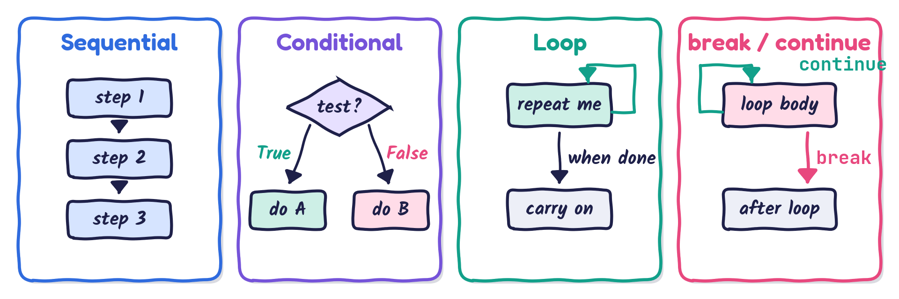{fig-align="center" width="100%"}

1. **Sequential** statements run one after another.
2. **Conditional** statements run one block if a condition is `True`, another if it is `False`.
3. **Loops** repeat a block until a condition says stop.
4. `break` and `continue` give you finer control inside a loop.

## `if` statement

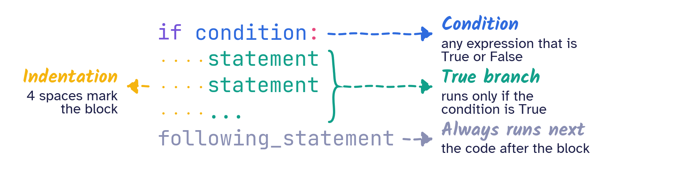{fig-align="center" width="92%"}

::: {.keybox}
**Remember (please, please, please!)** A **colon** `:` ends the `if` line, and the block below is **indented by 4 spaces**. Your editor's Tab key normally inserts these 4 spaces for you.
:::

## `if-else` statement

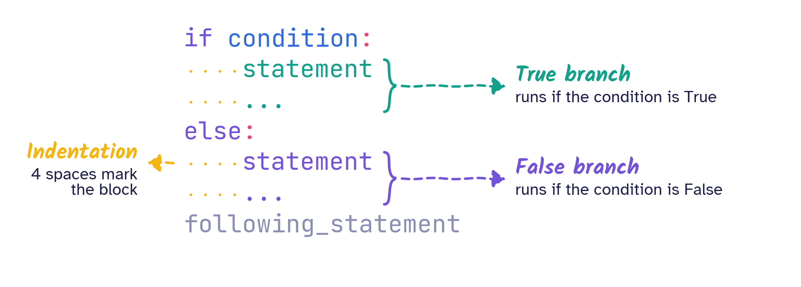{fig-align="center" width="92%"}

It reads almost like English: *if* the condition holds, do this; *else*, do that.

## `if-elif-else` statement

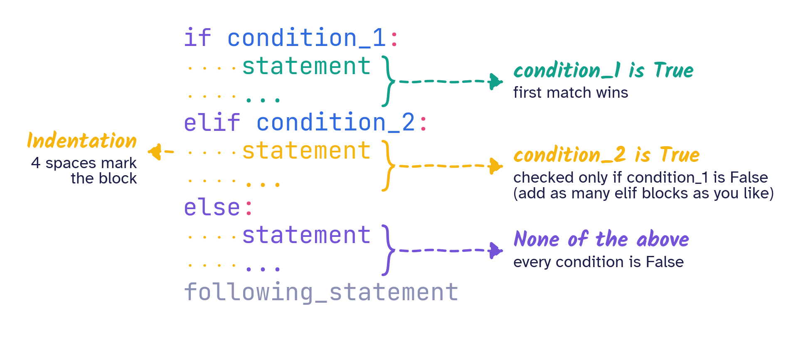{fig-align="center" width="90%"}

## Conditional statements: example

Both programs convert marks to a letter grade. Which one is easier to read?

:::: {.columns}
::: {.column width="50%"}
```python
marks = input("Your marks? ")
marks = int(marks)
if marks <= 50:
    grade = 'D'
else:
    if marks <= 59:
        grade = 'C'
    else:
        if marks <= 69:
            grade = 'B'
        else:
            grade = 'A'
print("Letter grade is", grade)
```
:::

::: {.column width="50%"}
```python
marks = input("Your marks? ")
marks = int(marks)
if marks <= 50:
    grade = 'D'
elif marks <= 59:
    grade = 'C'
elif marks <= 69:
    grade = 'B'
else:
    grade = 'A'
print("Letter grade is", grade)
```
:::
::::

## Loops

There are two kinds of loops:

1. **Indefinite** (or **sentinel**) loops run until some condition is met. You do not know in advance when that will happen, for example because it depends on user input or on a calculation.
2. **Counter** loops run a number of times that is known in advance.

Python offers two loop statements:

1. the `while` loop, natural for indefinite loops
2. the `for` loop, natural for counter loops and for walking through a collection

## `while` loop

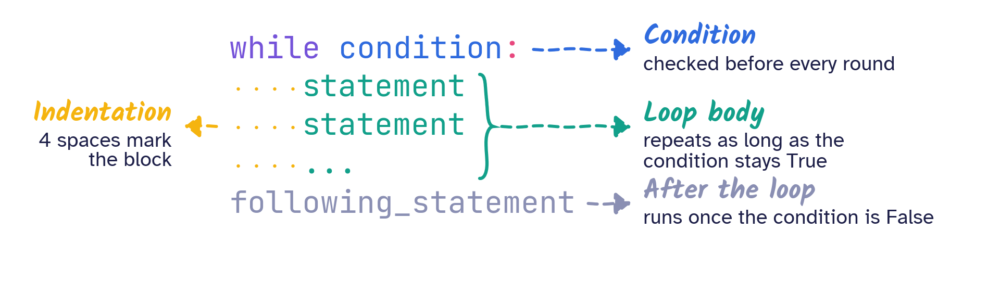{fig-align="center" width="92%"}

> *Reminder*: a **colon** `:` and **4-space indentation**, exactly as for `if`.

## `while` loop: examples {.smaller}

Example 1: powers of two

```python
counter, value = 0, 1            # multiple assignment
n = input("Value of index? ")
if n.isnumeric():
    n = int(n)                   # convert to an integer if it is a number
else:
    n = 5                        # otherwise, default to 5
print("2^{0:^2} = {1}".format(counter, value))
while counter < n:
    value *= 2
    counter += 1
    print("2^{0:^2} = {1}".format(counter, value))
```

Example 2: keep asking until the input is valid

```python
while True:
    n = input("Enter a whole number: ")
    if n.isnumeric():            # only digits, so "3.5" is rejected
        break                    # more about break in a moment
```

## `for` loop

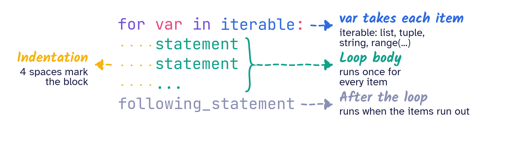{fig-align="center" width="92%"}

> *Reminder*: a **colon** `:` and **4-space indentation**.

## `for` loop: examples

```{python}
value = 1
for j in range(10):
    print("2^{0:^1} = {1}".format(j, value), end=" \t")   # \t is a tab
    if (j + 1) % 5 == 0:
        print()        # start a new line after every 5 results
    value *= 2
```

```{python}
my_list = ["I", "have", 2, "dogs", "&", 3, "cats"]
for x in my_list:
    print(x, end=' ')
print("\n")            # "\n" adds one new line, print adds another
for y in reversed(my_list):
    print(y, end=' ')
```

## `break` and `continue`

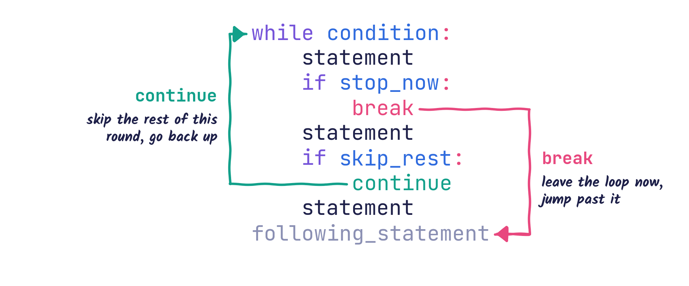{fig-align="center" width="82%"}

:::: {.columns .small}
::: {.column width="50%"}
Both keywords mean exactly what they say in English.

- `break` ends the loop **entirely**. Execution continues with the first statement after the loop body.
:::

::: {.column width="50%"}
- `continue` ends only the **current** round. Execution jumps back to the top of the loop for the next round.
:::
::::

## `break` versus `continue`

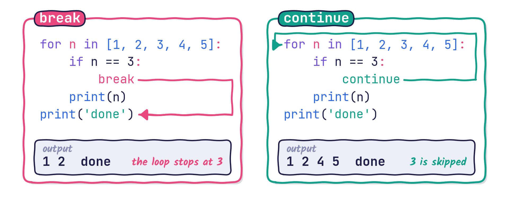{fig-align="center" width="100%"}

## `break` and `continue`: examples

Example 1

```python
for i in range(10):
    n = input("Enter a number smaller than 10: ")
    if int(n) < 10:
        print("Good job! You followed the instruction.")
        break
```

Example 2

```{python}
n = 0
while n < 10:
    n += 1
    if n % 2 == 0:
        continue       # skip even numbers
    print(n, end=" ")
```

# Basic data structures {background-image="theme/section-bg.svg"}

## List: indexing

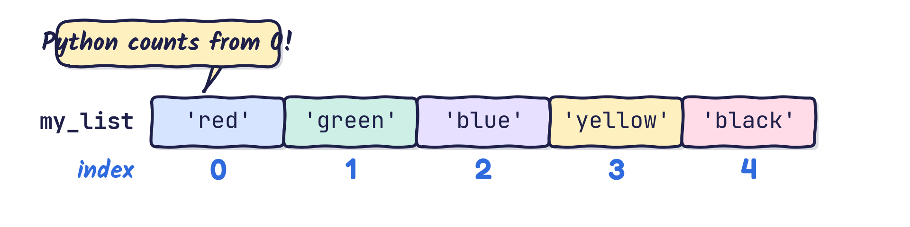{fig-align="center" width="85%"}

```{python}
my_list = ['red', 'green', 'blue', 'yellow', 'black']
print(my_list[0])      # red
print(my_list[3])      # yellow
for element in my_list:
    print(element, end="; ")
```

## List: negative indexing

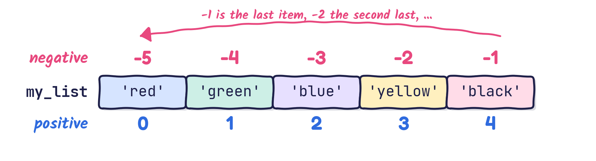{fig-align="center" width="85%"}

```{python}
my_list = ['red', 'green', 'blue', 'yellow', 'black']
print(my_list[-1])     # black
print(my_list[-5])     # red
for j in range(-5, 0, 1):
    print(my_list[j], end=" \t")
```

## List: walking backwards

Negative indices make it easy to go through a list from the end:

```{python}
my_list = ['red', 'green', 'blue', 'yellow', 'black']
for j in range(-1, -6, -1):
    print(my_list[j], end=" \t")
```

The same result, the Pythonic way:

```{python}
for colour in reversed(my_list):
    print(colour, end=" \t")
```

## List: nested lists

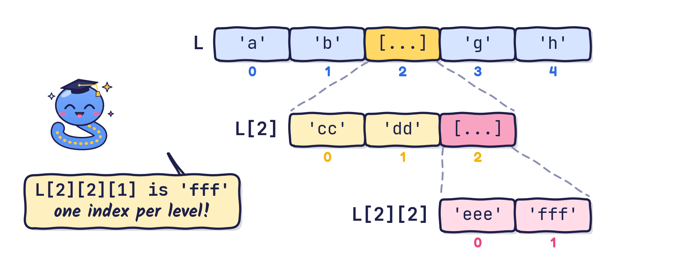{fig-align="center" width="72%"}

```{python}
L = ['a', 'b', ['cc', 'dd', ['eee', 'fff']], 'g', 'h']
print(L[2])         # ['cc', 'dd', ['eee', 'fff']]
print(L[2][2])      # ['eee', 'fff']
# print(L[2, 2])    # uncomment to see: this syntax gives an error for lists!
```

## List: adding two lists

- A list can contain elements of **any** data type.
- Think of a list as a container, not a mathematical set: a list may contain the same value twice, a set cannot.
- "Adding" two lists simply **joins** (concatenates) them.

```{python}
L1 = [1, 2, 3, 4, 5]
L2 = [5, 4, 3, 2, 1]
L3 = ['5', '4', '3', '2', '1']
print("L1 + L2 =", L1 + L2)
print("L1 + L3 =", L1 + L3)
```

## A quick detour to NumPy arrays

Lists join when you add them. Later we will meet **NumPy** arrays, which do arithmetic element by element:

```{python}
import numpy as np
a1 = np.array([1, 2, 3, 4, 5])     # more about this in the NumPy lecture
a2 = np.array([5, 4, 3, 2, 1])
print("a1 + a2 =", a1 + a2)
```

## List: slicing

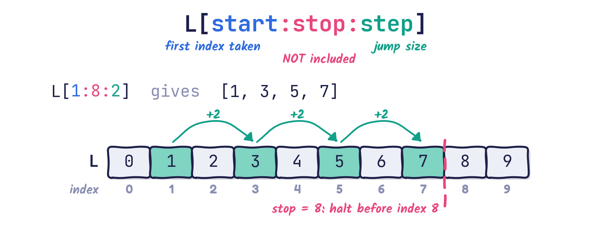{fig-align="center" width="66%"}

- The `stop` position is **not** included: slicing stops right before it.
- If `start` is missing, slicing starts at the beginning (index `0`).
- If `stop` is missing, slicing runs to the end of the list, **including** the last element.

## List: slicing examples

```{python}
L = [0, 1, 2, 3, 4, 5, 6, 7, 8, 9]
print(L[1:5])       # [1, 2, 3, 4]
print(L[1:5:2])     # [1, 3]
print(L[:5:3])      # [0, 3]
print(L[1::3])      # [1, 4, 7]
print(L[::3])       # [0, 3, 6, 9]
# print(L[[0, 3, 6, 7]])  # uncomment to see: a list cannot be indexed by a list!
```

## Slicing: test yourself

```python
L = [0, 1, 2, 3, 4, 5, 6, 7, 8, 9]
print(L[-3:])
print(L[::-1])
print(L[2:8:3])
```

::: {.question}
Predict the three lines of output before we run the code.
:::

::: {.fragment}
```{python}
#| echo: false
L = [0, 1, 2, 3, 4, 5, 6, 7, 8, 9]
print(L[-3:])
print(L[::-1])
print(L[2:8:3])
```

::: {.answer}
`L[-3:]` keeps the last three items, a step of `-1` walks backwards, and `L[2:8:3]` takes indices 2 and 5 (8 is excluded).
:::
:::

## Tuple

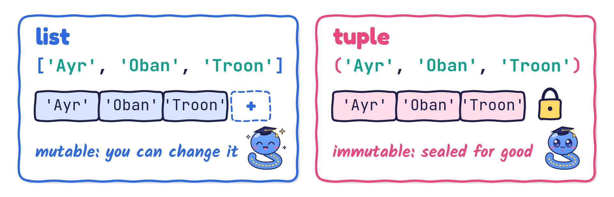{fig-align="center" width="78%"}

:::: {.columns .small}
::: {.column width="50%"}
**List**

- square brackets `[ ... ]`
- **mutable**: items can be changed, added, removed
- many methods: `append`, `insert`, `sort`, ...
- uses slightly more memory
:::

::: {.column width="50%"}
**Tuple**

- parentheses `( ... )`
- **immutable**: fixed once created
- only two methods: `count` and `index`
- slightly lighter and faster; can be a dictionary key
:::
::::

## Tuple: can we change it?

```{python}
#| eval: false
t = (1, 2, 3)
t[0] = 10
print(t)
```

::: {.question}
What happens when we run this code?
:::

::: {.fragment}
```{python}
#| echo: false
#| error: true
t = (1, 2, 3)
t[0] = 10
```

::: {.answer}
Python raises a `TypeError`: a tuple is **immutable**, so its items cannot be replaced. Use a list if the data must change.
:::
:::

## Tuple: packing and unpacking

- **Tuple packing**: the parentheses are optional.

    `t = 0, 1, 'two'     # same as t = (0, 1, 'two')`

    The values `0`, `1` and `'two'` are *packed* together into one tuple.

- **Sequence unpacking**:

    `t1, t2, t3 = t      # t1 == 0, t2 == 1, t3 == 'two'`

    There must be as many variables on the left as there are elements in the sequence on the right.

- **Multiple assignment** `a, b, c = 1, 2, 3` is tuple packing followed by sequence unpacking. It also gives a neat way to swap two values: `a, b = b, a`.

## Dictionary

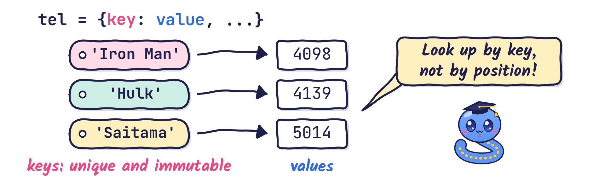{fig-align="center" width="78%"}

- Sequences (lists, tuples) are indexed by **numbers**; dictionaries are indexed by **keys**.
- Keys must be **immutable** (numbers, strings, tuples) and **unique**.
- Create one with braces `{key: value, ...}` or with the constructor `dict(...)` (more about constructors in the OOP lecture).

## Dictionary: example

```{python}
tel = {'Iron Man': 4098, 'Hulk': 4139}   # define a dictionary

tel['Saitama'] = 5014                     # add a key: value pair
tel['Mononoke'] = 6017                    # and another one

print("tel =", tel)                       # print the whole dictionary
print("tel['Iron Man'] =", tel['Iron Man'])   # access a value by its key

del tel['Hulk']                           # delete one entry
print("After deletion: tel =", tel)

print("keys:", list(tel))                 # list() of a dictionary gives its keys
```

## Looping over a dictionary

`.keys()`, `.values()` and `.items()` let you walk through a dictionary:

```{python}
tel = {'Iron Man': 4098, 'Saitama': 5014, 'Mononoke': 6017}
for name, number in tel.items():        # each item is a (key, value) tuple
    print(f"{name:<10} -> {number}")
print("Is 'Hulk' in the phone book?", 'Hulk' in tel)
```

## Bonus: writing maths in Jupyter

Markdown cells in Jupyter understand LaTeX. Typing

```latex
$$
\mathbf{A} = \begin{bmatrix} 1 & 2 \\ 3 & 4 \end{bmatrix} \in \mathbb{R}^{2 \times 2}
$$
```

produces

$$
\mathbf{A} = \begin{bmatrix} 1 & 2 \\ 3 & 4 \end{bmatrix} \in \mathbb{R}^{2 \times 2}
$$

Handy for documenting the equations behind your code.

# A few words about this course {background-image="theme/section-bg.svg"}

## Written exam versus coursework

- The written exam is a **closed-book** exam.
- To do well, **learn the concepts properly** and **practise with real code**. Typing, running and breaking code yourself is the best preparation for answering questions about it on paper.

## Grade distribution by assessment component {.smaller}

| Grade band | Component 1 (25%) | Component 2 (25%) | Written exam (50%) |
|:-----------|------------------:|------------------:|-------------------:|
| A1–A2      | 23                | 36                | 12                 |
| A3–A5      | 58                | 40                | 13                 |
| B1–B3      | 8                 | 1                 | 7                  |
| C1–C3      | 1                 | 14                | 6                  |
| D1–D3      | 1                 | 2                 | 14                 |
| E1–E3      | 0                 | 1                 | 18                 |
| F1–F3      | 4                 | 0                 | 12                 |
| G1–G2      | 0                 | 0                 | 2                  |
| H          | 1                 | 2                 | 3                  |
| **Total**  | **96**            | **96**            | **87**             |

: Grade distribution across the three assessment components {.small}

## Grade distribution: coursework 1

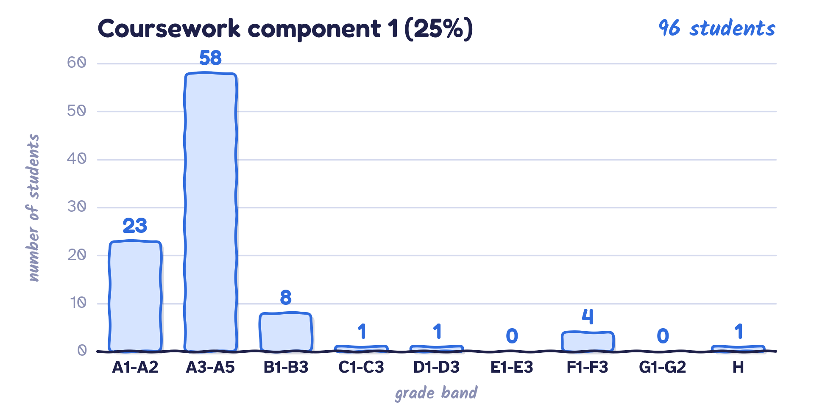{fig-align="center" width="92%"}

## Grade distribution: coursework 2

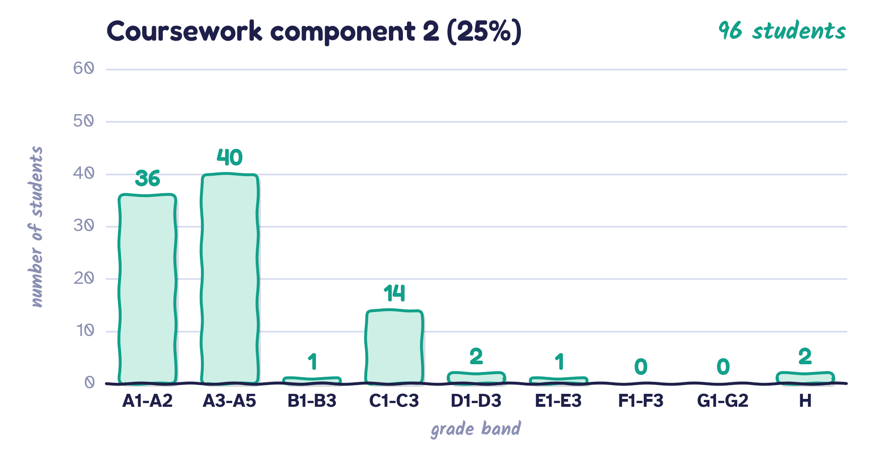{fig-align="center" width="92%"}

## Grade distribution: written exam

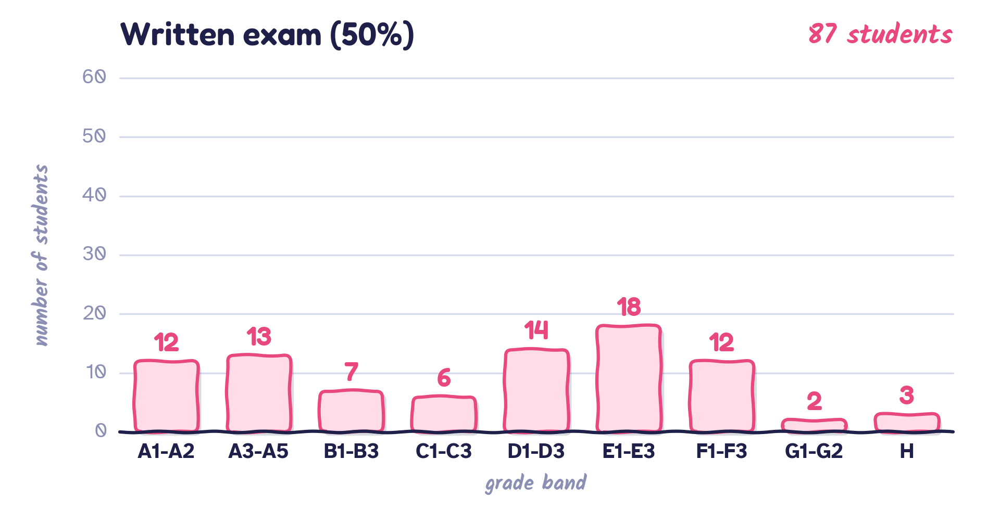{fig-align="center" width="92%"}

## Getting help

You do not need to wait for office hours: I am happy to help whenever you are stuck.

- Contact me by email, on MS Teams, or even on WhatsApp.
- I will reply to your questions as soon as I can.
- If you would like to meet in person, email me to arrange a time.

## Where to find me

My office is **Rankine 810**. This is what you will see on the door:

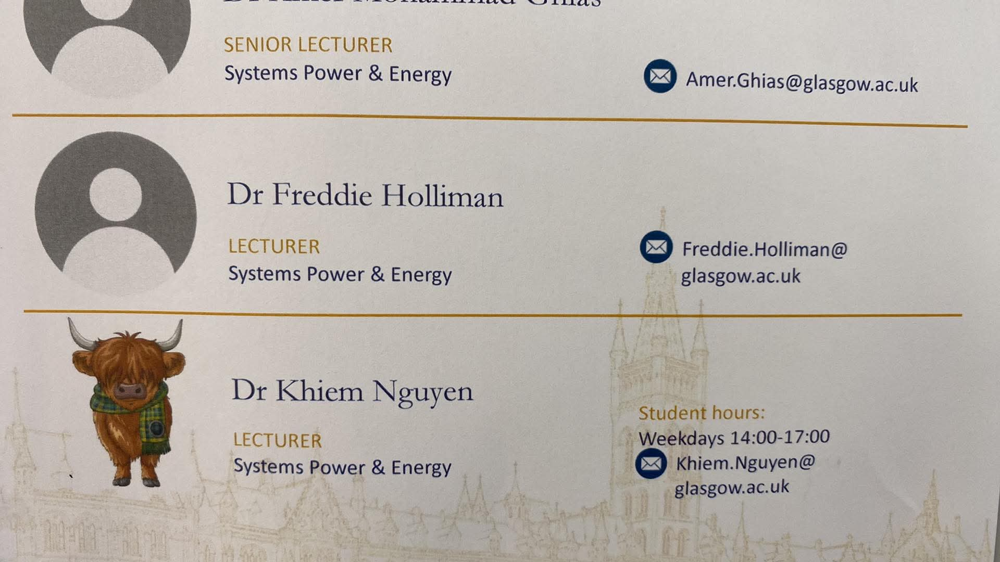{.photo fig-align="center" width="62%"}
