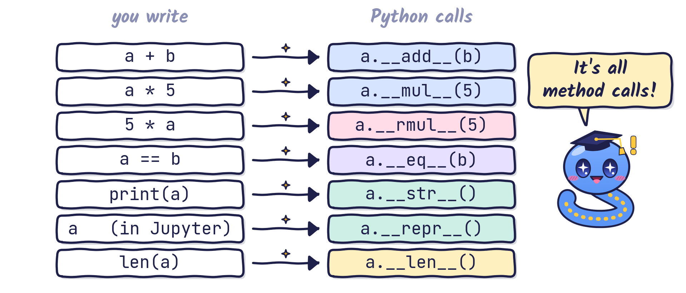
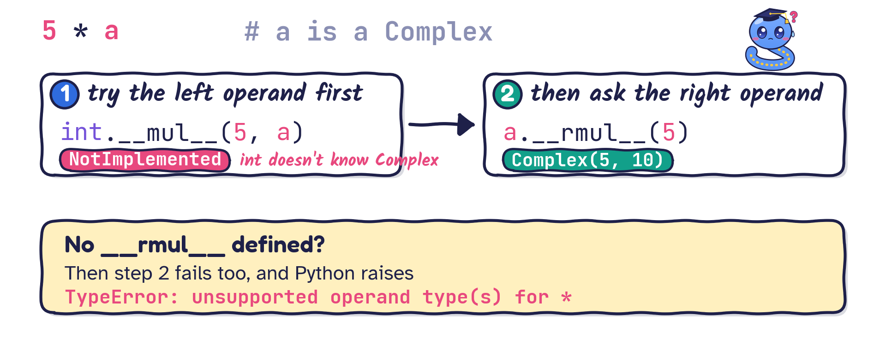

# Special methods {background-image="theme/section-bg.svg"}

## Learning outcomes

- Learn what Python's **special methods** (also called **dunder methods** or **magic methods**) are.
- Understand the "magic" behind them: Python calls them for you.
- Customise the behaviour of your own classes with special methods.

## Special methods: introduction {.compact}

- A special method is a method whose name **starts and ends with a double underscore**.
- You have already met one: `__init__(self, ...)`, the constructor.
- They are nicknamed **magic methods** or **dunder methods** ("double underscore").
- The double underscores flag them as core to some Python feature.

Some popular special methods:

| Magic method | Description |
|--------------|-------------|
| `__init__()` | initialises new objects (the constructor) |
| `__str__()`  | human-readable representation of an object |
| `__repr__()` | developer-oriented representation |
| `__call__()` | makes instances of a class callable like functions |
| `__len__()`  | supports the built-in `len()` function |

## Special methods: the official definition

Here is how the official Python documentation defines **special methods**:

> A method that is called implicitly by Python to execute a certain operation on a type, such as addition. Such methods have names starting and ending with double underscores. ([Python glossary](https://docs.python.org/3/glossary.html#term-special-method))

## Python's secret translations

{fig-align="center" width="94%"}

# Representing objects {background-image="theme/section-bg.svg"}

## Initialising objects with `__init__()`

You have used it all along: `__init__()` works as an **initialiser** (constructor) because it gives initial values to the *instance attributes* of our classes.

```{python}
class Complex:
    def __init__(self, real=0, imag=0):
        self.real = real
        self.imag = imag

    def display(self):
        print(f"{self.real} + {self.imag}*i")

a = Complex()
b = Complex(1, 2)
a.display()     # we wish we could just write print(a)
b.display()     # we wish we could just write print(b)
```

## What does `print()` show?

```python
a = Complex()
print(a)
```

::: {.question .fragment}
What will `print(a)` show at this point?
:::

::: {.fragment}
```{python}
print(a)
```
:::

## Representing objects as strings {.compact}

- `__str__()` returns a **human-readable** string representation of the object.
    - Python calls it when we use the built-in `str()` on the object.
    - Python also calls it when we pass the object to `print()` or `format()`, or put it in an f-string.
- `__repr__()` returns a string representation aimed at the **developer**.
    - Ideally, the string should let you rebuild an identical object.
    - Python calls it when we use the built-in `repr()` on the object.
    - In interactive mode or Jupyter, it is called when we query an object **without** using `print()`.

> Let me illustrate the difference between `__str__()` and `__repr__()` with a NumPy object.

## `str` versus `repr`: a NumPy example {.compact}

::: {.fragment}
```{python}
import numpy as np
a = np.array([1, 2, 3, 4, 5])
b = np.array([1.1, 2.1, 3.1, 4.1, 5.1])
print(a + b)    # print() shows the string returned by str(a + b)
```
:::

::: {.fragment}
- But if we type `a + b` in interactive mode, `array(...)` wraps the numbers:

```{python}
a + b
```

- That output is exactly the string returned by

```{python}
repr(a + b)
```
:::

## User-friendly output with `__str__()` {.compact}

Let us revisit our `Complex` class:

```{python}
class Complex:
    def __init__(self, real=0, imag=0):
        self.real = real
        self.imag = imag

    def __str__(self):
        output = f"{self.real}"
        if self.imag != 0:
            output += f" + {self.imag}*i"
        return output
```

Now we can print a `Complex` number with `print()` or an f-string:

```{python}
a = Complex()
b = Complex(1, 0)
c = Complex(4, 2)
print(f"a = {a}, b = {b}, c = {c}")
```

## Test yourself: printing a list of objects

```python
a, c = Complex(1, 2), Complex(4, 2)    # the class above defines only __str__
print(a)
print([a, c])
```

::: {.question}
What do the two `print` calls show?
:::

::: {.fragment}
```{python}
#| echo: false
a, c = Complex(1, 2), Complex(4, 2)
print(a)
print([a, c])
```

::: {.answer}
`print(a)` uses `__str__`, but a list shows its items with `repr()`. We never defined `__repr__`, so we get the default text. Always define `__repr__` (and `__str__` if you want a friendlier version).
:::
:::

## Developer-friendly output with `__repr__()` {.compact}

```{python}
class Complex:
    def __init__(self, real=0, imag=0):
        self.real = real
        self.imag = imag

    def __repr__(self):
        return f"Complex({self.real}, {self.imag})"   # looks like the code that builds it
```

- Now the interactive output tells us clearly that this is a `Complex` object:

```{python}
a = Complex(1, 2)
a
```

- We can also call `repr()` directly; lists now display nicely too:

```{python}
print(repr(a), [a, Complex(4, 2)])
```

# Overloading operators {background-image="theme/section-bg.svg"}

## Overloading operators

- We want to compute with complex numbers: $a = 1 + 2\mathrm{i}$, $b = 2 + \mathrm{i}$ $\;\Rightarrow\; a + b = 3 + 3\mathrm{i}$.
- Writing `a + b` naively fails: the computer does not know how to add two `Complex` objects. We must teach it.

```{python}
#| error: true
a = Complex(1, 2)
b = Complex(2, 1)
print(a + b)
```

## Arithmetic operators {.compact}

Arithmetic operators perform *arithmetic operations* on numeric values. Each has a supporting special method:

| Supporting method             | Operator |
|-------------------------------|----------|
| `__add__(self, other)`        | `+`      |
| `__sub__(self, other)`        | `-`      |
| `__mul__(self, other)`        | `*`      |
| `__truediv__(self, other)`    | `/`      |
| `__floordiv__(self, other)`   | `//`     |
| `__mod__(self, other)`        | `%`      |
| `__pow__(self, other)`        | `**`     |

All these methods take a second argument, called `other`. In `a + b`, `self` is `a` (the left operand) and `other` is `b` (the right operand).

## Operators are just functions {.compact}

- In fact, arithmetic operations are just functions:

```{python}
def add(a, b):
    return a + b

print(1 + 2)        # an operator acting on two inputs returns a value
print(add(1, 2))    # a function acting on two inputs returns a value
```

- In OOP language we can write

```{python}
print((1).__add__(2))   # note the parentheses: we cannot write 1.__add__(2)
x = 1
print(x.__add__(2))     # this is also fine
```

## Overloading addition and subtraction {.compact}

```{python}
class Complex:
    def __init__(self, real=0, imag=0):
        self.real = real; self.imag = imag

    def __add__(self, other):
        if not isinstance(other, type(self)):
            raise TypeError("unsupported operand for +: "
                            + f"{type(self).__name__} and {type(other).__name__}")
        return Complex(self.real + other.real, self.imag + other.imag)

    def __sub__(self, other):
        if not isinstance(other, type(self)):
            raise TypeError("unsupported operand for -: "
                            + f"{type(self).__name__} and {type(other).__name__}")
        return Complex(self.real - other.real, self.imag - other.imag)

    def __str__(self):              # kept short on purpose
        return f"{self.real} + {self.imag}*i"
```

## Overloading addition and subtraction {.compact}

- Now we can add and subtract:

```{python}
a = Complex(1, 2)
b = Complex(2, 1)
print(f"a + b = {a + b}")
print(f"a - b = {a - b}")
```

- But we did not define `__repr__(self)` in this class, so interactive mode still shows

```{python}
a + b    # in interactive mode, __repr__(self) is called
```

- To fix this, add `__repr__(self)` to the class. [That is your homework!]{.pink}

## Overloading multiplication {.compact}

- Of course, we want multiplication as well:

```{python}
#| error: true
a, b = Complex(1, 2), Complex(2, 3)
print(a * b)
```

## Overloading multiplication {.compact}

```{python}
from numbers import Real            # Real covers int, float, ...

class Complex:
    def __init__(self, real=0, imag=0):
        self.real = real; self.imag = imag

    def __mul__(self, other):
        if isinstance(other, type(self)):           # Complex * Complex
            return Complex(self.real * other.real - self.imag * other.imag,
                           self.real * other.imag + self.imag * other.real)
        if isinstance(other, Real):                  # Complex * number
            return Complex(other * self.real, other * self.imag)
        raise TypeError("unsupported operand for *: "
                        + f"{type(self).__name__} and {type(other).__name__}")

    def __str__(self):
        return f"{self.real} + {self.imag}*i"
```

## Overloading multiplication {.compact}

- Now we can multiply:

```{python}
a, b = Complex(1, 2), Complex(2, 1)
print(f"a * b = {a * b}")
print(f"a * 5 = {a * 5}")         # note: a is on the left of 5
print(f"a * 5.0 = {a * 5.0}")     # note: a is on the left of 5.0
```

- But a number **times** a `Complex` is still undefined. Here `a` is on the **right** of `5.0`:

```{python}
#| error: true
print(5.0 * a)
```

## How Python evaluates `5 * a`

{fig-align="center" width="94%"}

## Overloading right multiplication {.compact}

```{python}
#| echo: false
from numbers import Real
class Complex:
    def __init__(self, real=0, imag=0):
        self.real = real; self.imag = imag
    def __mul__(self, other):
        if isinstance(other, type(self)):
            return Complex(self.real * other.real - self.imag * other.imag,
                           self.real * other.imag + self.imag * other.real)
        if isinstance(other, Real):
            return Complex(other * self.real, other * self.imag)
        raise TypeError("unsupported operand for *: "
                        + f"{type(self).__name__} and {type(other).__name__}")
    def __rmul__(self, other):
        if not isinstance(other, Real):
            raise TypeError("unsupported operand for *: "
                            + f"{type(other).__name__} and {type(self).__name__}")
        return Complex(other * self.real, other * self.imag)
    def __eq__(self, other):
        if not isinstance(other, type(self)):
            return NotImplemented
        return self.real == other.real and self.imag == other.imag
    def __ne__(self, other):
        if not isinstance(other, type(self)):
            return NotImplemented
        return self.real != other.real or self.imag != other.imag
    def __str__(self):
        return f"{self.real} + {self.imag}*i"
```

```{python}
#| eval: false
class Complex:
    # ... PREVIOUS CODE AS BEFORE ...

    def __rmul__(self, other):          # right multiplication: other * self
        if not isinstance(other, Real):
            raise TypeError("unsupported operand for *: "
                            + f"{type(other).__name__} and {type(self).__name__}")
        return Complex(other * self.real, other * self.imag)
```

- Now we can multiply a `Complex` object by a scalar written in front of it:

```{python}
a = Complex(1, 2)
print(5 * a)
print(5.5 * a)
```

- Similarly, [**right addition**]{.pink} is implemented by `__radd__(self, other)`.

## Comparison operators

| Operator | Supporting method     |
|----------|-----------------------|
| `<`      | `__lt__(self, other)` |
| `<=`     | `__le__(self, other)` |
| `==`     | `__eq__(self, other)` |
| `!=`     | `__ne__(self, other)` |
| `>=`     | `__ge__(self, other)` |
| `>`      | `__gt__(self, other)` |

- We cannot say $1 + 2\mathrm{i} > 0.5 + 1.5\mathrm{i}$, but we can say $1 + 2\mathrm{i} = 1 + 2\mathrm{i}$.
- So for `Complex` objects we define "equal to" with `__eq__(self, other)` and "not equal to" with `__ne__(self, other)`.

## Comparison operators: example {.compact}

```{python}
#| eval: false
class Complex:
    # ... PREVIOUS CODE AS BEFORE ...

    def __eq__(self, other):
        if not isinstance(other, type(self)):
            return NotImplemented       # let Python handle other types
        return self.real == other.real and self.imag == other.imag

    def __ne__(self, other):            # optional: Python derives != from __eq__
        if not isinstance(other, type(self)):
            return NotImplemented
        return self.real != other.real or self.imag != other.imag
```

```{python}
a, b, c = Complex(1, 2), Complex(2, 1), Complex(1, 2)
print(f"a == b: {a == b}    a != b: {a != b}")
print(f"a == c: {a == c}     a != c: {a != c}")
print(f"a == 3: {a == 3}")     # NotImplemented -> Python falls back to False
```

# More magic {background-image="theme/section-bg.svg"}

## Bonus: callable and sized objects

`__call__` lets an object be **called like a function**; `__len__` supports `len()`.

```{python}
class Polynomial:
    """p(x) = c0 + c1 x + c2 x^2 + ..."""
    def __init__(self, *coeffs):
        self.coeffs = coeffs

    def __call__(self, x):                  # p(x)
        return sum(c * x**k for k, c in enumerate(self.coeffs))

    def __len__(self):                      # len(p)
        return len(self.coeffs)

    def __repr__(self):
        return f"Polynomial{self.coeffs}"

p = Polynomial(1, 0, 2)                     # p(x) = 1 + 2 x^2
```

## Callable and sized objects: test yourself

```python
p = Polynomial(1, 0, 2)                     # p(x) = 1 + 2 x^2
```

::: {.question .fragment}
What are `p(2)`, `len(p)` and `p` (typed on its own in Jupyter)?
:::

::: {.fragment}
```{python}
print(p(2), len(p), repr(p))
```
:::

## Special method names

- There are many more special methods than we can study in this course.
- The complete reference is in the [official Python documentation](https://docs.python.org/3.13/reference/datamodel.html#special-method-names).

## Key takeaways

- Special (dunder) methods are called **implicitly** by Python: `a + b` really means `a.__add__(b)`.
- `__str__` gives the friendly text for `print()`; `__repr__` gives the developer view (and is used inside lists).
- Arithmetic and comparison operators each map to a special method; `__rmul__`, `__radd__`, ... handle the operand on the **right**.
- Return `NotImplemented` when your method cannot handle the other operand.
- `__call__` and `__len__` make your objects behave like functions and containers.
